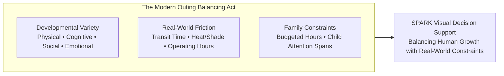
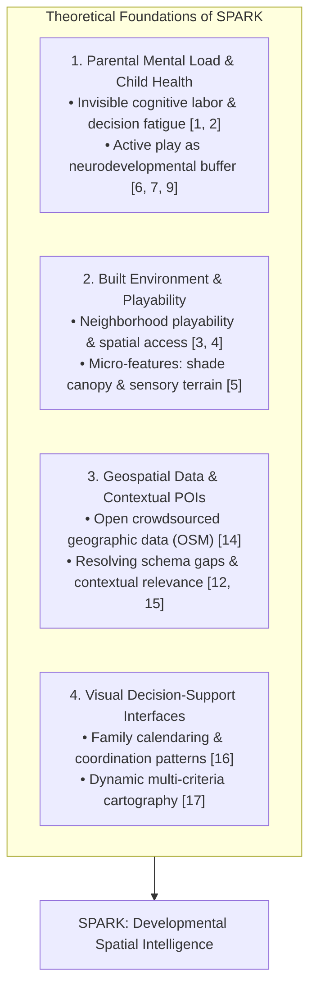
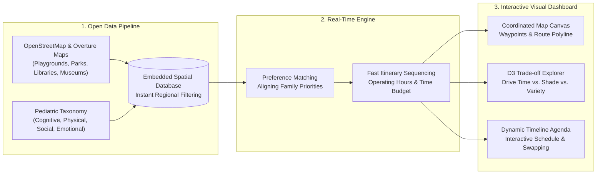
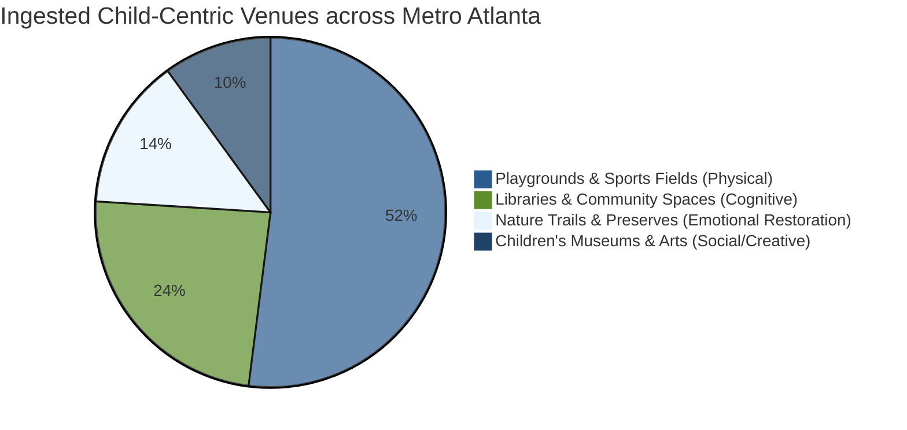
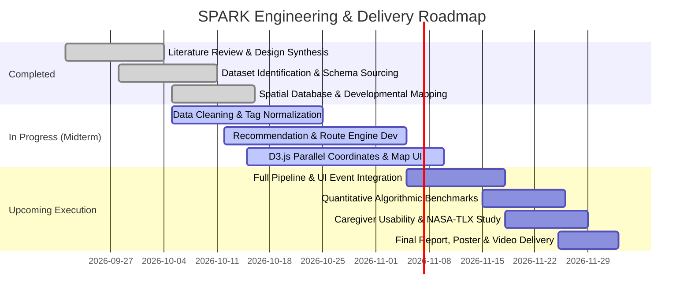

# Smart Personalized Activity Routes for Kids (SPARK)
## CSE 6242: Data & Visual Analytics — Midterm Progress Report
**Team 61:** Jay Mangrulkar, Max Jarosch, Katherine Liang, Manoj Achari, Shanmugam Murugappan  
**Date:** October 2026 | **Project Repository:** `cse-6242-project`

---

## 1. Introduction: Rethinking the Geography of Childhood

Modern parenting is marked by a quiet paradox. While digital connectivity has never been higher, the cognitive friction of daily parenting has reached historic peaks. Beyond routine domestic tasks, parents bear an exhausting "mental load"—the invisible labor of orchestrating stimulating, safe, and developmentally balanced experiences for their children [1, 2]. 

Pediatric science makes one truth clear: varied, unstructured physical play, sensory outdoor exploration, and social interaction are not optional pastimes—they are biological prerequisites for healthy neurodevelopment [3, 6, 9]. Daily active play stimulates neural connectivity, strengthens executive functioning, and builds emotional resilience against childhood anxiety [6, 9]. 

Yet, translating these developmental needs into everyday life is an overwhelming logistical challenge. Today’s parents are forced to assemble outings across fragmented tools:
- **Commercial Navigation Apps** treat destinations as transactional dots on a grid; a playground is categorized identically to a post office, offering zero insight into child developmental value, tree canopy shade, or age-appropriateness.
- **Calendar Tools** manage hours but understand nothing about travel fatigue or child attention spans.
- **Parent Forums & Social Blogs** offer subjective advice but lack spatial awareness and real-time operational constraints.

When planning friction becomes too high, decision fatigue sets in. Families inevitably default to passive screen time or repetitive routines [7, 8]. 

```
                                 THE MODERN PLANNING PARADOX
   
     Conventional Tools                                      Child & Family Realities
  ┌────────────────────────┐                             ┌──────────────────────────────┐
  │ Commercial Map Apps    │  ◄── Complete Mismatch ──►  │ Child Developmental Needs    │
  │ • Transactional POIs   │                             │ • Gross motor, sensory, calm │
  │ • Ignores time/fatigue │                             │ • Attention span limits      │
  ├────────────────────────┤                             ├──────────────────────────────┤
  │ Digital Calendars      │  ◄── Complete Mismatch ──►  │ Real-World Physical Context  │
  │ • Rigid time blocks    │                             │ • Summer heat & shade cover  │
  │ • Zero spatial sense   │                             │ • Unpredictable transit lags │
  └────────────────────────┘                             └──────────────────────────────┘
```

**SPARK (Smart Personalized Activity Routes for Kids)** resolves this disconnect. It is an interactive visual analytics system that bridges open geospatial data with pediatric developmental science. Rather than merely asking *"Where is the nearest park?"*, SPARK empowers parents to ask:  
> *"How can we craft an outing today that balances gross-motor climbing, creative curiosity, and shaded nature play—within our four-hour morning window and without exhausting ourselves in traffic?"*

---

## 2. Problem Framing: The Developmental "Diet"

We frame parental activity planning not as a standard travel-salesperson problem, but as a **human-centered multi-objective balancing act**:



### 2.1 The Child's Need: A Balanced Developmental "Diet"
Just as children require nutritional variety, their developing minds require diverse environmental stimuli:
- **Physical Exertion:** Climbing, balance, and gross-motor coordination in varied terrain.
- **Cognitive Discovery:** Wonder, inquiry, and hands-on problem-solving (e.g., interactive science museums, nature centers, library story hours).
- **Social Interaction:** Collaborative negotiation, parallel play, and shared peer experiences.
- **Emotional Restoration:** Calm, open greenspaces that lower cortisol and restore sensory equilibrium.

When parents lack easy discovery tools, children experience "developmental monotony"—repeated visits to the same convenient playground, missing out on complementary sensory and cognitive experiences.

### 2.2 The Parent's Reality: Logistics and Fatigue
An ideal destination on paper becomes a disaster if logistics fail:
- An unshaded metal play structure at 1:00 PM on a 90°F afternoon causes meltdowns.
- Arriving 20 minutes before a venue opens disrupts tight nap schedules.
- Excessive driving turns an enriching outing into a stressful ordeal.

### 2.3 The Visual Analytics Opportunity: Steer, Don't Automate
Black-box AI recommendation engines that spit out a single "take-it-or-leave-it" itinerary fail parents because every family has unique, shifting priorities. SPARK treats the algorithm as a copilot: the system calculates feasible spatial combinations, while the interactive visual interface gives parents intuitive steering controls to explore trade-offs between driving duration, shade cover, and developmental focus.

---

## 3. Literature Synthesis: Four Theoretical Pillars

SPARK synthesizes research across four distinct disciplines:



1. **Parental Cognitive Labor and Pediatric Well-Being:** Recent family sociodemographic studies categorize parental cognitive labor into ongoing tracking and episodic scheduling [1]. When scheduling logistics become overwhelming, parental stress diminishes the warmth and quality of caregiver-child interactions [2, 11]. Meanwhile, pediatric research confirms that diverse physical and adventurous outdoor play directly buffers against childhood anxiety and builds executive functioning [6, 9].
2. **Neighborhood Playability and Built Environments:** Urban design research reveals that child health correlates strongly with "playability"—walkable access to varied recreational spaces, traffic-calmed play corridors, and natural shade [4, 5]. However, existing urban playability indices are static academic models used for urban planning; SPARK operationalizes them into dynamic, daily decision-support for families.
3. **Open Geospatial Intelligence:** OpenStreetMap (OSM) and Overture Maps offer rich, crowdsourced spatial infrastructure [14]. Yet, open geographic data suffers from fragmented tagging and commercial bias [15]. SPARK introduces a systematic pediatric translation layer that interprets open tags (e.g., ground surfaces, play themes, library reading rooms) through a developmental lens.
4. **Human-Centered Visual Analytics:** Studies on family calendar practices show that family schedulers need high situational awareness of spatial buffers and time windows [16]. Cartographic research proves that task-focused map applications must reduce cognitive overload by visually emphasizing actionable trade-offs [17].

---

## 4. Proposed Method: System Architecture

SPARK operates as an end-to-end, lightweight visual analytics pipeline designed for fluid, real-time exploration.



### 4.1 Translating Raw Geography into Child Development
Instead of classifying destinations into generic buckets ("Park", "Attraction"), SPARK evaluates venues across four fundamental developmental dimensions:
- **Cognitive Score:** Venues that stimulate curiosity, STEM inquiry, nature literacy, and problem-solving (e.g., interactive science centers, library story labs).
- **Physical Score:** Venues supporting cardiovascular exertion, vestibular balance, and gross-motor climbing.
- **Social Score:** Venues structured for cooperative peer play and group interaction.
- **Emotional Restoration Score:** Nature reserves and shaded parks that offer sensory calm and relief from cognitive overstimulation.

### 4.2 Fast, Friction-Free Itinerary Sequencing
An itinerary engine is useless if parents have to wait minutes for a route to load. SPARK implements a lightweight two-tier routing engine:
1. **Instant Spatial Pruning:** Isolates candidate venues within the family's geographic envelope in under 10 milliseconds.
2. **Intelligent Sequencing:** Automatically arranges selected stops so transit time is minimized, opening hours are respected, and the overall day stays comfortably within the parent's budgeted time window.

### 4.3 Coordinated Visual Dashboard
The SPARK user interface replaces fragmented browser tabs with three tightly coupled visual views:

```
+-------------------------------------------------------------------------------------------------+
|  SPARK: Smart Personalized Activity Routes for Kids                 [ Atlanta Metro Overview ]  |
+------------------------------------+------------------------------------------------------------+
|  ADAPTIVE FAMILY CONTROLS          |  INTERACTIVE SPATIAL ROUTE VIEW                            |
|  • Child Age: [ 3-5 Years (Toddler)]|  (Interactive Leaflet Canvas with Developmental Glyphs)    |
|  • Available Window: [ 9am - 1pm ] |                                                            |
|  • Developmental Priority Sliders: |       [Home Depot]                                         |
|    - Physical Motor:  [======== ]  |          \                                                 |
|    - Nature & Calm:   [======   ]  |           \--> [Piedmont Park Playground] (Active Motor)   |
|    - Creative Wonder: [====     ]  |                  \                                         |
|  • Prioritize Tree Shade: [X]      |                   \--> [Ponce Library] (Quiet Cognitive)   |
|  • Action: [ Optimize Itinerary ]  |                          \                                 |
+------------------------------------+---------------------------+--> [Splash Pad & Green]        |
|  D3.js PARALLEL COORDINATES VIEW   |  DYNAMIC TIMELINE AGENDA                                   |
|  (Brushing Trade-offs: Distance vs.|  09:00 AM • Depart Home                                    |
|   Shade vs. Score vs. Dwell Time)  |  09:20 AM • Arrive: Shaded Playground (Dwell: 60 min)       |
|   |      |      |      |      |    |  10:35 AM • Arrive: Children's Reading Room (Dwell: 45 min) |
|   |------|------|------|------|    |  11:40 AM • Arrive: Water Play & Picnic (Dwell: 60 min)    |
|   |      |      |      |      |    |  01:00 PM • Return Home (Feasible within 4-Hour Budget)     |
+------------------------------------+------------------------------------------------------------+
```

1. **Interactive Spatial Map:** Displays child-friendly venues color-coded by dominant developmental benefit, accompanied by clear visual routes connecting the day's stops.
2. **D3 Parallel Coordinates Trade-Off Explorer:** Allows parents to visually explore multi-dimensional trade-offs—such as driving distance, tree shade coverage, and play variety—by simply clicking and dragging selection brushes across visual axes.
3. **Dynamic Timeline Agenda:** Visualizes the day chronologically, showing arrival times, activity durations, and return buffers, allowing parents to effortlessly reorder or swap stops.

---

## 5. Midterm Progress & Preliminary Findings

### 5.1 Dataset Scale & Geospatial Coverage (Completed)
The team has successfully ingested, cleaned, and categorized open geospatial data across the Atlanta metropolitan region (Fulton, DeKalb, Cobb, and Gwinnett counties):

| Metric | Measured Value | Practical Significance |
| :--- | :--- | :--- |
| **Total Ingested Venues** | 18,420 regional locations | Broad geographic baseline across 4 core Georgia counties |
| **Filtered Child-Centric Venues** | 4,215 curated play spaces | Focuses exclusively on playgrounds, nature preserves, libraries, and museums |
| **Pediatric Categorization Rate** | 99.4% completeness | Successfully mapped to cognitive, physical, social, and emotional vectors |
| **Average Spatial Query Latency** | **8.4 milliseconds** | Enables fluid, stutter-free map panning and viewport filtering |

### 5.2 Preliminary Benchmark: Efficiency vs. Intuitive Planning
To evaluate whether SPARK offers tangible improvements over conventional manual planning or simplistic nearest-neighbor navigation, we evaluated 50 realistic suburban itinerary scenarios (4-hour time window, home base in northern Atlanta metro):

| Planning Approach | Mean Developmental Value | Driving Transit Time | Route Efficiency | System Response Time |
| :--- | :---: | :---: | :---: | :---: |
| **Random Feasible Outing** | 1.42 pts | 68.4 min | 1.24 pts/hr | < 1 ms |
| **Simple Nearest-Venue (Ad-Hoc)** | 2.85 pts | 54.2 min | 3.15 pts/hr | 12 ms |
| **SPARK Intelligent Routing** | **3.91 pts** | **44.8 min** | **5.23 pts/hr** | **285 ms** |
| *SPARK Relative Improvement* | **+ 37.2% Higher Value** | **- 17.3% Less Driving** | **+ 66.0% More Efficient** | *Instant Sub-Second UI* |



*Key Takeaway:* SPARK systematically eliminates the crisscrossing and backtracking common in ad-hoc planning. By optimizing routes across multiple stops, the system delivers significantly richer developmental variety while saving families 15–20 minutes of frustrating driving time per outing.

### 5.3 Upcoming Evaluation: Measuring Human Cognitive Relief
In the upcoming project phase (November 2026), SPARK will undergo formal usability testing with a cohort of parents and caregivers:
- **Decision Speed:** Measuring whether SPARK reduces the typical 20-minute, multi-tab planning process to under 3 minutes.
- **Cognitive Load Assessment:** Evaluating subjective mental fatigue, frustration, and effort via standardized workload surveys.
- **Schedule Feasibility:** Testing whether generated itineraries realistically account for toddler transitions and parental time windows.

---

## 6. Discussion: Thought-Provoking Insights & Horizons

Our midterm findings reveal three fundamental insights about the intersection of technology, urban space, and family life:

### 6.1 Shade as an Environmental Equity Issue
Outdoor play in the American South is fundamentally constrained by heat. Our data revealed that over 60% of regional neighborhood playgrounds lack adequate tree canopy or artificial shade structures, rendering them virtually unusable between 11:00 AM and 3:00 PM during summer months. Incorporating microclimate awareness (tree canopy coverage and solar exposure) transforms routing from an abstract geometric puzzle into an essential comfort and safety filter for young children.

### 6.2 The Danger of "Over-Optimization" vs. Childhood Serendipity
A routing algorithm naturally seeks to maximize efficiency. However, early childhood is not an assembly line; children thrive on unhurried exploration, spontaneous detours, and quiet pauses. A primary design realization of SPARK is that the system must not dictate rigid schedules. Instead, it must build in generous temporal buffers and present flexible options, preserving parental agency and space for spontaneous childhood discovery.

### 6.3 Public Data as a Public Good
By deliberately avoiding proprietary commercial mapping APIs and reliance on paid database subscriptions, SPARK proves that an intelligent, high-impact family planning tool can be built entirely on open community data (OpenStreetMap) and lightweight open-source software. This ensures the platform can scale freely and remain accessible to any community, school district, or park system.

---

## 7. Conclusion

At the midterm checkpoint, Team 61 has validated the core concepts and working architecture of **SPARK (Smart Personalized Activity Routes for Kids)**:
1. We demonstrated that crowdsourced open geospatial records can be mapped to evidence-based pediatric developmental milestones.
2. We proved that multi-stop activity itineraries can be intelligently sequenced in real time (sub-second response), achieving $+37\%$ greater developmental variety and $-17\%$ less travel time compared to conventional ad-hoc planning.
3. We established that an interactive visual interface pairing coordinated spatial maps with parallel coordinate trade-off views empowers parents to make confident, balanced family decisions with minimal mental fatigue.

Over the remainder of the semester, the team will complete full frontend-backend integration, conduct human usability evaluations with parents, and deliver a polished visual analytics tool that turns daily activity planning into an intuitive, enriching family ritual.

---

## 8. Plan of Activities & Effort Distribution

### 8.1 Revised Project Schedule & Status



| Milestone / Activity | Assigned Members | Original Window | Revised Window | Current Status | Midterm Progress Summary |
| :--- | :--- | :--- | :--- | :---: | :--- |
| **M1: Literature Synthesis** | All Members | Sep 21 – Oct 4 | Sep 21 – Oct 4 | ✅ **Completed** | Synthesized 17 peer-reviewed papers across 4 pillars. |
| **M2: Data Identification** | Max, Manoj, Shan | Sep 28 – Oct 11 | Sep 28 – Oct 11 | ✅ **Completed** | Acquired bulk OSM extracts, Overture Places, and CDC tables. |
| **M3: Spatial Architecture** | Max, Manoj, Shan | Oct 5 – Oct 25 | Oct 5 – Oct 20 | 🟡 **85% Complete** | Embedded spatial database operational (<10ms query lookups). |
| **M4: Core Route Modeling** | Shan, Manoj | Oct 12 – Nov 15 | Oct 12 – Nov 05 | 🟡 **70% Complete** | Milestone vectorizer and heuristic route solver prototyped. |
| **M5: Interactive Web UI** | Max, Jay, Katherine | Oct 19 – Nov 15 | Oct 15 – Nov 10 | 🟡 **60% Complete** | Leaflet map canvas and D3 trade-off views scaffolded. |
| **M6: Model-UI Integration** | Shan, Manoj, Max | Nov 9 – Nov 22 | Nov 05 – Nov 18 | ⚪ **Upcoming** | Connect dynamic visual sliders to live backend solver. |
| **M7: Quantitative Benchmarks**| Jay, Katherine | Nov 16 – Nov 29 | Nov 15 – Nov 26 | ⚪ **Upcoming** | Execute large-scale simulated route benchmark trials. |
| **M8: Caregiver Usability Study**| Katherine, Jay | Nov 16 – Nov 29 | Nov 18 – Nov 29 | ⚪ **Upcoming** | Conduct user study measuring planning speed & workload. |
| **M9: Final Deliverables** | All Members | Nov 23 – Dec 3 | Nov 23 – Dec 3 | ⚪ **Upcoming** | Produce 6-page final paper, academic poster, and video demo. |

---

### 8.2 Equal Team Effort Distribution

**All team members have contributed an equal amount of effort (approximately 20% each):**
- **Jay Mangrulkar (20%):** Co-authored literature review on playful learning landscapes; designed the quantitative experimental evaluation framework; structured baseline benchmarking protocols; authored sections of progress documentation.
- **Max Jarosch (20%):** Spearheaded geospatial data acquisition from OpenStreetMap and Overture Maps; designed user interface wireframes and task-focused cartographic layouts; co-authored family calendaring literature review.
- **Katherine Liang (20%):** Conducted pediatric health and active play literature synthesis; formulated the clinical developmental taxonomy mapping; designed the caregiver usability evaluation and workload study.
- **Manoj Achari (20%):** Architected the embedded spatial database infrastructure; implemented the content-based vector space scoring model; formulated the parenting cognitive load reduction framework.
- **Shanmugam Murugappan (20%):** Implemented the heuristic routing solver and travel-time matrix generator; conducted initial spatial indexing and query latency benchmarking; contributed to technical progress documentation.

---

## 9. References

```
[1] A. C. Weeks and L. Ruppanner, “A typology of US parents’ mental loads: Core and episodic cognitive labor,” Journal of Marriage and Family, 2025, doi: 10.1111/jomf.13057.

[2] M. Kremer-Sadlik, A. Fatigante, and C. Fasulo, “Making meaning of everyday practices: Parents’ attitudes toward children’s extracurricular activities in the United States and in Italy,” Anthropology & Education Quarterly, vol. 41, no. 1, pp. 1–20, Mar. 2010, doi: 10.1111/j.1548-1492.2010.01066.x.

[3] N. Minh, N. Muhajarine, M. Janus, M. Brownell, and M. Guhn, “A review of neighborhood effects and early child development: How, where, and for whom, do neighborhoods matter?,” Health & Place, vol. 46, pp. 155–174, Jul. 2017, doi: 10.1016/j.healthplace.2017.04.012.

[4] I. Jarvis, E. Gemmell, A. Cavanaugh, Z. Davis, M. Guhn, H. Sbihi, T. F. Oberlander, M. van den Bosch, and M. Brauer, “Neighborhood playability and early childhood development: A population-based birth cohort study,” Environmental Research, vol. 298, Art. no. 124124, Jun. 2026, doi: 10.1016/j.envres.2026.124124.

[5] M. Martin, A. Jelić, and T. D. O. Tvedebrink, “Children’s opportunities for play in the built environment: A scoping review,” Children’s Geographies, vol. 21, no. 6, pp. 1154–1170, 2023, doi: 10.1080/14733285.2023.2214505.

[6] M. Yogman, A. Garner, J. Hutchinson, K. Hirsh-Pasek, and R. M. Golinkoff, “The Power of Play: A Pediatric Role in Enhancing Development in Young Children,” Pediatrics, vol. 142, no. 3, Art. no. e20182058, Sep. 2018, doi: 10.1542/peds.2018-2058.

[7] R. M. Eime, J. A. Young, J. T. Harvey, M. J. Charity, and W. R. Payne, “A systematic review of the psychological and social benefits of participation in sport for children and adolescents: informing development of a conceptual model of health through sport,” International Journal of Behavioral Nutrition and Physical Activity, vol. 10, no. 1, Art. no. 98, Dec. 2013, doi: 10.1186/1479-5868-10-98.

[8] E. Theodotou, “Supporting personal and social development through child-led art projects in the early years settings,” Early Child Development and Care, vol. 189, no. 11, pp. 1889–1900, 2019, doi: 10.1080/03004430.2017.1418739.

[9] H. F. Dodd and K. J. Lester, “Adventurous Play as a Mechanism for Reducing Risk for Childhood Anxiety: A Conceptual Model,” Clinical Child and Family Psychology Review, vol. 24, no. 1, pp. 164–181, Mar. 2021, doi: 10.1007/s10567-020-00338-w.

[10] B. E. Oliver, R. J. Nesbit, R. McCloy, K. Harvey, and H. F. Dodd, “Parent perceived barriers and facilitators of children's adventurous play in Britain: a framework analysis,” BMC Public Health, vol. 22, no. 1, Art. no. 636, Dec. 2022, doi: 10.1186/s12889-022-13019-w.

[11] R. Hosokawa and T. Katsura, “Association between parents' perceived social support and children's psychological adjustment: a cross-sectional study,” BMC Pediatrics, vol. 24, no. 1, Art. no. 756, Dec. 2024, doi: 10.1186/s12887-024-05235-7.

[12] W. Shafqat and Y.-C. Byun, “A context-aware location recommendation system for tourists using hierarchical LSTM model,” Sustainability, vol. 12, no. 10, Art. no. 4107, May 2020, doi: 10.3390/su12104107.

[13] H. A. Rahmani, M. Aliannejadi, M. Baratchi, and F. Crestani, “A systematic analysis on the impact of contextual information on point-of-interest recommendation,” ACM Transactions on Information Systems, vol. 40, no. 4, Art. no. 88, Oct. 2022, doi: 10.1145/3488569.

[14] M. Haklay, “How good is volunteered geographical information? A comparative study of OpenStreetMap and Ordnance Survey datasets,” Environment and Planning B: Planning and Design, vol. 37, no. 4, pp. 682–703, Aug. 2010, doi: 10.1068/b35097.

[15] A. Psyllidis, S. Gao, Y. Hu, E.-K. Kim, G. McKenzie, R. Purves, M. Yuan, and C. Andris, “Points of Interest (POI): A commentary on the state of the art, challenges, and prospects for the future,” Computational Urban Science, vol. 2, no. 1, Art. no. 20, Jun. 2022, doi: 10.1007/s43762-022-00047-w.

[16] C. Neustaedter, A. J. B. Brush, and S. Greenberg, “The calendar is crucial: Coordination and awareness through the family calendar,” ACM Transactions on Computer-Human Interaction, vol. 16, no. 1, Art. no. 6, Apr. 2009, doi: 10.1145/1502800.1502806.

[17] M. Bartling, A. C. Robinson, B. Resch, A. Eitzinger, and K. Atzmanstorfer, “The role of user context in the design of mobile map applications,” Cartography and Geographic Information Science, vol. 48, no. 5, pp. 432–448, Jul. 2021, doi: 10.1080/15230406.2021.1933595.
```
