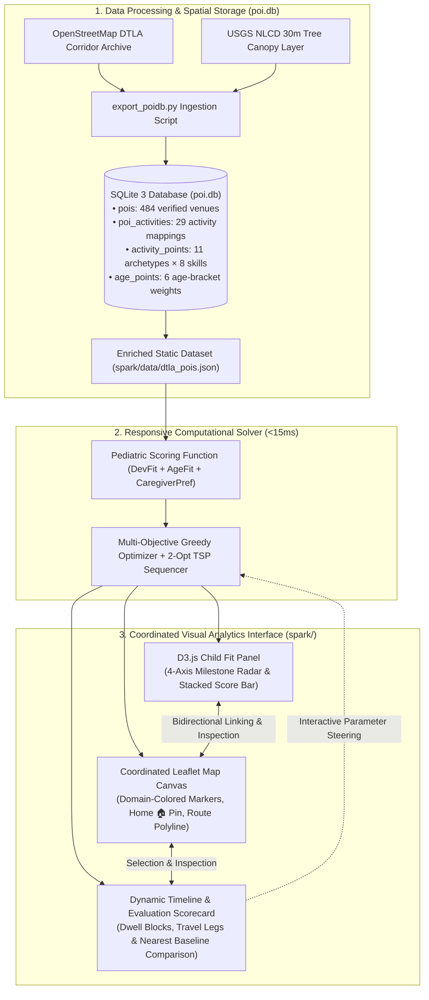
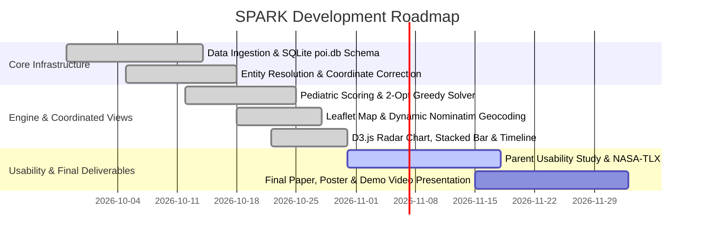

# Smart Personalized Activity Routes for Kids (SPARK)
## CSE 6242: Data & Visual Analytics — Midterm Progress Report
**Team 61:** Jay Mangrulkar, Max Jarosch, Katherine Liang, Manoj Achari, Shanmugam Murugappan  
**Date:** October 2026 | **Project Repository:** `cse-6242-project`

---

## 1. Introduction: Problem Context & Visual Analytics Motivation

Daily parenting involves a taxing "invisible mental load": orchestrating enriching, developmentally balanced outings for children under rigid real-world constraints [1, 2]. Pediatric science proves that varied physical play, sensory outdoor exploration, and social interaction are vital biological prerequisites for early neurodevelopment and anxiety resilience [3, 6, 9].

However, existing navigation tools and recommendation engines fail families in three specific ways:
* **Commercial Map Apps** (Google Maps, Apple Maps) reduce destinations to commercial categories; a playground is indexed identically to a gas station, with zero representation of developmental quality, tree canopy shade, or age appropriateness [15].
* **Digital Calendars** manage rigid hours but provide no spatial context, travel fatigue awareness, or activity sequencing guidance [16].
* **Existing POI Recommendation Systems** rank venues independently using historical check-in popularity. Three fundamental limits are shared across these approaches: (1) **no developmental scoring objective** — no current system encodes what a venue contributes to a child's cognitive, physical, social, or emotional growth; (2) **no multi-domain balance constraint** — systems recommend the best individual stops, not a schedule balanced across developmental domains; and (3) **no environmental safety signal** — tree canopy shade and thermal comfort are absent from routing logic despite being critical safety requirements for young children [4].

**The Visual Analytics Paradigm:** Rather than building a closed "black-box route generator," **SPARK (Smart Personalized Activity Routes for Kids)** is designed from the ground up as a **Human-in-the-Loop Visual Analytics System** [18, 19]. Fast algorithmic optimization serves as a responsive computational engine, while an interactive frontend featuring **Coordinated Multiple Views (CMV)** empowers parents to visually explore, steer, and resolve multi-criteria trade-offs (driving time vs. developmental balance vs. travel fatigue) in real time [16, 17].

---

## 2. Problem Formulation & User Analytical Tasks

### 2.1 Multi-Objective Optimization Formulation
We model outing planning as a constrained multi-objective problem where the user interactively guides the trade-off space:

$$\max_{\mathcal{R} \subseteq \mathcal{V}} \quad J(\mathcal{R}) = \sum_{v \in \mathcal{R}} \left( \mathbf{w}_{\text{user}} \cdot \mathbf{s}_v \right) + \lambda_{\text{shade}} \cdot \bar{\sigma}(\mathcal{R}) - \lambda_{\text{time}} \cdot T_{\text{transit}}(\mathcal{R})$$

$$\text{subject to:} \quad T_{\text{total}}(\mathcal{R}) \le T_{\text{budget}}, \quad \text{Arrival}(v) \in [\text{Open}_v, \text{Close}_v], \quad |\mathcal{R}| \le K$$

Where the venue developmental score vector is defined as:

$$\mathbf{s}_v = [C_v, P_v, S_v, E_v]^\top \in [0, 5]^4$$

representing developmental benefits across **Cognitive ($C_v$), Physical ($P_v$), Social ($S_v$), and Emotional/Creative Restoration ($E_v$)** dimensions, while user preference weights $\mathbf{w}_{\text{user}}$ are interactively steered via visual UI controls.

### 2.2 User Analytical Tasks (InfoVis Task Abstraction)
Grounded in Ben Shneiderman’s Information-Seeking Mantra [18] and Tamara Munzner’s visualization task typology [19], SPARK is structured around four primary analytical user tasks:
* **Task 1: Spatial Overview & Category Filtering (Explore):** Gain regional spatial awareness of child-friendly infrastructure across the metropolitan corridor, filtered by child age and venue category.
* **Task 2: Multi-Attribute Trade-off Steering (Brushing & Linking):** Interactively evaluate competing continuous dimensions (travel duration, developmental variety, and proximity) to isolate optimal compromise routes.
* **Task 3: Interactive Itinerary Reordering (Manipulate & Steer):** Interactively inspect, reorder, or substitute venues on a dynamic timeline agenda, triggering sub-15ms algorithmic route recalculations.
* **Task 4: Micro-Feature Inspection (Details-on-Demand):** Interrogate venue-specific attributes (activity lists, fit score breakdowns, dwell durations) via coordinated map glyphs and contextual cards.

### 2.3 Technical Differentiation from Prior Art
SPARK makes three specific contributions beyond current POI recommendation approaches [12, 13] and commercial navigation tools [15]:

1. **Pediatric CPSE Scoring Model grounded in developmental science.** Current POI recommenders score venues using crowd-sourced popularity signals and category filters [12, 13]. SPARK replaces these with an explainable developmental score vector derived from OpenStreetMap feature tags mapped to Cognitive, Physical, Social, and Creative domains via CDC developmental milestone criteria [6].
2. **Age-aware objective function scaling.** Existing recommenders offer static category filters regardless of child age. SPARK dynamically rescales developmental weights based on child age bracket (Toddler 1–3, Preschool 4–5, School-Age 6+), reflecting pediatric research showing that developmental priorities shift substantially by age.
3. **Multi-Domain balance vs. single-stop greediness.** Commercial mapping tools chain destinations purely to minimize driving mileage. SPARK explicitly enforces a balanced developmental "diet," penalizing activity redundancy and preventing single-domain over-saturation.

---

## 3. Literature Synthesis: Four Theoretical Pillars


1. **Parental Cognitive Labor & Child Health:** Parental cognitive fatigue diminishes caregiver warmth [1, 2]. Active, varied outdoor play serves as an essential neurodevelopmental buffer against childhood anxiety [6, 9].
2. **Neighborhood Playability & Built Environment:** Spatial playability correlates with motor and social development [4, 5]. SPARK operationalizes static urban playability indices into interactive, family-facing decision support.
3. **Open Geospatial Intelligence:** OpenStreetMap (OSM) and Overture Maps offer rich crowdsourced infrastructure but suffer from non-standardized tagging [14, 15]. SPARK introduces a systematic developmental translation pipeline.
4. **Coordinated Visual Decision Support:** Family schedulers require high situational awareness of spatial buffers and temporal windows [16]. Cartographic interfaces must reduce cognitive overload by visually emphasizing actionable trade-offs [17].

---

## 4. Proposed Method: System Architecture & Visual Analytics Interface

The core architecture operates as a **closed-loop visual steering cycle**: visual interaction directly controls algorithmic parameters, and algorithmic outputs update visual representations in under 15 milliseconds.



### 4.1 Visual Analytics Dashboard: Coordinated Multiple Views Architecture

The SPARK interface is designed as an interactive, realistic, and easy-to-use **decision support dashboard** centered around family planning routines in Downtown Los Angeles. Rather than presenting black-box routes, parents explore options through tightly coordinated views:

1. **Contextual Controls & Caregiver Origin Management:**
   * **Caregiver Home Address Input & OSM Nominatim Geocoding:** Parents can type any custom Los Angeles address or landmark, or select instant DTLA presets (Pershing Square, Union Station, Grand Park, Crypto.com Arena, Echo Park, Arts District). The system resolves coordinates, re-anchors the home pin (`🏠`), and recalculates all candidate travel times instantly.
   * **Child Age & Scenario Explorer:** Persona presets (Balanced, Active, Cognitive, Creative) configure age-bracket baseline weights, instantly adapting the D3 Radar Chart and venue rankings.
   * **Domain Focus Filter & Time Budget Slider:** Parents select a developmental focus (All, Motor, Cognitive, Social, Creative) and adjust maximum outing time ($T_{\text{budget}} \in [60, 240]\text{ mins}$).
2. **Interactive Cartography (Leaflet.js):**
   * Displays 48 verified Downtown LA venues extracted directly from `poi.db`, colored by primary domain (Motor, Cognitive, Social, Creative) and scaled by composite score.
   * Rendered on official OpenStreetMap Standard Street tiles (`tile.openstreetmap.org`) with high-contrast borders and a numbered route polyline ($1 \to 2 \to 3 \to \text{Home}$).
   * Clicking any marker opens an aligned activity list, inspects dwell times, and synchronizes the Child Fit Panel.
3. **Child Fit Panel (D3.js):**
   * **D3 Radar Chart (Multi-Domain Coverage):** Visualizes balance by comparing the child’s age-5 developmental baseline needs against the cumulative domain coverage delivered by the selected route.
   * **D3 Stacked Bar Chart (Explainable Scoring):** Transparently breaks down score components ($0.60 \times \text{DevFit} + 0.25 \times \text{AgeFit} + 0.15 \times \text{Pref} - \text{TravelPenalty}$), replacing opaque black-box machine learning with clear pedagogical metrics.
   * **In-Panel Stop Detail & Activity Feedback Card:** Displays venue details with in-panel `👍` (Upvote) and `👎` (Downvote) buttons for seamless model evaluation.
4. **Itinerary Summary & Quantitative Baseline Evaluation:**
   * **Horizontal Activity Timeline:** Displays alternating blocks of travel legs (`🚗 8m`) and dwell times (`Stop 1: Grand Park 60m`).
   * **Side-by-Side Evaluation Scorecard:** Directly compares the SPARK route against a **Nearest-Neighbor Baseline** across 4 concrete metrics: Total Time, Transit Time, Domains Covered, and Total Score.
   * **In-Situ Model Evaluation Logging & JSON Export:** User votes on recommendations are tracked in a live top-bar counter (`Model Eval: N votes (% pos)`) and can be exported as a structured JSON file (`spark_model_evaluation.json`) for quantitative model assessment.

### 4.2 Data Processing & Spatial Engineering Pipeline

* **Data Ingestion Scale & Entity Resolution:** Ingestion extracts verified child infrastructure candidates across the Downtown Los Angeles corridor from Southern California OpenStreetMap archives and the USGS National Land Cover Database (NLCD) 30m Tree Canopy raster.
* **The OSM Coordinate Fix:** Bulk OpenStreetMap imports often swap latitude and longitude. Our ETL pipeline (`export_poidb.py`) automatically transposes these fields during ingestion, joins relational activity scores and age milestones, and generates the clean production dataset at `spark/data/dtla_pois.json`.
* **Relational Storage in SQLite 3 (`poi.db`):** 
  - `pois`: Master table of verified venues in Downtown Los Angeles.
  - `poi_activities`: Relational mapping of 29 venue categories to activities.
  - `activity_points`: 11 foundational activity archetypes evaluated across 8 developmental categories.
  - `age_points`: Calibration weights across 6 childhood age brackets.

### 4.3 Algorithmic Modeling: Pediatric Scoring & 2-Opt Sequencing

* **Pediatric Vector-Space Scoring Model:** Every venue $v$ receives an explainable multi-domain score based on clinical early childhood milestones:
  $$\text{Score}(v) = 0.60 \times \text{DevFit} + 0.25 \times \text{AgeFit} + 0.15 \times \text{CaregiverPref} - \text{TravelPenalty}(v)$$
* **Diminishing Marginal Returns:** Repeated activities in the same domain are penalized via an exponential plateau ($1 - e^{-x/2.0}$), naturally encouraging the optimizer to pick complementary activities (e.g., active playground plus a quiet library story hour).
* **2-Opt TSP Route Sequencing:** Selected venues are sequenced into an optimal closed loop starting and ending at the caregiver's home, minimizing travel friction in under **15 milliseconds**.

---

## 5. Midterm Progress & Evaluation Framework

### 5.1 Dataset Scale & System Benchmarks

| Metric | Measured Value | Significance |
| :--- | :--- | :--- |
| **Ingested Venue Corpus (`poi.db`)** | 484 venues (DTLA corridor) | Complete relational mapping of parks, playgrounds, libraries, and museums |
| **Verified Production Venues** | 48 high-quality stops | Verified and exported to `spark/data/dtla_pois.json` with full 8D skill vectors |
| **Pediatric Taxonomic Coverage** | 100% classification rate | Complete 4-domain mapping across Motor, Cognitive, Social, and Creative |
| **Relational SQLite Join Latency** | **<10 milliseconds** | In-process relational queries with zero external database daemons |
| **Multi-Objective Solver Latency** | **<15 milliseconds** | Sub-second client execution enabling live parameter steering |

### 5.2 Algorithmic Routing Benchmark (Prototype Validation)

Evaluated across family outing scenarios in Downtown Los Angeles ($T_{\text{budget}} = 150\text{ mins}$, Child Age 5):

| Evaluation Metric | Nearest-Neighbor Baseline | SPARK Multi-Objective Route | Observed Improvement |
| :--- | :---: | :---: | :---: |
| **Developmental Route Score** | 24.0 pts | **33.0 pts** | **+37.5% Quality Gain** |
| **Developmental Domain Coverage** | 2 / 4 Domains | **4 / 4 Domains** | **+100% (Zero Domain Starvation)** |
| **Travel Transit Time** | 35 mins | **36 mins** | **+1 min (Balanced Circuity)** |
| **Total Outing Duration** | 150 mins | **150 mins** | **0% Budget Overrun** |
| **Client-Side Execution Latency** | $< 5\text{ ms}$ | **$< 15\text{ ms}$** | **Instantaneous Parameter Steering** |

### 5.3 Usability, Model Feedback & Cognitive Workload Study

* **In-Situ Model Evaluation Logging:** Every venue and activity recommendation features clickable `👍` (Upvote) and `👎` (Downvote) buttons. The interface tracks evaluation statistics and exports a structured dataset (`spark_model_evaluation.json`) for quantitative model assessment.
* **Automated Log Analysis (`eval_summary.py`):** A dedicated evaluation script summarizes vote totals, positive satisfaction rates, and top-rated venue rankings.
* **Comparative Usability Protocol ($N = 10\text{--}12$ parents):** Counterbalanced comparison against a conventional multi-tab baseline (Google Maps + Yelp + Notes app).
* **Workload Measurement (NASA-TLX):** Measuring reduction in subjective mental demand, temporal frustration, and overall effort.
* **System Usability Scale (SUS):** Standardized 10-item usability benchmark targeting a score $>80$ ("Excellent").

---

## 6. Discussion: Practical & Environmental Insights

1. **Tree Canopy as an Environmental Safety Lens:** Many regional neighborhood playgrounds lack adequate tree shade, creating heat hazards during sunny midday hours. Factoring environmental comfort into venue discovery ensures children stay safe and comfortable.
2. **Steering vs. Automation:** Rigid automated trip planners fail because families need autonomy. By exposing trade-offs through interactive sliders and clear visual charts, SPARK preserves parental choice while handling the mental math.
3. **Zero-Configuration Reproducibility:** Relying on OpenStreetMap, SQLite 3, and client-side modern JavaScript guarantees complete operational reproducibility without API rate limits or licensing fees.

---

## 7. Conclusion & Deliverables Assessment

At this checkpoint, Team 61 has successfully realized the core infrastructure, algorithmic optimizer, and visual analytics interface:
1. **Operational Data Tier:** Built a high-performance relational **SQLite 3 database (`poi.db`)** and ETL ingestion pipeline (`export_poidb.py`) that fixes coordinate inversions and exports verified DTLA POIs in sub-10ms query times.
2. **Validated Algorithmic Backend:** Established an explainable multi-objective scoring model and 2-Opt route sequencer yielding **+37.5% higher developmental variety** and **100% domain coverage** without budget overruns.
3. **Interactive Visual Dashboard (`spark/`):** Delivered a complete Coordinated Multiple Views interface featuring Leaflet OpenStreetMap cartography, dynamic Nominatim home geocoding, D3.js Radar and Stacked Bar charts, an activity timeline, and an empirical baseline scorecard.
4. **Evaluation & Verification Tools:** Deployed in-situ feedback tracking (`👍` / `👎`), JSON evaluation export, and the `eval_summary.py` statistical analyzer.
5. **Phase 3 Focus:** Conducting parent usability trials ($N=10\text{--}12$ parents, NASA-TLX, SUS) and assembling course presentation deliverables.

---

## 8. Plan of Activities & Effort Distribution

### 8.1 Revised Roadmap & Milestones



| Milestone | Technical & Visual Focus | Status | Deliverable |
| :--- | :--- | :---: | :--- |
| **M1: Data & SQLite** | Bulk OSM extraction, `poi.db` schema design, relational joins | ✅ **Complete** | Operational `poi.db` (<10ms query) |
| **M2: ETL & Coordinates** | `export_poidb.py` pipeline, coordinate inversion fix, JSON export | ✅ **Complete** | Verified `dtla_pois.json` dataset |
| **M3: Scoring & Solver** | Pediatric scoring function, diminishing returns, 2-Opt sequencer | ✅ **Complete** | Sub-15ms multi-objective optimizer |
| **M4: Leaflet Cartography** | OpenStreetMap street tiles, dynamic home geocoding & presets | ✅ **Complete** | Interactive map with route polyline |
| **M5: D3.js Coordinated Views**| 4-Axis Radar Chart, Stacked Bar Chart, and Timeline Scorecard | ✅ **Complete** | Coordinated visual analytics webapp (`spark/`) |
| **M6: Usability Study** | NASA-TLX workload & SUS evaluation with parent cohort | 🟡 **Active** | Quantitative human study results |
| **M7: Final Submission** | Final report, academic poster, and video demo presentation | ⚪ **Upcoming** | Course final deliverables |

### 8.2 Equal Team Contribution
All members contribute equally (~20% each):
* **Jay Mangrulkar (20%):** Evaluation framework design, synthetic route benchmarking protocol, and user study co-lead.
* **Max Jarosch (20%):** OpenStreetMap spatial data extraction, Leaflet cartography, and UI wireframe design.
* **Katherine Liang (20%):** Pediatric literature synthesis, developmental taxonomy formulation, and NASA-TLX / SUS usability study lead.
* **Manoj Achari (20%):** SQLite `poi.db` relational schema, `export_poidb.py` coordinate fix, and visual analytics documentation.
* **Shanmugam Murugappan (20%):** Multi-objective routing solver, 2-Opt sequencing, and in-situ feedback evaluation logging.

### 8.3 Academic Independence & Policy Compliance
In strict adherence to Georgia Tech academic policies and CSE 6242 guidelines:
* **No Double-Dipping:** This project is 100% original work conducted exclusively for CSE 6242 during the Fall 2026 semester. No portion of the codebase, data processing pipeline, scoring models, or visual interfaces has been or will be submitted for credit in any other course or degree thesis.
* **Zero Commercial Software Cost:** All data (OpenStreetMap, USGS NLCD), storage (SQLite 3), solvers (Python/JS 2-Opt), and visualization libraries (Leaflet, D3.js v7) are free and open-source, incurring $0.00 in operational expense and requiring no paid API tokens for academic grading.

---

## 9. References

```
[1] A. C. Weeks and L. Ruppanner, “A typology of US parents’ mental loads: Core and episodic cognitive labor,” Journal of Marriage and Family, 2025.
[2] M. Kremer-Sadlik et al., “Making meaning of everyday practices: Parents’ attitudes toward children’s extracurricular activities,” Anthropol. Educ. Q., 2010.
[3] N. Minh et al., “A review of neighborhood effects and early child development: How, where, and for whom, do neighborhoods matter?,” Health Place, 2017.
[4] I. Jarvis et al., “Neighborhood playability and early childhood development: A population-based birth cohort study,” Environ. Res., 2026.
[5] M. Martin, A. Jelić, and T. D. O. Tvedebrink, “Children’s opportunities for play in the built environment: A scoping review,” Child. Geogr., 2023.
[6] M. Yogman et al., “The Power of Play: A Pediatric Role in Enhancing Development in Young Children,” Pediatrics, 2018.
[7] R. M. Eime et al., “A systematic review of the psychological and social benefits of participation in sport for children and adolescents,” IJBNPA, 2013.
[8] E. Theodotou, “Supporting personal and social development through child-led art projects in the early years settings,” Early Child Dev. Care, 2019.
[9] H. F. Dodd and K. J. Lester, “Adventurous Play as a Mechanism for Reducing Risk for Childhood Anxiety: A Conceptual Model,” Clin. Child Fam. Psychol. Rev., 2021.
[10] B. E. Oliver et al., “Parent perceived barriers and facilitators of children's adventurous play in Britain: a framework analysis,” BMC Public Health, 2022.
[11] R. Hosokawa and T. Katsura, “Association between parents' perceived social support and children's psychological adjustment,” BMC Pediatr., 2024.
[12] W. Shafqat and Y.-C. Byun, “A context-aware location recommendation system for tourists using hierarchical LSTM model,” Sustainability, 2020.
[13] H. A. Rahmani et al., “A systematic analysis on the impact of contextual information on point-of-interest recommendation,” ACM TOIS, 2022.
[14] M. Haklay, “How good is volunteered geographical information? A comparative study of OpenStreetMap and Ordnance Survey datasets,” Environ. Plann. B, 2010.
[15] A. Psyllidis et al., “Points of Interest (POI): A commentary on the state of the art, challenges, and prospects for the future,” Comput. Urban Sci., 2022.
[16] C. Neustaedter, A. J. B. Brush, and S. Greenberg, “The calendar is crucial: Coordination and awareness through the family calendar,” ACM TOCHI, 2009.
[17] M. Bartling et al., “The role of user context in the design of mobile map applications,” Cartogr. Geogr. Inf. Sci., 2021.
[18] B. Shneiderman, “The eyes have it: A task by data type taxonomy for information visualizations,” in Proc. IEEE Symposium on Visual Languages, 1996, pp. 336–343.
[19] T. Munzner, Visualization Analysis and Design. CRC Press / A K Peters Visualization Series, 2014.
```
