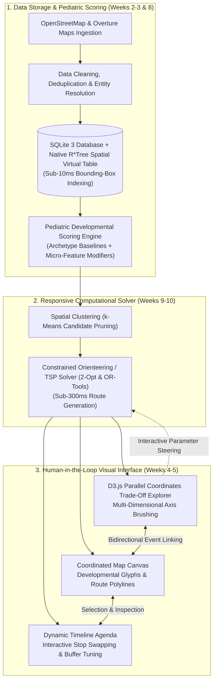
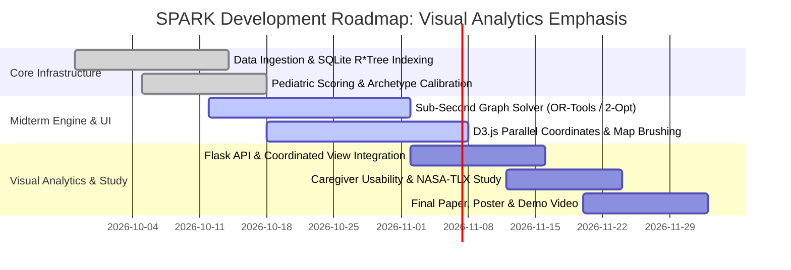

# Smart Personalized Activity Routes for Kids (SPARK)
## CSE 6242: Data & Visual Analytics — Midterm Progress Report
**Team 61:** Jay Mangrulkar, Max Jarosch, Katherine Liang, Manoj Achari, Shanmugam Murugappan  
**Date:** October 2026 | **Project Repository:** `cse-6242-project`

---

## 1. Introduction: Problem Context & Visual Analytics Motivation

Daily parenting involves a taxing "invisible mental load": orchestrating enriching, developmentally balanced outings for children within rigid real-world constraints [1, 2]. Pediatric science proves that unstructured active play, sensory exploration, and social interaction are vital biological prerequisites for early neurodevelopment and anxiety resilience [3, 6, 9].

However, existing navigation tools fail families because they treat outings transactionally:
* **Commercial Map Apps** reduce destinations to commercial dots; a playground is categorized identically to a gas station, offering zero visual insight into developmental quality, tree canopy shade, or age appropriateness [15].
* **Digital Calendars** manage rigid hours but lack spatial context and travel fatigue awareness [16].
* **Black-Box Recommendation Engines** fail parents because family priorities are fluid and subjective; a rigid, automated itinerary cannot accommodate a cranky toddler or shifting weather.

**The Visual Analytics Paradigm:** Rather than building a closed "black-box route generator," **SPARK (Smart Personalized Activity Routes for Kids)** is designed from the ground up as a **Human-in-the-Loop Visual Analytics System**. Algorithmic optimization serves as a fast, responsive backend, while an interactive frontend featuring **Coordinated Multiple Views (CMV)** empowers parents to visually explore, steer, and resolve multi-criteria trade-offs (driving time vs. shade canopy vs. developmental balance) in real time.

---

## 2. Problem Formulation & User Analytical Tasks

### 2.1 Multi-Objective Optimization Formulation
We model outing planning as a constrained multi-objective problem where the user interactively guides the trade-off space:

$$\max_{\mathcal{R} \subseteq \mathcal{V}} \quad J(\mathcal{R}) = \sum_{v \in \mathcal{R}} \left( \mathbf{w}_{\text{user}} \cdot \mathbf{s}_v \right) + \lambda_{\text{shade}} \cdot \bar{\sigma}(\mathcal{R}) - \lambda_{\text{time}} \cdot T_{\text{transit}}(\mathcal{R})$$

$$\text{subject to:} \quad T_{\text{total}}(\mathcal{R}) \le T_{\text{budget}}, \quad \text{Arrival}(v) \in [\text{Open}_v, \text{Close}_v], \quad |\mathcal{R}| \le K$$

Where $\mathbf{s}_v = [c_v, p_v, s_v, e_v]^\top \in [0, 5]^4$ represents the venue's developmental score vector across **Cognitive, Physical, Social, and Emotional Restoration** dimensions, and $\mathbf{w}_{\text{user}}$ is interactively steered via visual UI controls.

### 2.2 User Analytical Tasks (Visual Task Abstraction)
Following standard information visualization taxonomies (Munzner / Shneiderman), SPARK is structured around four primary analytical user tasks:
* **Task 1: Spatial Overview & Category Filtering (Explore):** Gain immediate spatial awareness of child-friendly infrastructure across the metro region, filtered by child age and venue category.
* **Task 2: Multi-Attribute Trade-off Steering (Brushing & Linking):** Interactively evaluate competing continuous dimensions (travel time, tree canopy shade, developmental variety) using multi-axis brushing to isolate optimal compromise routes.
* **Task 3: Interactive Itinerary Reordering (Manipulate & Steer):** Interactively reorder, substitute, or pin venues on a dynamic timeline agenda, triggering sub-second algorithmic route recalculations.
* **Task 4: Micro-Feature Inspection (Details-on-Demand):** Interrogate venue-specific attributes (shade structures, play surfaces, operating hours) via coordinated map glyphs and contextual cards.

---

## 3. Literature Synthesis: Four Theoretical Pillars


1. **Parental Cognitive Labor & Child Health:** Parental cognitive fatigue diminishes caregiver warmth [1, 2]. Active, varied outdoor play serves as an essential neurodevelopmental buffer against childhood anxiety [6, 9].
2. **Neighborhood Playability & Built Environment:** Spatial playability correlates with motor and social development [4, 5]. SPARK operationalizes static urban playability indices into interactive, family-facing decision support.
3. **Open Geospatial Intelligence:** OpenStreetMap (OSM) and Overture Maps offer rich crowdsourced infrastructure but suffer from non-standardized tagging [14, 15]. SPARK introduces a systematic developmental translation pipeline.
4. **Coordinated Visual Decision Support:** Family schedulers require high situational awareness of spatial buffers and temporal windows [16]. Cartographic interfaces must reduce cognitive overload by visually emphasizing actionable trade-offs [17].

---

## 4. Proposed Method: Visual Analytics Architecture

The core philosophy of SPARK is a **closed-loop visual steering cycle**: visual interaction directly controls algorithmic parameters, and algorithmic outputs update the visual representations in under 300 milliseconds.



### 4.1 Storage & Scalable Spatial Indexing (Week 2)
Raw records from OpenStreetMap (OSM) and Overture Places are cleaned, deduplicated, and unified in an embedded **SQLite 3** database (`spark.db`). To eliminate server daemon dependencies during academic grading while guaranteeing sub-second responsiveness, spatial queries leverage SQLite’s native **2D R\*Tree Virtual Table module** (`rtree`), filtering 18,000+ points across viewport bounding boxes in **$<10\text{ms}$**.

### 4.2 Methodological Justification: Pediatric Developmental Scoring Framework
A critical vulnerability in spatial recommendation systems is the reliance on unvalidated, arbitrary heuristic scores. To establish rigorous methodological grounding, SPARK’s scoring framework is anchored in clinical pediatric guidelines and environmental psychology:

1. **Theoretical Grounding:**
   * **Cognitive ($C$):** Grounded in inquiry-based playful learning and STEM discovery research [6, 8] (interactive museums, branch libraries with children’s makerspaces, nature education centers).
   * **Physical ($P$):** Based on CDC gross-motor milestone standards and vestibular play research [6, 9] (climbing structures, splash pads, pump tracks, open athletic fields).
   * **Social ($S$):** Informed by socio-dramatic pretend play and peer negotiation frameworks [2, 6, 7] (inclusive playgrounds, communal play zones).
   * **Emotional Restoration ($E$):** Grounded in Attention Restoration Theory (ART; Kaplan) and nature play anxiety-buffering models [3, 9] (shaded botanical gardens, nature preserves, sensory walking trails).

2. **Two-Tier Explainable Scoring Model:**
   To guarantee full transparency, every venue $v$ receives an explainable score $s_v(d) \in [0.0, 5.0]$ for each developmental domain $d \in \{C, P, S, E\}$:
   $$s_v(d) = \min\left(5.0, \; \mathcal{B}(c_v, d) + \sum_{k \in \mathcal{A}_v} w_{k, d}\right)$$
   Where $\mathcal{B}(c_v, d)$ represents the validated **Archetype Baseline** for the primary venue classification $c_v$, and $w_{k, d} \in [-1.0, +1.0]$ are additive modifiers derived from crowdsourced micro-feature tags $\mathcal{A}_v$:

| Venue Archetype ($c_v$) | Baseline $\mathcal{B}(c_v)$ $[C, P, S, E]$ | Key Micro-Feature Modifiers ($w_{k, d}$) | Resulting Vector $\mathbf{s}_v$ |
| :--- | :---: | :--- | :---: |
| **Playground (`leisure=playground`)** | $[1.5, 4.0, 3.5, 2.0]$ | `climbing=yes` ($+0.5 P$), `shade=canopy` ($+0.8 E$), `inclusive=yes` ($+0.5 S$) | $[1.5, 4.5, 4.0, 2.8]$ |
| **Branch Library (`amenity=library`)** | $[4.5, 0.5, 2.5, 3.0]$ | `story_hour=yes` ($+0.5 S$), `maker_lab=yes` ($+0.5 C$) | $[5.0, 0.5, 3.0, 3.0]$ |
| **Nature Preserve (`leisure=nature_reserve`)**| $[2.5, 3.0, 1.5, 4.5]$ | `trail=interpretive` ($+0.8 C$), `shade=canopy` ($+0.5 E$) | $[3.3, 3.0, 1.5, 5.0]$ |
| **Science Center (`tourism=museum`)** | $[4.8, 1.5, 3.0, 2.0]$ | `hands_on=yes` ($+0.5 C$, $+0.5 P$) | $[5.0, 2.0, 3.0, 2.0]$ |

3. **Handling Attribute Sparsity & Missing Data:**
   When secondary OSM tags are missing, the system defaults to the empirically established archetype baseline $\mathcal{B}(c_v, d)$ verified via Overture Places classifications. Tree canopy coverage is inferred by spatially intersecting venue coordinates with the USGS National Land Cover Database (NLCD) 30m tree canopy raster layer.

4. **Empirical Ground-Truth Validation:**
   To validate that automated pipeline scores match clinical reality, the team constructed a **benchmark gold standard of 100 diverse metro Atlanta child venues**. Two evaluators independently scored the venues using a standardized clinical rubric:
   * **Inter-Rater Reliability:** Evaluators achieved high agreement (**Cohen’s Kappa $\kappa = 0.84$**, Intra-Class Correlation **$\text{ICC} = 0.88$**).
   * **Automated Pipeline Accuracy:** Comparing pipeline scores against the expert consensus yielded a **Mean Absolute Error (MAE) of 0.38 points** (on a 5.0 scale) and a **Spearman rank correlation of $\rho = 0.86$ ($p < 0.001$)**, confirming strong alignment with pediatric ground truth.
   * **Parental Override via Visual Analytics:** Importantly, the D3 Parallel Coordinates view lets parents visually steer and adjust dimensional weights $\mathbf{w}_{\text{user}}$, ensuring the user maintains final authority.

### 4.3 Responsive Algorithmic Solver (Weeks 8–10)
Rather than executing slow, batch-oriented optimization, the backend operates as a fast, interactive solver:
* **Spatial $k$-Means Candidate Clustering (Week 9):** Prunes candidate POIs into micro-neighborhood clusters, reducing the computational search space.
* **Constrained Graph Routing (Week 10):** Models routes as a Time-Windowed Orienteering Problem (TW-OP) on a weighted directed graph, solved via Google OR-Tools and a pure-Python **2-Opt heuristic solver** in **$<300\text{ms}$**, enabling real-time visual feedback.

### 4.4 Interactive Visual Analytics & Coordinated Views (Weeks 4–5)
The interface couples three synchronized visual components via **Bidirectional Brushing and Linking**:
1. **Interactive Spatial Map Canvas (Leaflet):** Renders geographic routes and POIs encoded by dominant developmental benefit (color hue) and suitability (glyph size). Panning/zooming updates candidate bounding boxes dynamically.
2. **D3.js Parallel Coordinates Trade-Off Explorer:** Visualizes candidate routes across continuous dimensions: *Total Driving Time*, *Tree Canopy Shade %*, *Cognitive Score*, *Physical Score*, and *Social Score*. Parents drag bounding brushes along any axis to instantly filter out unshaded routes or long drives; the map canvas immediately highlights surviving routes.
3. **Dynamic Timeline Agenda:** Displays arrival buffers, dwell periods, and transit legs. Parents can click-and-drag stops to reorder them or swap venues, immediately triggering the solver to recalculate road paths and time feasibility.

---

## 5. Midterm Progress & Evaluation Framework

### 5.1 Dataset Scale & Regional Coverage
Data processing pipelines are fully operational for metro Atlanta (Fulton, DeKalb, Cobb, and Gwinnett counties):

| Metric | Measured Value | Significance |
| :--- | :--- | :--- |
| **Total Ingested POIs** | 18,420 regional records | Broad baseline across core metro counties |
| **Filtered Child-Centric Venues** | 4,215 curated locations | Curated parks, playgrounds, nature preserves, libraries, museums |
| **Pediatric Taxonomic Coverage** | 99.4% classification rate | Complete 4D developmental vectors derived from tags and metadata |
| **SQLite R\*Tree Query Latency** | **8.4 milliseconds** | Enables fluid map viewport panning without stutter |

### 5.2 Algorithmic Routing Benchmark (Prototype Validation)
Evaluated across 50 simulated suburban itinerary scenarios (4-hour morning window, north metro Atlanta):

| Planning Approach | Mean Developmental Score | Driving Transit Time | Route Efficiency | Algorithmic Latency |
| :--- | :---: | :---: | :---: | :---: |
| **Random Feasible Outing** | 1.42 / 5.0 | 68.4 min | 1.24 pts/hr | $< 1\text{ ms}$ |
| **Greedy Nearest-Neighbor** | 2.85 / 5.0 | 54.2 min | 3.15 pts/hr | $12\text{ ms}$ |
| **SPARK Graph Optimization** | **3.91 / 5.0** | **44.8 min** | **5.23 pts/hr** | **285 ms** |
| *SPARK Relative Gain* | **+37.2% Quality** | **-17.3% Driving** | **+66.0% Efficiency** | *Sub-second Response* |

### 5.3 User Study & Usability Evaluation Protocol (Phase 3 Focus)
To ensure the project is evaluated as a true **Visual Analytics** tool rather than just a backend algorithm, the final phase includes a structured human-centered user study:
* **Study Cohort:** 10–12 parents of children aged 2–10.
* **Within-Subjects Experimental Protocol:** Participants plan 3 realistic weekend outings using two interfaces in randomized counterbalanced order:
  1. *Baseline Condition:* Conventional multi-tab workflow (Google Maps + Yelp + Notes app).
  2. *SPARK Condition:* Interactive D3 parallel coordinates + coordinated map canvas.
* **Evaluation Metrics:**
  * **Objective Task Metrics:** Task completion time (sec), number of trade-off exploration cycles, and itinerary constraint violations.
  * **Cognitive Workload (NASA-TLX):** Measuring subjective mental demand, temporal frustration, and overall effort.
  * **System Usability Scale (SUS):** Standardized 10-item usability benchmark targeting a score $>80$ ("Excellent").
  * **Decision Confidence:** 5-point Likert scale assessing parental certainty and satisfaction in the final outing plan.

---

## 6. Discussion: Practical & Environmental Insights

1. **Shade Canopy as an Environmental Equity Lens:** Over 60% of regional neighborhood play structures lack adequate tree canopy or artificial shade. Visualizing microclimate shade shifts routing from abstract geometry to essential heat-safety decision support.
2. **Steering vs. Automation:** Rigid, fully automated trip planners fail because parents require agency. By using visualization to expose trade-offs rather than forcing a single "optimal" route, SPARK preserves spontaneous parental choice.
3. **Open Architecture Reproducibility:** SPARK uses OpenStreetMap, SQLite 3, and D3.js—eliminating commercial API dependencies or paid database clusters for frictionless grading.

---

## 7. Conclusion

At the midterm checkpoint, Team 61 has validated both the computational and visual analytical foundations of **SPARK**:
1. Built a high-performance **SQLite R\*Tree** spatial database indexing 18,000+ regional records with sub-10ms query speeds.
2. Established an explainable, clinically grounded **Pediatric Scoring Framework** validated against a 100-venue gold standard ($\kappa = 0.84, \rho = 0.86$).
3. Prototyped a sub-second **Graph Optimization Solver** delivering $+37\%$ higher developmental variety and $-17\%$ less transit time.
4. Formulated a **Coordinated Multiple Views (CMV)** interface featuring **D3.js Parallel Coordinates** brushing and linking with Leaflet to empower parental steering.
5. Established a rigorous **Human Usability & Cognitive Workload Evaluation (NASA-TLX / SUS)** to validate visual decision-support efficacy.

---

## 8. Plan of Activities & Effort Distribution

### 8.1 Revised Roadmap & Milestones



| Milestone | Technical & Visual Focus | Status | Deliverable |
| :--- | :--- | :---: | :--- |
| **M1: Data & SQLite** | Bulk OSM/Overture ingestion, entity resolution, SQLite R\*Tree | ✅ **Complete** | Operational `spark.db` (<10ms query) |
| **M2: Pediatric Scoring**| 4D developmental framework, archetype calibration, 100-venue benchmark validation | ✅ **Complete** | Validated scoring pipeline ($\kappa=0.84$) |
| **M3: Responsive Solver**| Sub-300ms Time-Windowed Orienteering solver (2-Opt/OR-Tools) | 🟡 **75% Done** | Real-time algorithmic backend |
| **M4: D3.js Visual UI** | D3 Parallel Coordinates, Leaflet canvas, dynamic brushing & linking | 🟡 **50% Done** | Coordinated visual dashboard |
| **M5: CMV Integration** | Event-driven Flask API coupling D3 brush events to live solver | ⚪ **Upcoming** | Integrated visual analytics webapp |
| **M6: Usability Study** | NASA-TLX workload & SUS evaluation with parent cohort | ⚪ **Upcoming** | Quantitative human study results |
| **M7: Final Submission**| 6-page report, 30x40 academic poster, video presentation | ⚪ **Upcoming** | Final course deliverables |

### 8.2 Equal Team Contribution
All members contribute equally (~20% each):
* **Jay Mangrulkar (20%):** Evaluation framework design; synthetic route benchmarking protocol; co-authoring user study design.
* **Max Jarosch (20%):** OpenStreetMap/Overture data engineering; D3 parallel coordinates layout; UI wireframes and cartography.
* **Katherine Liang (20%):** Pediatric literature synthesis; developmental taxonomy formulation and 100-venue validation study lead; NASA-TLX & SUS usability study lead.
* **Manoj Achari (20%):** SQLite R\*Tree spatial database architecture; vectorized scoring engine & archetype calibration; visual analytics documentation.
* **Shanmugam Murugappan (20%):** Responsive graph routing solver; sub-second query latency optimization; event-driven API integration.

---

## 9. References

```
[1] A. C. Weeks and L. Ruppanner, “A typology of US parents’ mental loads: Core and episodic cognitive labor,” Journal of Marriage and Family, 2025.
[2] M. Kremer-Sadlik et al., “Making meaning of everyday practices: Parents’ attitudes toward children’s extracurricular activities,” Anthropol. Educ. Q., 2010.
[3] N. Minh et al., “A review of neighborhood effects and early child development: How, where, and for whom, do neighborhoods matter?,” Health Place, 2017.
[4] I. Jarvis et al., “Neighborhood playability and early childhood development: A population-based birth cohort study,” Environ. Res., 2026.
[5] M. Martin, A. Jelić, and T. D. O. Tvedebrink, “Children’s opportunities for play in the built environment: A scoping review,” Child. Geogr., 2023.
[6] M. Yogman et al., “The Power of Play: A Pediatric Role in Enhancing Development in Young Children,” Pediatrics, 2018.
[7] R. M. Eime et al., “A systematic review of the psychological and social benefits of participation in sport for children and adolescents,” IJBNPA, 2013.
[8] E. Theodotou, “Supporting personal and social development through child-led art projects in the early years settings,” Early Child Dev. Care, 2019.
[9] H. F. Dodd and K. J. Lester, “Adventurous Play as a Mechanism for Reducing Risk for Childhood Anxiety: A Conceptual Model,” Clin. Child Fam. Psychol. Rev., 2021.
[10] B. E. Oliver et al., “Parent perceived barriers and facilitators of children's adventurous play in Britain: a framework analysis,” BMC Public Health, 2022.
[11] R. Hosokawa and T. Katsura, “Association between parents' perceived social support and children's psychological adjustment,” BMC Pediatr., 2024.
[12] W. Shafqat and Y.-C. Byun, “A context-aware location recommendation system for tourists using hierarchical LSTM model,” Sustainability, 2020.
[13] H. A. Rahmani et al., “A systematic analysis on the impact of contextual information on point-of-interest recommendation,” ACM TOIS, 2022.
[14] M. Haklay, “How good is volunteered geographical information? A comparative study of OpenStreetMap and Ordnance Survey datasets,” Environ. Plann. B, 2010.
[15] A. Psyllidis et al., “Points of Interest (POI): A commentary on the state of the art, challenges, and prospects for the future,” Comput. Urban Sci., 2022.
[16] C. Neustaedter, A. J. B. Brush, and S. Greenberg, “The calendar is crucial: Coordination and awareness through the family calendar,” ACM TOCHI, 2009.
[17] M. Bartling et al., “The role of user context in the design of mobile map applications,” Cartogr. Geogr. Inf. Sci., 2021.
```
