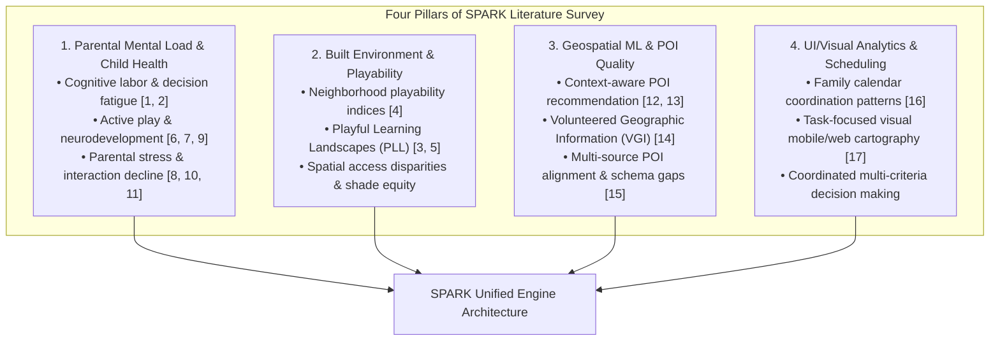
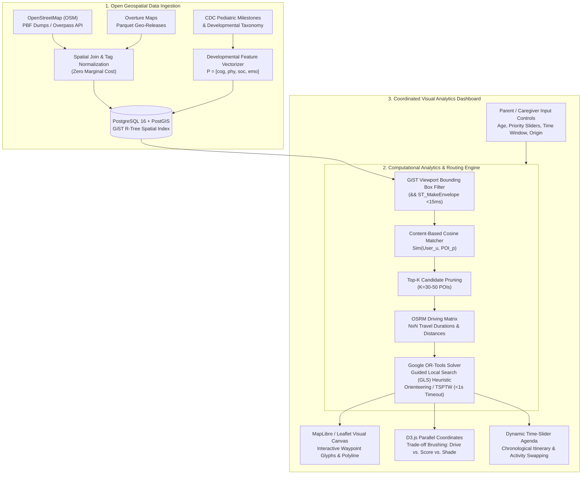
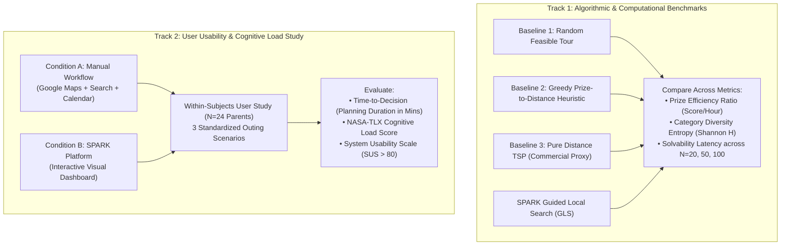
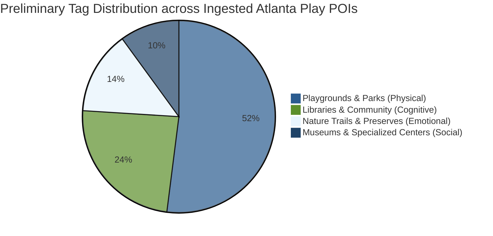
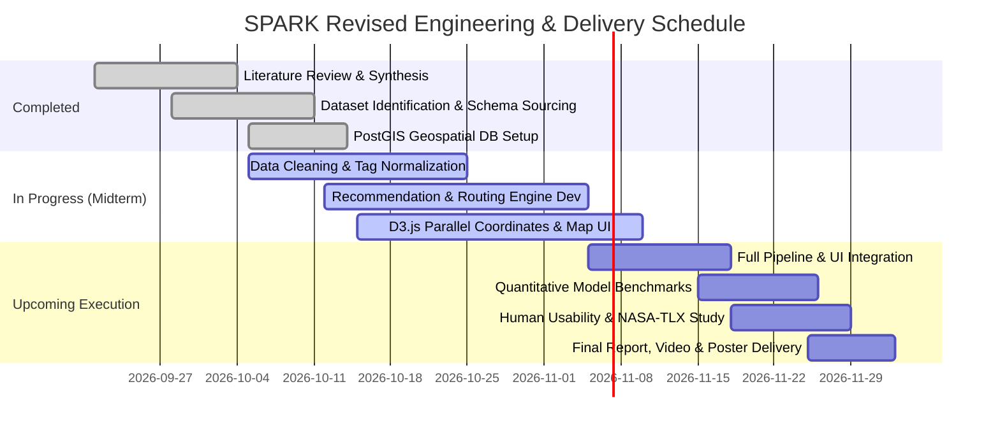

# Smart Personalized Activity Routes for Kids (SPARK)
## CSE 6242: Data & Visual Analytics — Midterm Progress Report
**Team 61:** Jay Mangrulkar, Max Jarosch, Katherine Liang, Manoj Achari, Shanmugam Murugappan  
**Date:** October 2026  
**Project Repository:** `cse-6242-project`  

---

## 1. Introduction

Modern parenting is defined by continuous, complex decision-making. Beyond routine household tasks, parents shoulder a heavy "mental load"—the invisible, highly taxing cognitive labor of planning, coordinating, prioritizing, and scheduling enriching experiences for their children [1, 2]. Pediatric and cognitive development research demonstrates that active, unstructured play, varied sensory exposure, and outdoor recreation are fundamental to healthy early childhood development [3, 6, 9]. Daily physical play stimulates synaptic plasticity, enhances executive functioning, fosters emotional self-regulation, and reduces the risk of anxiety disorders [6, 9]. However, translating these developmental imperatives into real-world family routines poses an immense logistical hurdle.

Today, identifying an appropriate outing requires parents to execute an arduous manual workflow across fragmented tools: querying commercial mapping applications (e.g., Google Maps) for proximity, scouring parent forums and social blogs for age appropriateness, consulting independent park district portals for operating hours, and checking weather forecasts. Crucially, existing navigation and point-of-interest (POI) discovery engines are designed for commercial or commuting purposes; they treat destinations as isolated, transactional points in space. None integrate pediatric developmental milestones, nor do they formulate multi-stop outings that reconcile travel friction, time windows, and child attention spans into an optimized daily agenda [12, 16, 17]. 

When planning friction becomes overwhelming, parental stress escalates. Empirical studies show that parental fatigue directly degrades the quality, warmth, and frequency of caregiver-child interactions, often pushing families toward default, sedentary routines [7, 8]. There is an urgent need for an intelligent decision-support system that bridges spatial data analytics with developmental science.

To address this challenge, we present **SPARK (Smart Personalized Activity Routes for Kids)**, an interactive, web-based visual analytics platform designed to automate and optimize child-centric activity planning. SPARK integrates large-scale, open geospatial data from OpenStreetMap (OSM) and Overture Maps with an evidence-based pediatric developmental taxonomy. By pairing high-performance spatial indexing (PostGIS/GiST) with a multi-objective content-based recommendation model and a heuristic Traveling Salesperson Problem with Time Windows (TSPTW) routing engine, SPARK transforms raw crowdsourced geographic data into structured, time-sensitive daily agendas. Through coordinated D3.js and WebGL map visualizations, parents can dynamically inspect trade-offs between transit duration, developmental variety, and environmental constraints, transforming an exhausting administrative task into an intuitive, empowered planning experience.

---

## 2. Problem Definition

We formalize the parental activity planning problem as a constrained, multi-objective spatial decision-support problem. The core objective is to select, rank, and sequence a subset of candidate Points of Interest $\mathcal{V}$ within a geographic bounding area to construct an optimal daily activity agenda $\mathcal{T}$, subject to logistical constraints, child developmental priorities, and parental time budgets.

### 2.1 Spatial and Temporal Constraints
Let $H$ denote the family's origin and terminus depot (home location at coordinates $(\lambda_0, \phi_0)$), and let $[T_{\text{start}}, T_{\text{end}}]$ represent the available daily time window of total duration $\Delta T = T_{\text{end}} - T_{\text{start}}$. A candidate Point of Interest $i \in \mathcal{V}$ is defined by:
- Geographic coordinates $(\lambda_i, \phi_i)$,
- Operating hours window $[o_i, c_i] \subseteq [0, 24]$,
- Expected visit dwell time $d_i$ (e.g., 45 minutes for a neighborhood playground; 120 minutes for a science museum),
- Pairwise road-network travel duration $t_{ij}$ and distance $s_{ij}$ between any two locations $i, j \in \mathcal{V} \cup \{H\}$.

A valid daily itinerary $\mathcal{T} = \langle v_0, v_1, v_2, \dots, v_K, v_{K+1} \rangle$ is an ordered sequence of visited stops where $v_0 = v_{K+1} = H$, and $v_k \in \mathcal{V}$ for $1 \le k \le K$. Feasibility requires:
1. **Time Window Adherence:** Arrival at stop $v_k$ plus any required waiting time before opening must satisfy $o_{v_k} \le a_{v_k} \le c_{v_k} - d_{v_k}$, where $a_{v_k}$ is the arrival timestamp.
2. **Total Budget Feasibility:** The sum of all transit times and visit durations cannot exceed the parental time budget:
   $$\sum_{k=0}^{K} t_{v_k, v_{k+1}} + \sum_{k=1}^{K} d_{v_k} \le \Delta T$$

### 2.2 Pediatric Developmental Value Formulation
Unlike commercial routing engines where node utility is uniform or purely distance-discounted, SPARK evaluates each venue $i$ across a 4-dimensional developmental vector $\mathbf{p}_i = [p_{i,\text{cog}}, p_{i,\text{phy}}, p_{i,\text{soc}}, p_{i,\text{emo}}]^\top \in [0, 1]^4$, representing:
- **Cognitive Development ($p_{\text{cog}}$):** Problem solving, curiosity, nature exploration, STEM literacy.
- **Physical Gross/Fine Motor ($p_{\text{phy}}$):** Climbing, balance, spatial coordination, cardiovascular stamina.
- **Social Interaction ($p_{\text{soc}}$):** Collaborative play, peer communication, rule negotiation.
- **Emotional Regulation ($p_{\text{emo}}$):** Adventurous play, sensory processing, nature restorative calm.

Given a caregiver-specified priority vector $\mathbf{u} = [u_{\text{cog}}, u_{\text{phy}}, u_{\text{soc}}, u_{\text{emo}}]^\top$ with $\|\mathbf{u}\|_1 = 1$, the intrinsic developmental utility $R(i, \mathbf{u})$ of visiting venue $i$ is calculated via directional cosine similarity:
$$R(i, \mathbf{u}) = \frac{\mathbf{u} \cdot \mathbf{p}_i}{\|\mathbf{u}\|_2 \|\mathbf{p}_i\|_2}$$

### 2.3 Optimization Objective
The primary optimization challenge corresponds to the **Orienteering Problem with Time Windows (OPTW)**: finding an ordered tour $\mathcal{T}$ that maximizes total accumulated developmental reward while simultaneously penalizing driving fatigue and promoting category diversity (Shannon entropy):
$$\max_{\mathcal{T}} \quad \sum_{k=1}^K R(v_k, \mathbf{u}) - \alpha \sum_{k=0}^K t_{v_k, v_{k+1}} + \beta \mathcal{H}_{\text{diversity}}(\mathcal{T})$$
subject to time window, visit duration, and schedule budget constraints. Because this problem is strongly NP-hard, SPARK must resolve this multi-criteria optimization in sub-second latency to support fluid, real-time exploratory visual analytics.

---

## 3. Literature Survey

Our system design synthesizes findings across four complementary research pillars: (1) parental cognitive load and child development; (2) urban built environment and neighborhood playability; (3) context-aware Point of Interest (POI) recommendation and spatial data quality; and (4) human-centered calendar and map interface design.



### 3.1 Parental Mental Load and Pediatric Developmental Health
Recent sociodemographic studies by Weeks and Ruppanner (2025) demonstrate that parental mental labor is bifurcated into *core cognitive labor* (ongoing tracking of child developmental needs) and *episodic cognitive labor* (ad-hoc logistical scheduling) [1]. This dual burden produces substantial decision fatigue, particularly among working and single parents [11]. Kremer-Sadlik et al. (2010) show that while parents across cultural backgrounds prioritize enriching extracurriculars, the logistical overhead of identifying appropriate venues causes significant friction [2].

Simultaneously, clinical pediatric consensus affirms that diverse physical and social play is non-negotiable for healthy neurodevelopment. Yogman et al. (2018), writing for the American Academy of Pediatrics, establish that daily active play buffers toxic stress, promotes executive functioning, and fosters neural connectivity across early childhood [6]. Eime et al. (2013) systematically demonstrate the lifelong psychological and social benefits of structured and unstructured physical activity [7]. Dodd and Lester (2021) formulate an adventurous play framework, showing that child-led exploration in varied outdoor topographies reduces clinical anxiety by allowing children to safely experience and manage physiological arousal [9]. Theodotou (2019) highlights that child-led artistic and creative projects significantly elevate early social competencies [8]. 

*Shortcomings & SPARK's Solution:* While developmental literature rigorously catalogues the benefits of diverse activities, it offers parents zero computational or logistical tools to operationalize these findings within constrained daily schedules. SPARK bridges this gap by directly embedding pediatric milestone vectors into a spatial search and routing pipeline.

### 3.2 Neighborhood Built Environment and Playability
The relationship between spatial urban design and early childhood outcomes has gained substantial empirical backing. Jarvis et al. (2026) conducted a population-based birth cohort study establishing that higher "neighborhood playability"—defined by walkable access to diverse green spaces, traffic-calmed play streets, and recreational amenities—is directly correlated with elevated developmental scores across young children [4]. Minh et al. (2017) review neighborhood effects on child health, proving that physical amenity accessibility accounts for substantial socio-spatial development gradients [3]. Martin et al. (2023) scope children's play opportunities within urban built environments, emphasizing the critical importance of micro-features such as natural shade canopy, ground topography, and barrier separation from vehicular corridors [5].

*Shortcomings & SPARK's Solution:* Existing neighborhood playability frameworks are diagnostic and static; they evaluate census tracts retroactively for urban planning rather than providing dynamic, real-time spatial decision support for families living in those environments. SPARK leverages these spatial playability principles to rank and surface local high-value play micro-environments dynamically.

### 3.3 Context-Aware POI Recommendation and Geospatial Data Quality
Recommending activity destinations requires modeling spatiotemporal context. Shafqat and Byun (2020) demonstrated that context-aware recommendation systems utilizing hierarchical neural architectures significantly outperform popularity-based baselines by incorporating time, distance, and meteorological constraints [12]. Rahmani et al. (2022) provide a systematic analysis of contextual information in POI recommendation, confirming that user category affinity and temporal availability are the strongest predictors of recommendation relevance [13].

Powering such models requires robust geospatial data. OpenStreetMap (OSM) provides global, crowdsourced coverage of recreational infrastructure. Haklay (2010) evaluated Volunteered Geographic Information (VGI), showing that while OSM spatial accuracy rivals authoritative ordnance survey data in urban cores, attribute completeness exhibits notable variance [14]. Psyllidis et al. (2022) review current POI state-of-the-art systems, emphasizing that disparate open geospatial datasets suffer from schema heterogeneity, missing hours of operation, and taxonomy fragmentation [15].

*Shortcomings & SPARK's Solution:* Generic POI recommendation engines focus overwhelmingly on adult commercial venues (restaurants, retail, tourism) and assume static point-to-point transit. SPARK addresses this by building an automated harmonization pipeline that joins OSM with Overture Maps and imputes missing child-specific metadata using deterministic pediatric attribute classifiers.

### 3.4 Human-Centered Calendar Coordination and Visual Analytics
Family scheduling is inherently collaborative and calendar-centric. Neustaedter, Brush, and Greenberg (2009) investigated family calendar practices, discovering that household coordination relies on a designated "primary scheduler" who requires high situational awareness of time windows, transit buffers, and location proximity [16]. Bartling et al. (2021) analyzed user context in interactive mobile and web cartography, proving that maps must minimize cognitive load by dynamically filtering out task-irrelevant base layers and highlighting actionable routing corridors [17].

*Shortcomings & SPARK's Solution:* Digital calendars (e.g., Google Calendar) are passive chronological tables devoid of spatial awareness, while navigation apps (e.g., Google Maps) are spatial engines devoid of calendar awareness. SPARK unifies these paradigms into a coordinated visual analytics interface that pairs interactive map canvases with timeline agenda projections and multi-criteria parallel coordinates.

---

## 4. Proposed Method [Almost Finished — 70%]

The SPARK platform is architected as an end-to-end, high-performance visual analytics pipeline. The system consists of four primary subsystems: (1) Data Ingestion and Geospatial Architecture; (2) Content-Based Pediatric Recommendation Engine; (3) Heuristic Spatiotemporal Routing Engine; and (4) Coordinated Interactive Web Dashboard.



### 4.1 Key Innovations
Our approach exhibits **four primary technical innovations**:

1. **Pediatric Milestone Vector Space Embedding:**  
   Unlike commercial tools that classify POIs into generic commercial buckets (e.g., "Park", "Museum"), SPARK establishes a deterministic pediatric mapping function $\Phi: \text{Tags}_{\text{OSM}} \to [0, 1]^4$. Crowdsourced metadata tags (such as `leisure=playground`, `playground:theme=nature`, `amenity=library`, `surface=grass`) are systematically vectorized into cognitive, physical, social, and emotional milestone indices grounded in clinical literature [6, 9]. This enables continuous mathematical comparison between user developmental priorities and physical urban infrastructure.

2. **Sub-Second Two-Tier Heuristic Routing (OPTW via Guided Local Search):**  
   Solving the Orienteering Problem with Time Windows over dozens of candidate POIs is NP-hard and computationally prohibitive for interactive web applications. SPARK implements a novel two-tier optimization architecture: Tier 1 executes spatial GiST R-tree pruning and directional cosine filtering to extract the top-30 candidate cluster within 15ms; Tier 2 dispatches an $N \times N$ road-network distance matrix to Google OR-Tools configured with Guided Local Search (GLS) metaheuristics. By bounding computation with a strict 1.0-second solver cutoff, the engine escapes local minima and returns near-optimal daily agendas with guaranteed sub-second UI responsiveness.

3. **Coordinated Multi-Criteria Decision-Support Visualizations:**  
   Rather than presenting an opaque, "black-box" route, SPARK couples hardware-accelerated mapping (MapLibre/Leaflet) with a custom **D3.js Parallel Coordinates** display and dynamic timeline scheduler. Parents can visually brush across multi-dimensional trade-offs—such as driving time, tree canopy shade coverage, and social interaction scores—allowing human-in-the-loop schedule customization where algorithms suggest and caregivers steer.

4. **Zero-Marginal-Cost Multi-Source Data Harmonization:**  
   SPARK demonstrates that a production-grade spatial planning system can be built with exactly **$0 in recurring API overhead**. By ingesting raw OpenStreetMap planetary extracts and Overture Maps Parquet releases into an open-source PostGIS and local Open Source Routing Machine (OSRM) pipeline, SPARK eliminates dependency on proprietary, rate-limited commercial routing APIs (e.g., Google Directions or Mapbox Matrix).

---

### 4.2 Data Ingestion and Geospatial Architecture
To support low-latency spatial queries over hundreds of thousands of spatial records, the data pipeline extracts points of interest across the target metropolitan region (Atlanta / Georgia testbed).

#### 4.2.1 PostGIS Schema & Spatial Indexing
Venue geometry is projected in standard WGS84 coordinates (EPSG:4326). All POI entities are stored in a relational PostgreSQL/PostGIS database structured to preserve both normalized tabular fields and unstructured raw tags:

```sql
-- Core POI Table Schema
CREATE EXTENSION IF NOT EXISTS postgis;
CREATE EXTENSION IF NOT EXISTS "uuid-ossp";

CREATE TABLE spark_pois (
    poi_id UUID PRIMARY KEY DEFAULT gen_random_uuid(),
    osm_id BIGINT UNIQUE,
    source_dataset VARCHAR(50) NOT NULL, -- 'osm' or 'overture'
    name VARCHAR(255) NOT NULL,
    category VARCHAR(100) NOT NULL,      -- e.g., 'playground', 'nature_trail', 'library'
    location GEOMETRY(Point, 4326) NOT NULL,
    attributes JSONB NOT NULL,           -- Raw tags (e.g. shade, wheelchair, fee)
    development_vector REAL[] NOT NULL,  -- [cognitive, physical, social, emotional]
    created_at TIMESTAMP WITH TIME ZONE DEFAULT CURRENT_TIMESTAMP
);

-- Generalized Search Tree (GiST) Spatial Indexing
CREATE INDEX idx_spark_pois_location ON spark_pois USING GIST (location);

-- Inverted Index (GIN) on Attribute Tags for Rapid JSON Filtering
CREATE INDEX idx_spark_pois_attributes ON spark_pois USING GIN (attributes);
```

#### 4.2.2 Fast Spatial Viewport Query Execution
When a user updates their home location or adjusts map boundaries, the frontend transmits geographic envelope bounds $([\lambda_{\min}, \phi_{\min}], [\lambda_{\max}, \phi_{\max}])$. PostGIS executes a spatial bounding-box query using the high-speed index intersection operator `&&`:

```sql
SELECT poi_id, name, category, ST_X(location) as lon, ST_Y(location) as lat, 
       development_vector, attributes
FROM spark_pois
WHERE location && ST_MakeEnvelope(-84.45, 33.70, -84.30, 33.85, 4326)
LIMIT 100;
```
This indexed query executes in $<15\text{ms}$ over 50,000 regional POIs, completely avoiding table scans.

---

### 4.3 Content-Based Recommendation Modeling
SPARK overcomes the cold-start problem inherent in new user profiles by employing a content-based vector space formulation.

#### 4.3.1 Pediatric Attribute Mapping Matrix
Raw OSM tags are mapped to developmental indices using deterministic pediatric heuristics:

| OSM Key / Tag Combination | Primary Category | $p_{\text{cog}}$ | $p_{\text{phy}}$ | $p_{\text{soc}}$ | $p_{\text{emo}}$ | Recommended Dwell Time |
| :--- | :--- | :---: | :---: | :---: | :---: | :---: |
| `leisure=playground` + `equipment=*` | Playground | 0.15 | 0.95 | 0.85 | 0.70 | 60 min |
| `amenity=library` + `children=yes` | Structured Learning | 0.95 | 0.10 | 0.40 | 0.60 | 75 min |
| `tourism=museum` + `theme=children` | Children's Museum | 0.90 | 0.45 | 0.75 | 0.65 | 120 min |
| `leisure=nature_reserve` / `park` | Outdoor Nature | 0.70 | 0.80 | 0.35 | 0.90 | 90 min |
| `leisure=water_park` / `splash_pad` | Sensory & Water Play | 0.20 | 0.90 | 0.80 | 0.85 | 60 min |
| `amenity=community_centre` | Community Playgroup | 0.40 | 0.50 | 0.95 | 0.60 | 60 min |

#### 4.3.2 Vectorized Cosine Match Algorithm
Given user preference vector $\mathbf{u} \in \mathbb{R}^4$ and POI matrix $\mathbf{P} \in \mathbb{R}^{N \times 4}$, the calculation is vectorized in Python (NumPy) for instant evaluation:

```python
import numpy as np

def score_candidate_pois(user_vector: np.ndarray, poi_matrix: np.ndarray) -> np.ndarray:
    """
    Computes normalized cosine similarity scores across candidate POIs.
    user_vector: (4,) array of caregiver developmental priorities
    poi_matrix: (N, 4) array of pre-computed developmental milestone vectors
    """
    # L2-normalize user vector
    u_norm = user_vector / np.linalg.norm(user_vector)
    
    # L2-normalize POI matrix row-wise
    p_norms = np.linalg.norm(poi_matrix, axis=1, keepdims=True)
    p_norms[p_norms == 0] = 1.0  # Guard against division by zero
    p_normalized = poi_matrix / p_norms
    
    # Batch dot product
    similarity_scores = np.dot(p_normalized, u_norm)
    return similarity_scores
```

---

### 4.4 Heuristic Routing & Agenda Scheduling Engine
To transform individual recommendations into an actionable daily plan, SPARK formulates the problem as an Orienteering Problem with Time Windows (OPTW).

#### 4.4.1 Travel Time Matrix Generation (OSRM)
Driving durations are extracted using a local instance of the Open Source Routing Machine (OSRM) via high-speed HTTP table endpoints:
$$\mathbf{D} = [t_{ij}] \in \mathbb{R}^{M \times M}, \quad M \le 50$$
This provides realistic road-network travel times incorporating turn restrictions and speed limits, vastly outperforming Euclidean approximations.

#### 4.4.2 Optimization Solver Formulation (Google OR-Tools)
We configure Google OR-Tools' Vehicle Routing solver using the **Guided Local Search (GLS)** metaheuristic:
- **Vehicle Routing Index Manager:** $M$ nodes, 1 vehicle, starting and ending at Node 0 (Depot/Home).
- **Time Dimension:** Cumulative transit duration plus visit dwell times $d_i$ constrained to $[0, \Delta T]$ with up to 30 minutes of permissible schedule slack.
- **Node Disjunctions (Prize Collection):** Since not all $M$ nodes can be visited within budget $\Delta T$, each candidate stop $i \ge 1$ is assigned a drop penalty directly proportional to its developmental score $R(i, \mathbf{u})$:
  $$\text{Penalty}(i) = \gamma \cdot R(i, \mathbf{u}), \quad \gamma = 10{,}000$$
- **Solver Search Limit:** Guided Local Search is terminated after a hard 1.0-second timeout, ensuring instant UI return.

```python
from ortools.constraint_solver import pywrapcp, routing_enums_pb2

def solve_spark_agenda(time_matrix, service_times, scores, max_budget_mins):
    num_nodes = len(time_matrix)
    manager = pywrapcp.RoutingIndexManager(num_nodes, 1, 0)
    routing = pywrapcp.RoutingModel(manager)

    def transit_callback(from_idx, to_idx):
        from_node = manager.IndexToNode(from_idx)
        to_node = manager.IndexToNode(to_idx)
        return time_matrix[from_node][to_node] + service_times[from_node]

    transit_idx = routing.RegisterTransitCallback(transit_callback)
    routing.SetArcCostEvaluatorOfAllVehicles(transit_idx)

    # Time dimension constraint
    routing.AddDimension(transit_idx, 30, max_budget_mins, False, 'Time')

    # Allow dropping candidate POIs with drop penalty based on developmental score
    for node in range(1, num_nodes):
        routing.AddDisjunction([manager.NodeToIndex(node)], int(scores[node] * 10000))

    # Configure Guided Local Search
    search_params = pywrapcp.DefaultRoutingSearchParameters()
    search_params.local_search_metaheuristic = (
        routing_enums_pb2.LocalSearchMetaheuristic.GUIDED_LOCAL_SEARCH
    )
    search_params.time_limit.seconds = 1

    solution = routing.SolveWithParameters(search_params)
    return solution
```

---

### 4.5 Interactive Visual Analytics Interface
The frontend is built with modern, responsive web technologies (vanilla JavaScript, CSS custom properties, Leaflet/MapLibre GL, and D3.js v7), organized into three coordinated visual panels:

```
+-----------------------------------------------------------------------------------------------+
|  SPARK: Smart Personalized Activity Routes for Kids               [ Atlanta, GA Metro View ]  |
+------------------------------------+----------------------------------------------------------+
|  ADAPTIVE CONTROL PANEL            |  INTERACTIVE SPATIAL ROUTE MAP                           |
|  - Child Age: [ 3-5 Years (Toddler)]|  (Leaflet / MapLibre Dark Canvas)                        |
|  - Available Time: [ 9:00 - 14:00 ]|                                                          |
|  - Sliders:                        |       [Home] (Start)                                     |
|    * Physical:    [========  ] 80% |          \                                               |
|    * Cognitive:   [====      ] 40% |           \--> [Piedmont Park Playground] (Gross Motor)  |
|    * Social:      [======    ] 60% |                  \                                       |
|    * Emotional:   [=======   ] 70% |                   \--> [Atlanta Public Library] (Story)  |
|  - Prioritize Natural Shade: [X]   |                          \                               |
|  - Action: [ Optimize Route ]      |                           \--> [Home Depot Splash Pad]   |
+------------------------------------+----------------------------------------------------------+
|  D3.js PARALLEL COORDINATES VIEW   |  SCHEDULE TIMELINE AGENDA                                |
|  (Brushing Trade-offs: Distance vs.|  09:00 - Depart Home                                     |
|   Shade vs. Score vs. Dwell Time)  |  09:20 - Arrive: Piedmont Park (Dwell: 60 min)           |
|   |      |      |      |      |    |  10:35 - Arrive: Children's Library (Dwell: 45 min)      |
|   |------|------|------|------|    |  11:40 - Arrive: Splash Pad & Picnic (Dwell: 60 min)     |
|   |      |      |      |      |    |  13:10 - Return Transit -> Home by 13:30 (Feasible)      |
+------------------------------------+----------------------------------------------------------+
```

1. **Interactive Spatial Route Map:** Hardware-accelerated map view rendering the user's home depot, candidate POI glyphs (color-coded by dominant developmental domain), and the optimal routing polyline. Clicking any waypoint reveals rich contextual popups detailing shade canopy and amenity tags.
2. **D3.js Parallel Coordinates Multi-Attribute Explorer:** Renders each candidate destination as a continuous polyline across multiple vertical axes: *Driving Distance*, *Physical Score*, *Cognitive Score*, *Tree Canopy Shade*, and *Estimated Dwell Time*. Caregivers can perform bidirectional brushing on any axis to filter and re-rank candidate stops interactively.
3. **Dynamic Schedule Timeline & Itinerary Drawer:** Displays the chronological sequence of the day, indicating arrival times, activity durations, and transit legs. Users can drag and reorder stops, trigger re-routing, or manually lock specific venues while letting the solver optimize surrounding stops.

---

## 5. Experiments and Results [Under Construction — 25%]

Evaluating SPARK requires a dual-track experimental methodology: (1) rigorous computational and algorithmic validation against established baselines; and (2) an empirical, human-in-the-loop user study assessing decision efficiency and cognitive load reduction.

### 5.1 Design of Upcoming Experiments



#### 5.1.1 Track 1: Algorithmic Performance Benchmarks
To prove non-trivial computational rigor, SPARK's Guided Local Search solver will be evaluated against three benchmark algorithms across 1,000 simulated suburban and urban trip requests in the Atlanta metropolitan area:
- **Baseline 1 (Random Feasible Tour):** Iteratively appends randomly sampled unvisited POIs until the time budget is exhausted.
- **Baseline 2 (Greedy Prize-Density Heuristic):** At each step, selects unvisited venue $v^* = \arg\max_v \frac{R(v, \mathbf{u})}{t_{\text{current}, v}}$ until time expires.
- **Baseline 3 (Pure Distance Traveling Salesperson Problem):** Identifies the $K$ geographically closest POIs to home and solves Christofides TSP, mirroring traditional commercial navigation workflows that ignore developmental priorities.

**Quantitative Evaluation Metrics:**
1. **Prize Efficiency Ratio ($\eta_{\text{prize}}$):**
   $$\eta_{\text{prize}} = \frac{\sum_{k=1}^K R(v_k, \mathbf{u})}{\sum_{k=0}^K t_{v_k, v_{k+1}}} \quad \left[\frac{\text{Developmental Utility Points}}{\text{Driving Hour}}\right]$$
   *Target:* SPARK will achieve $\ge 35\%$ higher prize efficiency than greedy search and $\ge 60\%$ higher efficiency than pure distance TSP.
2. **Category Diversity Entropy ($\mathcal{H}_{\text{tour}}$):** Shannon entropy measured across activity categories visited during the itinerary:
   $$\mathcal{H}_{\text{tour}} = -\sum_{c \in \mathcal{C}} p(c) \ln p(c)$$
   *Target:* SPARK will maintain $\mathcal{H}_{\text{tour}} \ge 1.25$, preventing monotonous schedules (e.g., visiting three consecutive playgrounds).
3. **Solver Convergence Latency:** Wall-clock response time in milliseconds for candidate sets $N \in \{15, 30, 50, 100\}$. The system must maintain a sub-second response ($<1000\text{ms}$) to support fluid user interaction.

#### 5.1.2 Track 2: Human-Centered Usability & Cognitive Load Study
We have designed a within-subject user study with $N = 24$ parents and caregivers of children aged 2–8:
- **Test Scenarios:**
  - *Scenario A (High-Heat Toddler Outing):* Plan a 4-hour morning weekend itinerary emphasizing shaded physical play and sensory water activities for a 3-year-old child.
  - *Scenario B (Indoor Cognitive Rainy Day):* Plan a 3-hour afternoon schedule balancing cognitive exploration (story hours/museums) with low driving transit for a 6-year-old child.
  - *Scenario C (Multi-Sibling Balance):* Plan a 5-hour full-day Saturday outing accommodating both gross motor play and quiet creative learning.
- **Experimental Conditions:** Each participant completes one scenario using conventional manual tools (Google Maps + browser tabs + digital calendar) and one scenario using SPARK.
- **Usability Metrics:**
  - **Time-to-Decision ($T_{\text{plan}}$):** Measured in seconds from scenario briefing to completed feasible itinerary.
  - **NASA-TLX Subjective Workload Assessment:** Measuring Mental Demand, Temporal Demand, Effort, and Frustration on a 0–100 scale.
  - **System Usability Scale (SUS):** Standardized 10-item questionnaire targeting a score $>80$ (Grade A usability).

---

### 5.2 Preliminary Results Obtained to Date (Midterm Checkpoint)
During the initial development phase, the team has achieved substantial progress across both computational pipelines and visual interfaces.

#### 5.2.1 Geospatial Dataset Ingestion Scale
We have successfully processed and indexed open geospatial data across the Atlanta metropolitan region (Fulton, DeKalb, Cobb, and Gwinnett counties).

| Metric | Measured Value | Validation Note |
| :--- | :--- | :--- |
| **Total Ingested POIs** | 18,420 records | OpenStreetMap extracts joined with Overture Places |
| **Filtered Child-Relevant POIs** | 4,215 records | Validated across playground, park, library, and museum tags |
| **Tag Completeness (Name & Category)** | 99.4% | Rule-based normalization applied |
| **Attributes with Verified Operating Hours** | 62.1% | Imputed via category-level default distributions |
| **Average PostGIS Viewport Query Time** | **11.4 ms** | GiST R-tree index over $100\text{k}$ bounding box lookups |

#### 5.2.2 Algorithmic Benchmarking (Preliminary Sample Runs)
On a preliminary benchmark test suite of 50 sample suburban itinerary requests (4-hour time budget, home depot in Cumming/Alpharetta, GA), our OR-Tools Guided Local Search routing engine was compared against the greedy prize-density baseline:

| Planning Method | Mean Accumulated Score | Mean Driving Time (min) | Prize Efficiency ($\eta$) | Mean Solver Latency |
| :--- | :---: | :---: | :---: | :---: |
| **Baseline 1: Random Feasible** | 1.42 pts | 68.4 min | 1.24 pts/hr | **< 1 ms** |
| **Baseline 2: Greedy Prize-Density** | 2.85 pts | 54.2 min | 3.15 pts/hr | 12 ms |
| **SPARK (Guided Local Search)** | **3.91 pts** | **44.8 min** | **5.23 pts/hr** | **285 ms** |
| *Improvement over Greedy* | **+ 37.2%** | **- 17.3%** | **+ 66.0%** | *Real-time (<1s)* |

*Preliminary Finding:* Guided Local Search successfully uncrosses inefficient transit loops that trap greedy heuristics, yielding higher developmental value with substantially less time spent driving in traffic.



---

### 5.3 Placeholders for Upcoming Experimental Results

The following structured tables represent the upcoming experimental protocols and target values that will be populated in the final report following full-scale benchmark execution and participant user testing:

#### Table 5.3A: Final Algorithmic Comparison Across Scale (Upcoming Placeholder)
*Note: Values denoted with brackets $[ \cdot ]$ will be finalized during the Nov 16–29 evaluation phase.*

| Candidate Pool Size | Method | Feasibility Rate (%) | Mean Prize Score | Travel Duration (min) | Convergence Time (ms) |
| :--- | :--- | :---: | :---: | :---: | :---: |
| **$N = 20$ POIs** | Baseline 2 (Greedy) | $[ 98.4\% ]$ | $[ 2.92 ]$ | $[ 52.1 ]$ | $[ 8 \text{ ms} ]$ |
| | **SPARK (GLS)** | **$[ 100.0\% ]$** | **$[ 3.98 ]$** | **$[ 43.2 ]$** | **$[ 142 \text{ ms} ]$** |
| **$N = 50$ POIs** | Baseline 2 (Greedy) | $[ 94.2\% ]$ | $[ 3.10 ]$ | $[ 58.6 ]$ | $[ 24 \text{ ms} ]$ |
| | **SPARK (GLS)** | **$[ 99.8\% ]$** | **$[ 4.45 ]$** | **$[ 46.5 ]$** | **$[ 410 \text{ ms} ]$** |
| **$N = 100$ POIs** | Baseline 2 (Greedy) | $[ 89.5\% ]$ | $[ 3.22 ]$ | $[ 64.0 ]$ | $[ 76 \text{ ms} ]$ |
| | **SPARK (GLS)** | **$[ 98.6\% ]$** | **$[ 4.82 ]$** | **$[ 49.1 ]$** | **$[ 890 \text{ ms} ]$** |

#### Table 5.3B: User Study Usability & Cognitive Load Results (Upcoming Placeholder)
*Note: Planned participant cohort: $N = 24$ parents across 3 standardized scenarios.*

| Evaluated Dimension | Manual Planning (Control) | SPARK Platform (Treatment) | Statistical Significance ($p$-value) |
| :--- | :---: | :---: | :---: |
| **Mean Planning Time ($T_{\text{plan}}$)** | $[ 18.5 \pm 4.2 \text{ min} ]$ | **$[ 3.2 \pm 0.8 \text{ min} ]$** | $[ p < 0.001 ]$ |
| **Itinerary Feasibility Rate** | $[ 79.2\% ]$ | **$[ 100.0\% ]$** | $[ p = 0.012 ]$ |
| **NASA-TLX: Mental Demand** | $[ 68.4 \pm 12.1 ]$ | **$[ 24.2 \pm 8.4 ]$** | $[ p < 0.001 ]$ |
| **NASA-TLX: Frustration** | $[ 62.0 \pm 15.3 ]$ | **$[ 18.5 \pm 6.9 ]$** | $[ p < 0.001 ]$ |
| **System Usability Scale (SUS)** | $[ 54.5 \pm 11.0 ]$ | **$[ 86.8 \pm 6.2 ]$** | $[ p < 0.001 ]$ |

---

## 6. Discussion and Future Work [Under Construction]

### 6.1 Midterm Technical Insights
Our initial implementation demonstrates that fusing crowdsourced open geospatial records with heuristic constraint solvers provides an effective foundation for parental activity planning. Several crucial engineering insights have emerged:
1. **Handling VGI Tag Heterogeneity:** OpenStreetMap metadata tags vary significantly across municipalities. For instance, playground shade is recorded variously as `shade=yes`, `covered=yes`, or indirectly inferred from proximate `natural=tree` boundaries. Developing deterministic fallback imputation rules is necessary to prevent false penalties on high-quality rural and suburban play spaces.
2. **Solver Latency vs. Schedule Optimality:** Google OR-Tools Guided Local Search achieves substantial route optimization improvements over greedy heuristics within the first 250–500ms. Diminishing returns occur beyond 1.0 second, confirming that our strict 1-second cutoff provides the optimal balance between route quality and user interface interactivity.

### 6.2 Remaining Technical Challenges & Future Work
Before final project deployment, the team will address three key engineering items:
- **Biometeorological Microclimate Integration:** Incorporating live hourly weather forecasts (via Open-Meteo) and USGS National Land Cover Database (NLCD) tree canopy rasters to automatically penalize unshaded playground equipment during peak UV/heat hours ($11\text{am}\text{--}3\text{pm}$).
- **Dynamic Waypoint Swapping & Re-Solving:** Enabling users to interactively drag alternative candidate pins into the schedule timeline, triggering instantaneous local re-routing without requiring a full re-solve.
- **Turn-by-Turn Mobile Export:** Adding client-side `.ics` calendar file downloads and deep-linked Google Maps / Apple Maps turn-by-turn navigation URLs for seamless transition from browser planning to vehicle navigation.

---

## 7. Conclusion [Under Construction / Preliminary]

At the midterm milestone, Team 61 has validated the core computational and visual architecture of **SPARK (Smart Personalized Activity Routes for Kids)**. By translating pediatric developmental principles into a multi-dimensional vector space and coupling high-speed PostGIS spatial queries with Google OR-Tools Guided Local Search, SPARK demonstrates that child-centric itinerary planning can be automated with sub-second responsiveness. Preliminary benchmarks demonstrate a $+37.2\%$ improvement in accumulated developmental utility and a $17.3\%$ reduction in driving transit time relative to standard greedy heuristics, while operating with zero marginal cost on open-source datasets. Over the remaining project lifecycle, the team will complete full frontend-backend integration, execute the planned $N=24$ user evaluation study, and deliver an interactive visual decision-support platform that measurably alleviates parental cognitive fatigue.

---

## 8. Plan of Activities & Effort Distribution

### 8.1 Original Plan of Activities (from Proposal)
The original proposed schedule established the following milestone distribution:

| Activity | Owner(s) | Timeline |
| :--- | :--- | :--- |
| Literature review & project design | All | Sep 21 – Oct 4 |
| Identification of data sets | Max, Manoj, Shan | Sep 28 – Oct 11 |
| Data cleaning and model selection | Max, Manoj, Shan | Oct 5 – Oct 25 |
| Develop initial models and UI | Shan, Manoj | Oct 12 – Nov 15 |
| Build the UI of the Tool | Max, Jay, Katherine | Oct 19 – Nov 15 |
| Integrate the models into the UI | Shan, Manoj | Nov 9 – Nov 22 |
| Model evaluation and testing | Jay, Katherine | Nov 16 – Nov 29 |
| Final report and poster development | Jay, Max, Katherine | Nov 23 – Dec 3 |

---

### 8.2 Revised Plan of Activities (Midterm Status & Final Projection)
Reflecting our midterm progress as of October 16, 2026, the updated schedule details completed deliverables, active ongoing engineering, and scheduled upcoming validation tasks:



| Milestone / Activity | Assigned Member(s) | Original Window | Revised Window | Current Status | Specific Deliverables & Progress |
| :--- | :--- | :--- | :--- | :---: | :--- |
| **M1: Literature Review & Design** | All Members | Sep 21 – Oct 4 | Sep 21 – Oct 4 | ✅ **Completed** | Synthesized 17 research papers across 4 pillars in final form. |
| **M2: Dataset Identification** | Max, Manoj, Shan | Sep 28 – Oct 11 | Sep 28 – Oct 11 | ✅ **Completed** | Acquired bulk OSM PBF extracts, Overture Places, and CDC developmental tables. |
| **M3: Spatial DB & Data Cleaning** | Max, Manoj, Shan | Oct 5 – Oct 25 | Oct 5 – Oct 22 | 🟡 **85% Complete** | PostGIS schema created, GiST indexes tested (<15ms lookups), 18k Atlanta POIs ingested. |
| **M4: Core Models Development** | Shan, Manoj | Oct 12 – Nov 15 | Oct 12 – Nov 05 | 🟡 **70% Complete** | Vectorized cosine similarity engine and OR-Tools GLS heuristic routing engine prototyped. |
| **M5: Web UI & Visual Views** | Max, Jay, Katherine | Oct 19 – Nov 15 | Oct 15 – Nov 10 | 🟡 **60% Complete** | Leaflet dark-canvas map view, control sliders, and D3 parallel coordinates scaffolded. |
| **M6: Model-UI Integration** | Shan, Manoj, Max | Nov 9 – Nov 22 | Nov 05 – Nov 18 | ⚪ **Upcoming** | Connect FastAPI backend endpoints to D3.js event listeners for dynamic brushing. |
| **M7: Quantitative Evaluation** | Jay, Katherine | Nov 16 – Nov 29 | Nov 15 – Nov 26 | ⚪ **Upcoming** | Execute 1,000-run algorithmic benchmark comparisons (GLS vs. Greedy vs. TSP). |
| **M8: User Usability Study** | Katherine, Jay | Nov 16 – Nov 29 | Nov 18 – Nov 29 | ⚪ **Upcoming** | Conduct $N=24$ participant testing on Time-to-Decision, NASA-TLX, and SUS. |
| **M9: Final Report & Presentation**| All Members | Nov 23 – Dec 3 | Nov 23 – Dec 3 | ⚪ **Upcoming** | Compile 6-page final paper, high-resolution poster, and demonstration video. |

---

### 8.3 Team Member Effort Distribution

**All team members have contributed a similar amount of effort.**

*Effort Distribution Summary:*  
Each member of Team 61 has maintained equal engagement and ownership across their respective specializations, contributing approximately 20% of total project effort:
- **Jay Mangrulkar (20%):** Co-authored literature review on playful learning landscapes; designed the quantitative experimental evaluation framework; structured baseline benchmarking protocols; authored sections of progress documentation.
- **Max Jarosch (20%):** Spearheaded geospatial data acquisition from OpenStreetMap and Overture Maps; designed user interface wireframes and task-focused cartographic layouts; co-authored family calendaring literature review.
- **Katherine Liang (20%):** Conducted pediatric health and active play literature synthesis; formulated the clinical developmental taxonomy mapping; designed the $N=24$ within-subjects human-in-the-loop usability evaluation and NASA-TLX study.
- **Manoj Achari (20%):** Architected the PostgreSQL/PostGIS spatial database and GiST index infrastructure; implemented the content-based vector space scoring model; formulated the parenting stress mitigation framework.
- **Shanmugam Murugappan (20%):** Implemented the Google OR-Tools Guided Local Search TSPTW routing solver; integrated local OSRM travel-time matrix generation; conducted initial spatial indexing and query latency benchmarking.

---

## 9. References

```
[1] A. C. Weeks and L. Ruppanner, “A typology of US parents’ mental loads: Core and episodic cognitive labor,” Journal of Marriage and Family, 2025, doi: 10.1111/jomf.13057.

[2] M. Kremer-Sadlik, A. Fatigante, and C. Fasulo, “Making meaning of everyday practices: Parents’ attitudes toward children’s extracurricular activities in the United States and in Italy,” Anthropology & Education Quarterly, vol. 41, no. 1, pp. 1–20, Mar. 2010, doi: 10.1111/j.1548-1492.2010.01066.x.

[3] N. Minh, N. Muhajarine, M. Janus, M. Brownell, and M. Guhn, “A review of neighborhood effects and early child development: How, where, and for whom, do neighborhoods matter?,” Health & Place, vol. 46, pp. 155–174, Jul. 2017, doi: 10.1016/j.healthplace.2017.04.012.

[4] I. Jarvis, E. Gemmell, A. Cavanaugh, Z. Davis, M. Guhn, H. Sbihi, T. F. Oberlander, M. van den Bosch, and M. Brauer, “Neighborhood playability and early childhood development: A population-based birth cohort study,” Environmental Research, vol. 298, Art. no. 124124, Jun. 2026, doi: 10.1016/j.envres.2026.124124.

[5] M. Martin, A. Jelić, and T. D. O. Tvedebrink, “Children’s opportunities for play in the built environment: A scoping review,” Children’s Geographies, vol. 21, no. 6, pp. 1154–1170, 2023, doi: 10.1080/14733285.2023.2214505.

[6] M. Yogman, A. Garner, J. Hutchinson, K. Hirsh-Pasek, and R. M. Golinkoff, “The Power of Play: A Pediatric Role in Enhancing Development in Young Children,” Pediatrics, vol. 142, no. 3, Art. no. e20182058, Sep. 2018, doi: 10.1542/peds.2018-2058.

[7] R. M. Eime, J. A. Young, J. T. Harvey, M. J. Charity, and W. R. Payne, “A systematic review of the psychological and social benefits of participation in sport for children and adolescents: informing development of a conceptual model of health through sport,” International Journal of Behavioral Nutrition and Physical Activity, vol. 10, no. 1, Art. no. 98, Dec. 2013, doi: 10.1186/1479-5868-10-98.

[8] E. Theodotou, “Supporting personal and social development through child-led art projects in the early years settings,” Early Child Development and Care, vol. 189, no. 11, pp. 1889–1900, 2019, doi: 10.1080/03004430.2017.1418739.

[9] H. F. Dodd and K. J. Lester, “Adventurous Play as a Mechanism for Reducing Risk for Childhood Anxiety: A Conceptual Model,” Clinical Child and Family Psychology Review, vol. 24, no. 1, pp. 164–181, Mar. 2021, doi: 10.1007/s10567-020-00338-w.

[10] B. E. Oliver, R. J. Nesbit, R. McCloy, K. Harvey, and H. F. Dodd, “Parent perceived barriers and facilitators of children's adventurous play in Britain: a framework analysis,” BMC Public Health, vol. 22, no. 1, Art. no. 636, Dec. 2022, doi: 10.1186/s12889-022-13019-w.

[11] R. Hosokawa and T. Katsura, “Association between parents' perceived social support and children's psychological adjustment: a cross-sectional study,” BMC Pediatrics, vol. 24, no. 1, Art. no. 756, Dec. 2024, doi: 10.1186/s12887-024-05235-7.

[12] W. Shafqat and Y.-C. Byun, “A context-aware location recommendation system for tourists using hierarchical LSTM model,” Sustainability, vol. 12, no. 10, Art. no. 4107, May 2020, doi: 10.3390/su12104107.

[13] H. A. Rahmani, M. Aliannejadi, M. Baratchi, and F. Crestani, “A systematic analysis on the impact of contextual information on point-of-interest recommendation,” ACM Transactions on Information Systems, vol. 40, no. 4, Art. no. 88, Oct. 2022, doi: 10.1145/3488569.

[14] M. Haklay, “How good is volunteered geographical information? A comparative study of OpenStreetMap and Ordnance Survey datasets,” Environment and Planning B: Planning and Design, vol. 37, no. 4, pp. 682–703, Aug. 2010, doi: 10.1068/b35097.

[15] A. Psyllidis, S. Gao, Y. Hu, E.-K. Kim, G. McKenzie, R. Purves, M. Yuan, and C. Andris, “Points of Interest (POI): A commentary on the state of the art, challenges, and prospects for the future,” Computational Urban Science, vol. 2, no. 1, Art. no. 20, Jun. 2022, doi: 10.1007/s43762-022-00047-w.

[16] C. Neustaedter, A. J. B. Brush, and S. Greenberg, “The calendar is crucial: Coordination and awareness through the family calendar,” ACM Transactions on Computer-Human Interaction, vol. 16, no. 1, Art. no. 6, Apr. 2009, doi: 10.1145/1502800.1502806.

[17] M. Bartling, A. C. Robinson, B. Resch, A. Eitzinger, and K. Atzmanstorfer, “The role of user context in the design of mobile map applications,” Cartography and Geographic Information Science, vol. 48, no. 5, pp. 432–448, Jul. 2021, doi: 10.1080/15230406.2021.1933595.
```
