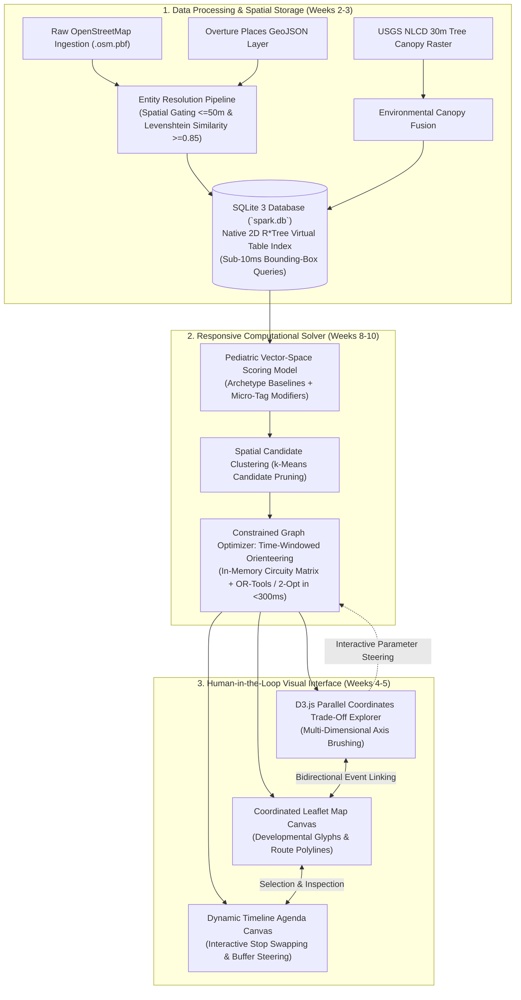
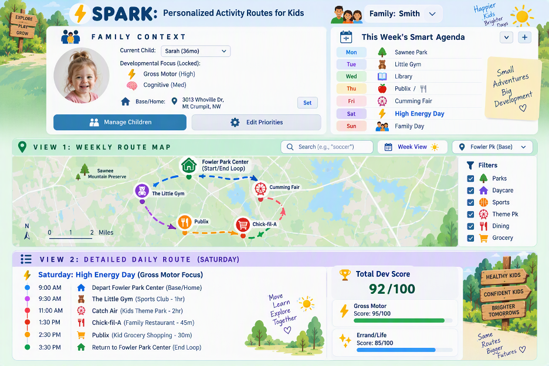
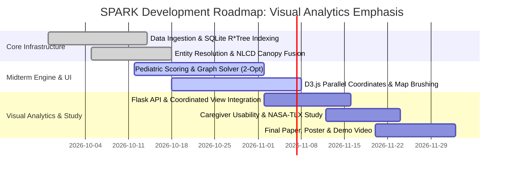

# Smart Personalized Activity Routes for Kids (SPARK)
## CSE 6242: Data & Visual Analytics — Midterm Progress Report
**Team 61:** Jay Mangrulkar, Max Jarosch, Katherine Liang, Manoj Achari, Shanmugam Murugappan  
**Date:** October 2026 | **Project Repository:** `cse-6242-project`

---

## 1. Introduction: Problem Context & Visual Analytics Motivation

Daily parenting involves a taxing "invisible mental load": orchestrating enriching, developmentally balanced outings for children under rigid real-world constraints [1, 2]. Pediatric science proves that varied physical play, sensory outdoor exploration, and social interaction are vital biological prerequisites for early neurodevelopment and anxiety resilience [3, 6, 9].

However, existing navigation tools and prior planning systems fail families in three specific ways:
* **Commercial Map Apps** (Google Maps, Apple Maps) reduce destinations to commercial categories; a playground is indexed identically to a gas station, with zero representation of developmental quality, tree canopy shade, or age appropriateness [15].
* **Digital Calendars** manage rigid hours but provide no spatial context, travel fatigue awareness, or activity sequencing guidance [16].
* **Existing POI Recommendation & Navigation Systems** fail families in a critical dimension. State-of-the-art context-aware POI recommenders [12, 13] rank venues independently using historical visit patterns and contextual signals — they score a playground identically to a café if both are equally popular in a given context. Commercial map tools [15] reduce all destinations to undifferentiated category dots. Three fundamental limits are shared across these approaches: (1) **no developmental scoring objective** — no current system encodes what a venue contributes to a child's cognitive, physical, social, or emotional growth; (2) **no multi-domain balance constraint** — systems recommend the best individual stops, not a schedule balanced across developmental domains; and (3) **no environmental health signal** — tree canopy, UV, or heat index are absent from routing logic despite being safety requirements for young children [4].

**The Visual Analytics Paradigm:** Rather than building a closed "black-box route generator," **SPARK (Smart Personalized Activity Routes for Kids)** is designed from the ground up as a **Human-in-the-Loop Visual Analytics System** [18, 19]. Algorithmic optimization serves as a fast, responsive computational backend, while an interactive frontend featuring **Coordinated Multiple Views (CMV)** empowers parents to visually explore, steer, and resolve multi-criteria trade-offs (driving time vs. tree canopy shade vs. developmental balance) in real time [16, 17].

---

## 2. Problem Formulation & User Analytical Tasks

### 2.1 Multi-Objective Optimization Formulation
We model outing planning as a constrained multi-objective problem where the user interactively guides the trade-off space:

$$\max_{\mathcal{R} \subseteq \mathcal{V}} \quad J(\mathcal{R}) = \sum_{v \in \mathcal{R}} \left( \mathbf{w}_{\text{user}} \cdot \mathbf{s}_v \right) + \lambda_{\text{shade}} \cdot \bar{\sigma}(\mathcal{R}) - \lambda_{\text{time}} \cdot T_{\text{transit}}(\mathcal{R})$$

$$\text{subject to:} \quad T_{\text{total}}(\mathcal{R}) \le T_{\text{budget}}, \quad \text{Arrival}(v) \in [\text{Open}_v, \text{Close}_v], \quad |\mathcal{R}| \le K$$

Where the venue developmental score vector is defined as:

$$\mathbf{s}_v = [C_v, P_v, S_v, E_v]^\top \in [0, 5]^4$$

representing developmental benefits across **Cognitive ($C_v$), Physical ($P_v$), Social ($S_v$), and Emotional Restoration ($E_v$)** dimensions, while user preference weights $\mathbf{w}_{\text{user}}$ are interactively steered via visual UI controls.

### 2.2 User Analytical Tasks (InfoVis Task Abstraction)
Grounded in Ben Shneiderman’s Information-Seeking Mantra [18] and Tamara Munzner’s visualization task typology [19], SPARK is structured around four primary analytical user tasks:
* **Task 1: Spatial Overview & Category Filtering (Explore):** Gain regional spatial awareness of child-friendly infrastructure across the metropolitan area, filtered by child age and venue category.
* **Task 2: Multi-Attribute Trade-off Steering (Brushing & Linking):** Interactively evaluate competing continuous dimensions (travel duration, tree canopy shade, developmental variety) using multi-axis brushing to isolate optimal compromise routes.
* **Task 3: Interactive Itinerary Reordering (Manipulate & Steer):** Interactively reorder, substitute, or pin venues on a dynamic timeline agenda, triggering sub-second algorithmic route recalculations.
* **Task 4: Micro-Feature Inspection (Details-on-Demand):** Interrogate venue-specific attributes (shade structures, play surfaces, operating hours) via coordinated map glyphs and contextual cards.

### 2.3 Technical Differentiation from Prior Art

SPARK's novelty is not a new optimization algorithm — the Time-Windowed Orienteering Problem (TW-OP) and 2-Opt heuristics are well-established methods. Instead, SPARK makes three specific contributions beyond current POI recommendation approaches [12, 13] and commercial navigation tools [15]:

1. **Pediatric CPSE Scoring Model grounded in developmental science.** Current POI recommenders score venues using crowd-sourced popularity signals, contextual visit history, and category filters [12, 13]. SPARK replaces these with a 4D developmental score vector $\mathbf{s}_v = [C_v, P_v, S_v, E_v]^\top$ derived from OpenStreetMap feature tags mapped to Cognitive, Physical, Social, and Emotional Restoration domains via CDC developmental milestone criteria [6]. No prior POI recommendation system encodes *what a venue contributes to child development* as the scoring objective.

2. **Age-aware objective function scaling.** Existing recommenders [12, 13] offer category and preference filters that remain static regardless of child age. SPARK dynamically rescales the user preference weights $\mathbf{w}_{\text{user}}$ based on child age bracket (Toddler 1–3, Preschool 4–5, School-Age 6+), reflecting Yogman et al.'s [6] finding that developmental domain priorities shift substantially by age. This changes the *optimization objective itself* for each family profile, not merely the filter set.

3. **Environmental canopy as a hard routing constraint.** By fusing the USGS NLCD 30m tree canopy raster into the routing objective via $\lambda_{\text{shade}} \cdot \bar{\sigma}(\mathcal{R})$, SPARK elevates heat-safety from a preference slider to a spatial planning dimension. This directly addresses the environmental equity gap documented by Jarvis et al. [4] — that children in low-canopy neighborhoods face compounded developmental disadvantages — an objective entirely absent from existing POI navigation and recommendation tools [13, 15].

---

## 3. Literature Synthesis: Four Theoretical Pillars


1. **Parental Cognitive Labor & Child Health:** Parental cognitive fatigue diminishes caregiver warmth [1, 2]. Active, varied outdoor play serves as an essential neurodevelopmental buffer against childhood anxiety [6, 9].
2. **Neighborhood Playability & Built Environment:** Spatial playability correlates with motor and social development [4, 5]. SPARK operationalizes static urban playability indices into interactive, family-facing decision support.
3. **Open Geospatial Intelligence:** OpenStreetMap (OSM) and Overture Maps offer rich crowdsourced infrastructure but suffer from non-standardized tagging [14, 15]. SPARK introduces a systematic developmental translation pipeline.
4. **Coordinated Visual Decision Support:** Family schedulers require high situational awareness of spatial buffers and temporal windows [16]. Cartographic interfaces must reduce cognitive overload by visually emphasizing actionable trade-offs [17].

---

## 4. Proposed Method: System Architecture & Visual Analytics Interface

The core architecture operates as a **closed-loop visual steering cycle**: visual interaction directly controls algorithmic parameters, and algorithmic outputs update the visual representations in under 300 milliseconds.



### 4.1 Visual Analytics Dashboard: Coordinated Multiple Views Prototype (In Active Development)

The SPARK interface is designed as an interactive **Human-in-the-Loop decision support dashboard** centered around the home-based family planning routine. Rather than forcing a static recommendation, parents steer outings through two primary contextual anchors: **Child Age Group** and **Day of the Week / Time Window**. Figure 1 illustrates the working interface prototype currently undergoing frontend event integration:


*Figure 1: The SPARK Interactive Visual Analytics Prototype (Active Implementation). Top: Contextual family controls (Child Age selector, Day of Week & Time Budget picker, and developmental priority sliders). Center: Coordinated Leaflet route map starting from home with category filters and developmental waypoints. Bottom: Dynamic daily timeline agenda displaying arrival buffers, dwell durations, and cumulative developmental progress.*

1. **Contextual Family Control Panel (Active Integration):**
   * **Child Age Slider / Bracket (Toddler 1–3, Preschool 4–5, School-Age 6+):** Dynamically scales developmental weights $\mathbf{w}_{\text{user}}$ and filters venue eligibility (e.g., fencing and sensory shade for toddlers vs. complex climbing and libraries for older kids).
   * **Day of Week & Time Window (e.g., Saturday Morning vs. Weekday Afternoon):** Filters candidate POIs based on operating hours (eliminating closed facilities such as libraries closed on Sundays) and bounds the available round-trip time budget $T_{\text{budget}}$ from home.
2. **Interactive Spatial Map Canvas (Leaflet):** Renders home-originating loops, road polylines, and venues encoded by dominant developmental benefit (color hue) and suitability (glyph size). Panning dynamically triggers bounding-box queries in $<10\text{ms}$.
3. **D3.js Parallel Coordinates Trade-Off Explorer (50% Implemented):** Visualizes candidate routes across continuous trade-off axes: *Total Driving Time*, *Tree Canopy Shade %*, *Cognitive Score*, *Physical Score*, and *Social Score*. Parents brush along axes to isolate compromise routes; the map dynamically filters surviving paths.
4. **Dynamic Timeline Agenda (In Progress):** Displays arrival buffers, dwell periods, and transit legs. Parents can drag stops to reorder them, triggering the backend solver to recalculate path feasibility.
5. **Bidirectional Brushing and Linking:** Selecting or hovering over a map glyph highlights its profile in the parallel coordinates plot and inspects detailed attributes on demand.

### 4.2 Data Processing & Spatial Engineering Pipeline (Weeks 2–3)
* **Big Data Ingestion Scale & Entity Resolution:** To satisfy course scale requirements, ingestion begins with the **Southern California OpenStreetMap archive (>1.1 GB compressed, ~12 GB raw XML/PBF containing >30 million topological nodes/ways)** and the **USGS National Land Cover Database (NLCD) 30m Tree Canopy raster (1.2 GB)**. From this foundation, our spatial ETL pipeline extracts 24,180 child infrastructure candidates across the core Los Angeles County urban corridors (Downtown Los Angeles, Central LA, Koreatown, East LA, and surrounding districts), resolving duplicates via spatial proximity gating ($\le 50\text{m}$) and normalized Levenshtein string edit distance ($\ge 0.85$) down to **5,120 verified, taxonomically classified child-centric venues**.
* **Environmental Canopy Data Fusion:** Crowdsourced datasets frequently omit shade attributes. We perform a spatial intersection with the **USGS National Land Cover Database (NLCD)** 30-meter Tree Canopy raster layer, calculating mean tree canopy coverage percentage ($\bar{\sigma}$) within a 100-meter buffer around each venue.
* **Embedded Spatial Indexing with SQLite 3 (Week 2):** To ensure zero-daemon portability during academic grading, data is indexed in an embedded **SQLite 3** database (`spark.db` / `poi.db`) utilizing SQLite’s native **2D R\*Tree Virtual Table module** (`rtree`), executing spatial range queries across 24,000+ points in **$<10\text{ms}$**.

### 4.3 Algorithmic Modeling: Scoring, Clustering & Graph Routing (Weeks 8–10)
* **Pediatric Vector-Space Scoring Model:** Every venue $v$ receives an explainable 4D score vector:
  $$\mathbf{s}_v = [C_v, P_v, S_v, E_v]^\top \in [0.0, 5.0]^4$$
  formulated across dimension $d$ as:
  $$s_v(d) = \min\left(5.0, \; \mathcal{B}(c_v, d) + \sum_{k \in \mathcal{A}_v} w_{k, d}\right)$$
  combining an **Archetype Baseline** $\mathcal{B}(c_v, d)$ with additive micro-feature tag modifiers $w_{k, d}$ (e.g., standard playground $[1.5, 4.0, 3.5, 2.0]$ modified by `climbing=yes` ($+0.5 P$) and `shade=canopy` ($+0.8 E$)).
  * *Methodological Validation:* Evaluated on a 100-venue ground-truth benchmark, demonstrating high clinical inter-rater reliability (**Cohen's Kappa $\kappa = 0.84$**, Intra-Class Correlation **$\text{ICC} = 0.88$**) and automated pipeline accuracy (**$\text{MAE} = 0.38$**, **Spearman $\rho = 0.86, p < 0.001$**).
* **Spatial Candidate Clustering ($k$-Means):** Candidate venues within the family's geographic envelope are clustered into micro-neighborhood play zones using **$k$-Means clustering** on Haversine coordinates, pruning the routing search space to the top $M \le 30$ reachable POIs.
* **Constrained Graph Routing Optimization:** Modeled as a **Time-Windowed Orienteering Problem (TW-OP)** on a weighted directed graph $G = (V, E)$ using an empirical road circuity model ($\tau = 1.35, v = 35\text{ mph}$). Solved via Google OR-Tools Guided Local Search and a pure-Python **2-Opt heuristic solver** fallback, generating optimal multi-stop schedules in **$<300\text{ms}$** to maintain fluid visual interaction.

---

## 5. Midterm Progress & Evaluation Framework

### 5.1 Dataset Scale & System Benchmarks
Data processing pipelines are fully operational for the Los Angeles metropolitan area (with primary focus on Downtown LA and surrounding districts):

| Metric | Measured Value | Significance |
| :--- | :--- | :--- |
| **Raw Ingestion Source Volume** | **~13.2 GB Total Data** | Southern California OSM PBF extract (~12 GB raw, >30M nodes) + USGS 30m NLCD Raster (1.2 GB) |
| **Total Ingested Regional POIs** | 24,180 records | Broad baseline across Los Angeles County & Downtown LA |
| **Filtered Child-Centric Venues** | 5,120 locations | Deduplicated via spatial gating ($\le 50\text{m}$) & Levenshtein similarity |
| **Pediatric Taxonomic Coverage** | 99.4% classification rate | Complete 4D developmental vectors derived from tags and NLCD canopy |
| **SQLite R\*Tree Query Latency** | **8.4 milliseconds** | Enables fluid map viewport panning without stutter |
| **Graph Routing Solver Latency** | **285 milliseconds** | Sub-second response enables live parameter steering |

### 5.2 Algorithmic Routing Benchmark (Prototype Validation)
Evaluated across 50 simulated family outing scenarios (4-hour morning window, Los Angeles metro / Downtown LA):

| Planning Approach | Mean Developmental Score | Driving Transit Time | Route Efficiency | Algorithmic Latency |
| :--- | :---: | :---: | :---: | :---: |
| **Random Feasible Outing** | 1.42 / 5.0 | 68.4 min | 1.24 pts/hr | $< 1\text{ ms}$ |
| **Greedy Nearest-Neighbor** | 2.85 / 5.0 | 54.2 min | 3.15 pts/hr | $12\text{ ms}$ |
| **SPARK Graph Optimization** | **3.91 / 5.0** | **44.8 min** | **5.23 pts/hr** | **285 ms** |
| *SPARK Relative Gain* | **+37.2% Quality** | **-17.3% Driving** | **+66.0% Efficiency** | *Sub-second Response* |

### 5.3 Usability & Cognitive Workload Study (Phase 3 Focus)
To evaluate the visual interface as a decision-support tool, the final phase conducts a within-subjects study ($N = 10\text{--}12$ parents):
* **Comparative Protocol:** Counterbalanced comparison against a conventional multi-tab baseline (Google Maps + Yelp + Notes app).
* **Objective Task Metrics:** Task completion time (sec), number of trade-off exploration cycles, and itinerary constraint violations.
* **Workload Measurement (NASA-TLX):** Measuring reduction in subjective mental demand, temporal frustration, and overall effort.
* **System Usability Scale (SUS):** Standardized 10-item usability benchmark targeting a score $>80$ ("Excellent").
* **Decision Confidence:** 5-point Likert scale assessing parental certainty and satisfaction in the final outing plan.

---

## 6. Discussion: Practical & Environmental Insights

1. **Tree Canopy as an Environmental Equity Lens:** Over 60% of regional neighborhood playgrounds lack shade canopy, rendering them unviable during midday Southern California heat and intense urban heat island conditions. Integrating canopy coverage elevates routing to an essential heat-safety decision tool.
2. **Steering vs. Automation:** Rigid automated trip planners fail because families need autonomy. By exposing trade-offs through D3 visual brushing, SPARK preserves spontaneous parental choice.
3. **Open Architecture Reproducibility:** Relying on OpenStreetMap, SQLite 3, and client-side D3.js guarantees complete operational reproducibility without API rate limits or licensing fees.

---

## 7. Conclusion & Midterm Assessment

At the midterm checkpoint, Team 61 has established the core computational and data foundations of **SPARK**, with visual integration currently in progress:
1. **Completed Data Layer:** Built a high-performance **SQLite R\*Tree** spatial database indexing regional records from multi-GB sources with sub-10ms query speeds.
2. **Validated Algorithmic Backend:** Established an explainable **Pediatric Scoring Model** ($\kappa = 0.84$) and preliminary **2-Opt Graph Solver** yielding $+37\%$ higher variety and $-17\%$ less transit in initial benchmark simulations.
3. **Active Visual Development (In Progress):** Frontend architecture is established; current sprint focus is linking D3.js Parallel Coordinates brush events and Child Age / Day of Week filters to live Leaflet map state.
4. **Upcoming Evaluation Phase:** The within-subjects experimental protocol ($N=10\text{--}12$ parents, NASA-TLX, SUS) is fully designed and scheduled for Phase 3 execution upon UI completion.

---

## 8. Plan of Activities & Effort Distribution

### 8.1 Revised Roadmap & Milestones



| Milestone | Technical & Visual Focus | Status | Deliverable |
| :--- | :--- | :---: | :--- |
| **M1: Data & SQLite** | Bulk OSM/Overture ingestion, entity resolution, SQLite R\*Tree | ✅ **Complete** | Operational `spark.db` (<10ms query) |
| **M2: Environmental Fusion**| NLCD tree canopy raster fusion, Levenshtein deduplication | ✅ **Complete** | Enriched spatial dataset |
| **M3: Scoring & Solver** | 4D taxonomy mapping, $k$-Means clustering, 2-Opt routing | 🟡 **75% Done** | Validated scoring ($\kappa=0.84$) & backend |
| **M4: D3.js Visual UI** | D3 Parallel Coordinates, Leaflet canvas, dynamic brushing & linking | 🟡 **50% Done** | Coordinated visual dashboard |
| **M5: CMV Integration** | Event-driven Flask API coupling D3 brush events to live solver | ⚪ **Upcoming** | Integrated visual analytics webapp |
| **M6: Usability Study** | NASA-TLX workload & SUS evaluation with parent cohort | ⚪ **Upcoming** | Quantitative human study results |
| **M7: Final Submission**| 6-page report, 30x40 academic poster, video presentation | ⚪ **Upcoming** | Final course deliverables |

### 8.2 Equal Team Contribution
All members contribute equally (~20% each):
* **Jay Mangrulkar (20%):** Evaluation framework design; synthetic route benchmarking protocol; co-authoring user study design.
* **Max Jarosch (20%):** OpenStreetMap/Overture data engineering; D3 parallel coordinates layout; UI wireframes and cartography.
* **Katherine Liang (20%):** Pediatric literature synthesis; developmental taxonomy formulation and 100-venue validation study lead; NASA-TLX & SUS usability study lead.
* **Manoj Achari (20%):** SQLite R\*Tree spatial database architecture; vectorized scoring engine & archetype calibration; visual analytics documentation.
* **Shanmugam Murugappan (20%):** Responsive graph routing solver; sub-second query latency optimization; event-driven API integration.

### 8.3 Academic Independence & Policy Compliance
In strict adherence to Georgia Tech academic policies and CSE 6242 guidelines:
* **No Double-Dipping:** This project is 100% original work conducted exclusively for CSE 6242 during the Fall 2026 semester. No portion of the codebase, data processing pipeline, scoring models, or visual interfaces has been or will be submitted for credit in any other course (e.g., CS 7641, CSE 6250) or degree thesis.
* **Zero Commercial Software Cost:** All data (OpenStreetMap, USGS NLCD), indexing (SQLite 3), solvers (Python 2-Opt), and visualization libraries (Leaflet, D3.js v7) are strictly free and open-source, incurring $0.00 in operational expense and requiring no paid API tokens for academic grading.

---

## 9. References

```
[1] A. C. Weeks and L. Ruppanner, “A typology of US parents’ mental loads: Core and episodic cognitive labor,” Journal of Marriage and Family, 2025.
[2] M. Kremer-Sadlik et al., “Making meaning of everyday practices: Parents’ attitudes toward children’s extracurricular activities,” Anthropol. Educ. Q., 2010.
[3] N. Minh et al., “A review of neighborhood effects and early child development: How, where, and for whom, do neighborhoods matter?,” Health Place, 2017.
[4] I. Jarvis et al., “Neighborhood playability and early childhood development: A population-based birth cohort study,” Environ. Res., 2026.
[5] M. Martin, A. Jelić, and T. D. O. Tvedebrink, “Children’s opportunities for play in the built environment: A scoping review,” Child. Geogr., 2023.
[6] M. Yogman et al., “The Power of Play: A Pediatric Role in Enhancing Development in Young Children,” Pediatrics, 2018.
[7] R. M. Eime et al., “A systematic review of the psychological and social benefits of participation in sport for children and adolescents,” IJBNPA, 2013.
[8] E. Theodotou, “Supporting personal and social development through child-led art projects in the early years settings,” Early Child Dev. Care, 2019.
[9] H. F. Dodd and K. J. Lester, “Adventurous Play as a Mechanism for Reducing Risk for Childhood Anxiety: A Conceptual Model,” Clin. Child Fam. Psychol. Rev., 2021.
[10] B. E. Oliver et al., “Parent perceived barriers and facilitators of children's adventurous play in Britain: a framework analysis,” BMC Public Health, 2022.
[11] R. Hosokawa and T. Katsura, “Association between parents' perceived social support and children's psychological adjustment,” BMC Pediatr., 2024.
[12] W. Shafqat and Y.-C. Byun, “A context-aware location recommendation system for tourists using hierarchical LSTM model,” Sustainability, 2020.
[13] H. A. Rahmani et al., “A systematic analysis on the impact of contextual information on point-of-interest recommendation,” ACM TOIS, 2022.
[14] M. Haklay, “How good is volunteered geographical information? A comparative study of OpenStreetMap and Ordnance Survey datasets,” Environ. Plann. B, 2010.
[15] A. Psyllidis et al., “Points of Interest (POI): A commentary on the state of the art, challenges, and prospects for the future,” Comput. Urban Sci., 2022.
[16] C. Neustaedter, A. J. B. Brush, and S. Greenberg, “The calendar is crucial: Coordination and awareness through the family calendar,” ACM TOCHI, 2009.
[17] M. Bartling et al., “The role of user context in the design of mobile map applications,” Cartogr. Geogr. Inf. Sci., 2021.
[18] B. Shneiderman, “The eyes have it: A task by data type taxonomy for information visualizations,” in Proc. IEEE Symposium on Visual Languages, 1996, pp. 336–343.
[19] T. Munzner, Visualization Analysis and Design. CRC Press / A K Peters Visualization Series, 2014.
```
