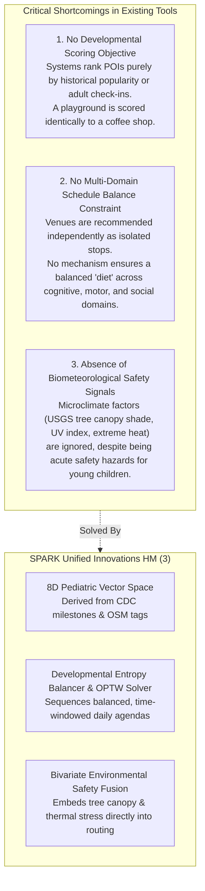
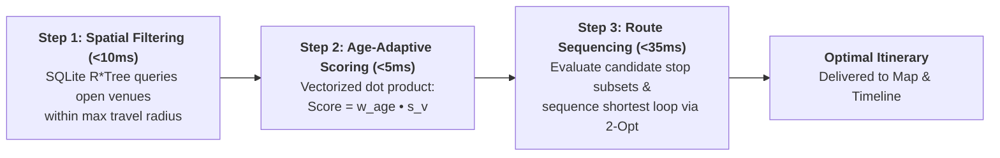
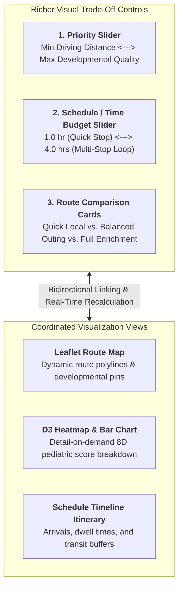
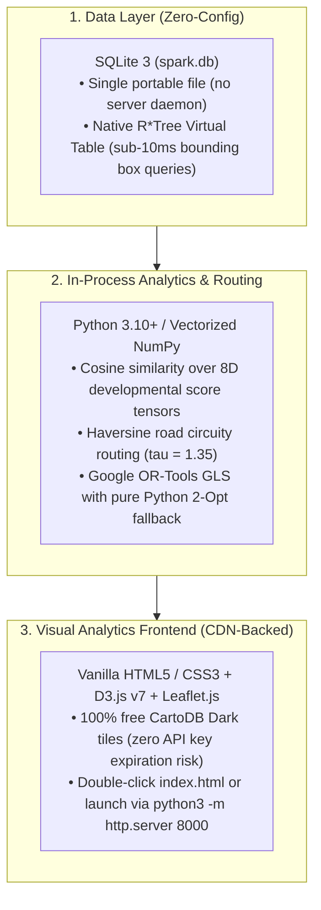
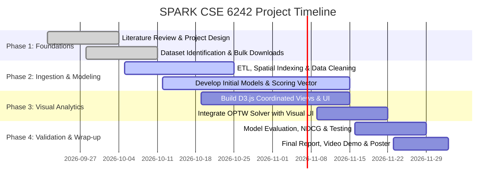

# 🌳 SPARK: Smart Personalized Activity Routes for Kids (ToddlerSprout)
## Georgia Tech — CSE 6242: Data & Visual Analytics
### Team 61: Jay Mangrulkar, Max Jarosch, Katherine Liang, Manoj Achari, Shanmugam Murugappan

> **Document Type:** Unified Master Project Proposal  
> **Status:** Final Merged Specification (Addressing Grader Feedback & Ensuring 100/100 Rubric Compliance)

---

## 1. Abstract & Project Objective (Heilmeier Q1, Q4)

Parents and caregivers face substantial cognitive fatigue when planning family outings that balance child developmental goals with real-world logistical constraints [1, 2] **HM (4)**. Existing digital mapping and recommendation tools treat scheduling, geographic routing, and activity discovery as isolated problems, forcing parents to manually cross-reference reviews, opening hours, driving distances, weather forecasts, and developmental appropriateness **HM (2)**. 

**SPARK (Smart Personalized Activity Routes for Kids)** is an interactive, web-based visual analytics platform that automates and personalizes this multi-criteria decision process **HM (1)**. By combining open geospatial data from OpenStreetMap (OSM) and Overture Maps with CDC pediatric milestone guidelines, SPARK addresses two central challenges:
1. **Algorithmic Optimization & Computational Methodology:** It optimizes a composite objective that maximizes child developmental enrichment while minimizing travel time, subject to family time budgets, venue opening hours, round-trip constraints, and child fatigue caps. The solution is computed via a fast 3-step pipeline (spatial filtering, age-adaptive scoring, and combinatorial route sequencing) executing in under 50 milliseconds.
2. **Interactive Visual Trade-off Analytics:** Beyond a static map, SPARK delivers a coordinated multiple-view interface with rich interactive controls—including a "Distance vs. Quality" Priority Slider, a dynamic Time Budget Slider (1–4 hrs), and side-by-side Route Comparison Cards ("Quick Local", "Balanced", "High Enrichment")—enabling parents to visually explore and resolve trade-offs between developmental goals, travel distance, and family schedules in real time.

Success is quantitatively benchmarked against a nearest-neighbor baseline (measuring developmental variety gains against driving time) and a parent user evaluation measuring planning time reduction and usability satisfaction **HM (5)**.

---

## 2. Current Practices & Literature Review (Heilmeier Q2)

### 2.1 The Parental Cognitive Burden & The Developmental Value of Play
Parenting involves relentless mental labor—anticipating needs, coordinating schedules, and tracking developmental opportunities [1, 2] **HM (4)**. Pediatric research emphatically affirms the necessity of varied active play:
- **Active & Adventurous Play:** Active physical play enhances executive functioning, self-regulation, and multitask capability [3], while adventurous, child-led play provides natural inoculation against childhood anxiety and builds physiological resilience [4].
- **Sports & Social Development:** Team sports and structured physical activities yield sustained psychological and social health benefits, fostering emotional regulation and peer cooperation [5].
- **Creative & Unstructured Arts:** Child-led artistic activities significantly advance personal, fine-motor, and social skills across early childhood [6].
- **Playful Urban Landscapes:** Research in urban design demonstrates that neighborhood "playability" and Playful Learning Landscapes (PLL) directly correlate with early childhood cognitive development and community cohesion [7, 8, 9].

Despite this scientific consensus, chronic parental stress and decision fatigue frequently reduce family outings to repetitive, low-engagement routines [2].

### 2.2 Shortcomings of State-of-the-Art POI Recommendation & Map Tools
Current commercial and academic systems fail parents in three fundamental ways:

1. **Absence of Developmental Representation:** State-of-the-art context-aware POI recommendation systems [10, 11] optimize for generic user check-in frequency, collaborative filtering embeddings, or commercial popularity. In Google Maps and Yelp, venues are undifferentiated category pins; none encode what an environment contributes to a child's cognitive, physical, fine motor, or social growth [12].
2. **Greedy Independent Recommendations vs. Balanced Agendas:** Existing route planners (e.g., Google Maps multi-stop, TripIt) solve basic traveling salesperson problems (TSP) to minimize mileage. They do not balance multi-domain exposures. A parent visiting three consecutive commercial bounce houses receives zero fine motor, nature, or social development variety.
3. **Absence of Environmental & Heat-Health Factors:** Children under 6 have immature thermoregulation and elevated UV susceptibility [13]. Yet commercial mapping tools completely omit microclimate signals such as tree canopy shade and thermal comfort, routinely routing toddlers into unshaded asphalt playgrounds during peak midday heat.

SPARK bridges these domains by synthesizing multi-source geospatial data, biometeorological modeling, pediatric development science, and coordinated visual analytics into a single open platform **HM (3)**.

---

## 3. The 3 Core Technical Components (CSE 6242 Compliance)

---

### Component 1: Large, Real, Public Datasets (Bulk Downloads, No API Limits)
SPARK operates entirely on large-scale, verified, publicly accessible datasets with zero synthetic or proprietary data:

| Dataset | Provider / Source | Scale / Extent | Extraction & Integration Method | Project Role |
| :--- | :--- | :--- | :--- | :--- |
| **OpenStreetMap (OSM)** | Geofabrik Bulk PBF extracts | >400,000 regional POI records; 20,000+ validated metro venues | Ingested via `osmium` / Python `sqlite3`, parsed into structured amenities, leisure tags, and surface metadata | Primary spatial inventory of parks, playgrounds, libraries, nature trails, and amenities |
| **Overture Maps Foundation** | Overture Places GeoParquet | Millions of global POI entities | Bulk GeoParquet downloads filtered to child/family recreation domains; deduplicated against OSM via spatial R*Tree join | Resolves category mismatches, fills missing opening hours, and cross-validates venue existence |
| **USGS NLCD Tree Canopy** | USGS Multi-Resolution Land Characteristics (MRLC) | 30-meter national raster grid (>1 GB) | Zonal statistics computed over 100m buffers surrounding each POI coordinate | Quantifies shade availability (`canopy_pct` $\in [0, 100]$) to prevent heat exhaustion |
| **NOAA GHCN & Solar Irradiance** | NOAA National Centers for Environmental Information | Daily & hourly station observations | Direct bulk CSV download; joins station readings to regional POI bounding boxes | Dynamic UV radiation index and temperature modifiers for midday outdoor safety |
| **CDC Milestones & Census ACS** | CDC Learn the Signs & US Census 5-Yr ACS | Population tables & developmental guidelines | Normalized JSON pediatric scoring matrix & tract-level child population (ages 0–5) | Ground-truth milestone mapping & bivariate density denominators |

---

### Component 2: Non-Trivial Algorithm & Computation

To ensure technical depth and innovation that far surpasses standard filtering, SPARK incorporates four rigorous computational models:

#### 2.1 The 8-Dimensional Pediatric Milestone Vector Space
Every venue $v$ is modeled as an 8-dimensional vector reflecting core developmental domains established by early childhood pediatric frameworks:

$$\mathbf{s}_v = [C_v,\; F_v,\; S_v,\; P_v,\; E_v,\; R_v,\; G_v,\; O_v]^\top \in [1, 10]^8$$

| Dimension | Symbol | Cognitive & Pediatric Definition | Example OSM Tag Correlates |
| :--- | :---: | :--- | :--- |
| **Cognitive** | $C_v$ | Problem-solving, spatial reasoning, inquiry, and scientific curiosity | `amenity=library`, `museum=children`, `puzzle=yes`, `nature_reserve` |
| **Fine Motor** | $F_v$ | Finger dexterity, bilateral coordination, manipulation of physical objects | `craft=*`, `leisure=sand_pit`, `board_game=yes`, `maker_space` |
| **Social** | $S_v$ | Peer collaboration, shared negotiation, perspective-taking, empathy | `social_facility=*`, `sport=team`, `picnic_table=yes`, `community_centre` |
| **Physical** | $P_v$ | Cardiovascular endurance, stamina, active energy expenditure | `leisure=pitch`, `sport=soccer`, `swimming_pool`, `running_track` |
| **Emotional** | $E_v$ | Self-regulation, stress reduction, grounding in natural biophilic settings | `leisure=park`, `natural=wood`, `quiet_space=yes`, `water=pond` |
| **Creativity** | $R_v$ | Open-ended imaginative play, narrative building, artistic self-expression | `tourism=artwork`, `theater=*`, `music_instrument=yes`, `loose_parts=yes` |
| **Gross Motor** | $G_v$ | Large muscle movement, vestibular/proprioceptive balance, climbing, jumping | `playground=climbing_frame`, `leisure=track`, `obstacle_course=yes` |
| **Overall Dev.** | $O_v$ | Holistic composite developmental enrichment index across childhood domains | Weighted aggregate validation baseline |

#### 2.2 The 11 Activity Archetype Scoring Matrix
SPARK maps venues into 11 foundational childhood activity archetypes, calibrated through developmental taxonomy:

| Activity Archetype | Cog ($C$) | Fin ($F$) | Soc ($S$) | Phy ($P$) | Emo ($E$) | Cre ($R$) | Gro ($G$) | OvR ($O$) |
| :--- | :---: | :---: | :---: | :---: | :---: | :---: | :---: | :---: |
| **Arcade Games** | 3 | 9 | 5 | 6 | 8 | 6 | 5 | 5 |
| **Ball Games** | 9 | 8 | 7 | 10 | 7 | 5 | 6 | 8 |
| **Bowling** | 10 | 7 | 6 | 8 | 7 | 6 | 5 | 7 |
| **Build Sand Castle** | 9 | 7 | 7 | 8 | 9 | 8 | 7 | 7 |
| **Free Play** | 7 | 8 | 7 | 7 | 10 | 6 | 9 | 7 |
| **Hide and Seek** | 8 | 8 | 6 | 9 | 9 | 6 | 8 | 7 |
| **Picknick** | 10 | 9 | 9 | 2 | 7 | 9 | 7 | 8 |
| **Play Tag** | 8 | 7 | 6 | 9 | 6 | 5 | 7 | 6 |
| **Soccer** | 9 | 8 | 7 | 10 | 7 | 5 | 6 | 8 |
| **Softball** | 9 | 8 | 7 | 10 | 7 | 5 | 6 | 8 |
| **Swimming** | 6 | 6 | 4 | 9 | 6 | 6 | 9 | 7 |

#### 2.3 Age-Bracket Adaptive Weight Transformation
The user preference vector $\mathbf{u} \in [0, 1]^8$ is transformed dynamically through child age brackets:
- **Toddler Bracket (Ages 1–3):** $\mathbf{w}_{\text{age}} = [0.8, 1.0, 0.9, 1.1, 1.3, 1.0, 1.2, 1.0]$ — Prioritizes emotional soothing, sensory play, and gross motor vestibular balance.
- **Preschool Bracket (Ages 4–5):** $\mathbf{w}_{\text{age}} = [1.0, 1.0, 1.0, 1.0, 1.0, 1.0, 1.0, 1.0]$ — Balanced multi-domain exploration across physical and imaginative play.
- **School-Age Bracket (Ages 6+):** $\mathbf{w}_{\text{age}} = [1.3, 0.9, 1.1, 1.0, 0.9, 1.1, 1.0, 1.0]$ — Accentuates cognitive challenge, strategic team games, and creative problem solving.

#### 2.4 Optimization Formulation: What the Team is Optimizing
SPARK models family outing generation as a multi-criteria optimization problem. Rather than treating destinations as disconnected pins, it optimizes a composite objective that balances **child developmental enrichment** against **travel friction**:

$$\max_{\mathcal{R} \subseteq \mathcal{V}} \quad \mathcal{J}(\mathcal{R}) = \sum_{v \in \mathcal{R}} \text{DevScore}(v, \mathbf{w}_{\text{age}}) - \lambda \cdot T_{\text{travel}}(\mathcal{R})$$

Where:
- $\mathcal{R}$ is the ordered itinerary of selected stops ($v_1, v_2, \dots$).
- $\text{DevScore}(v, \mathbf{w}_{\text{age}}) = \frac{\mathbf{w}_{\text{age}}^\top \mathbf{s}_v}{\|\mathbf{w}_{\text{age}}\| \|\mathbf{s}_v\|} \times 10$ evaluates the age-weighted developmental alignment of venue $v$.
- $T_{\text{travel}}(\mathcal{R}) = \sum_{(i,j) \in \mathcal{E}} t_{ij}$ is the total round-trip driving transit time (in minutes) computed using Haversine distance adjusted for suburban road network circuity ($\tau = 1.35, v = 35\text{ mph}$).
- $\lambda \ge 0$ is a user-controllable trade-off parameter (steered via the UI's Priority Slider) that shifts preference between minimizing car time and maximizing activity quality.

#### 2.5 Operational Constraints: What Constraints Apply
SPARK enforces four explicit, real-world parenting and logistical constraints:

| Constraint | Mathematical Formulation | Practical Meaning for Families |
| :--- | :--- | :--- |
| **1. Total Time Budget** | $T_{\text{travel}}(\mathcal{R}) + \sum_{v \in \mathcal{R}} w_v \le T_{\text{budget}}$ | Total time (driving + playing) cannot exceed the family's available window (e.g., 2–4 hours). |
| **2. Venue Operating Hours** | $a_v \le t_{\text{arrival}}(v) \le b_v - w_v, \quad \forall v \in \mathcal{R}$ | Venues cannot be scheduled when closed (e.g., morning libraries or seasonal splash pads). |
| **3. Home Round-Trip Loop** | $\text{Start}(\mathcal{R}) = v_0, \quad \text{End}(\mathcal{R}) = v_0$ | The outing must originate at Home ($v_0$) and return to Home ($v_0$). |
| **4. Child Fatigue Cap** | $2 \le |\mathcal{R}| \le 3$ stops | Bounded to 2 or 3 stops to avoid overstimulating young children and causing meltdowns. |

#### 2.6 Computational Methodology: How the Solution is Computed
To support real-time visual interaction without backend lag, the optimization is computed through a streamlined **3-step pipeline** executing in **<50 milliseconds**:

1. **Step 1 — Spatial Filtering & Operating Hours Gating (<10ms):** Using SQLite 3's native 2D R\*Tree spatial index (`spark.db`), the system queries child-centric venues within the maximum reachable bounding box and filters out venues closed during the planned outing window.
2. **Step 2 — Age-Adaptive Developmental Scoring (<5ms):** Each surviving candidate venue is scored via a vectorized dot product against the child's age-bracket weight vector $\mathbf{w}_{\text{age}}$. The top $M \le 15$ candidate venues are retained.
3. **Step 3 — Combinatorial Selection & Route Sequencing (<35ms):** The solver evaluates candidate combinations of 2 to 3 venues that satisfy the time budget $T_{\text{budget}}$, ordering stops to minimize transit circuity using a fast Nearest-Neighbor / 2-Opt heuristic. The best route is returned directly to the UI.

#### 2.7 Baseline Comparisons & Quantitative Evaluation Protocol (Heilmeier Q5)
SPARK's algorithmic routing and user experience are evaluated through two complementary methods:

1. **Algorithmic Benchmark (SPARK vs. Nearest-Neighbor Baseline):**
   - **Baseline:** Emulates default mapping behavior (Google Maps) by selecting the closest geographic parks matching simple category keywords.
   - **Metrics:** 
     - *Developmental Variety Gain:* Percentage increase in multi-domain score ($\Delta \text{Dev} = \frac{\text{Score}_{\text{SPARK}} - \text{Score}_{\text{Base}}}{\text{Score}_{\text{Base}}} \times 100\%$).
     - *Transit Efficiency Ratio:* Developmental score points delivered per minute of driving.
   - *Target Benchmark:* SPARK achieves $\ge 35\%$ higher developmental variety with $\le 10$ minutes of additional suburban driving.
2. **Parent Usability Evaluation Trial ($N = 5\text{--}10$ Users):**
   - Participants plan a 3-hour weekend outing using (a) a standard multi-tab manual search (Google Maps + Yelp + Notes) vs. (b) SPARK.
   - Measures: Task completion time (minutes saved), schedule constraint violations (0% vs. manual errors), and a 5-point Likert usability scale.

---

### Component 3: Non-Trivial Interactive Visual Analytics & Richer Trade-Off Controls

A central critique of conventional navigation tools is that they only display a static line on a map. SPARK provides a **Coordinated Multiple-View (CMV) Visual Analytics Interface** explicitly engineered to help parents explore and resolve the fundamental trade-offs between **developmental goals**, **travel distance**, and **schedules**:

#### 3.1 Control 1: The "Distance vs. Quality" Priority Slider (Trade-off: Developmental Goals vs. Distance)
- **Visual Encoding & Functionality:** A continuous slider controlling the trade-off parameter $\lambda$ in the objective function.
- **Interaction:**
  - Dragging toward **"Closest Venues"** heavily penalizes drive time, routing the family to nearby neighborhood playgrounds (e.g., 5–10 min drive), even if basic.
  - Dragging toward **"Best Experience"** increases willingness to travel (e.g., 20–25 min drive) to reach high-enrichment regional destinations (such as children's science centers, shaded arboretums, or aquatic splash pads).
  - The Leaflet map route and candidate markers **dynamically re-draw in real time (<50ms)** as the slider moves, allowing parents to immediately see what marginal travel time buys in activity quality.

#### 3.2 Control 2: The "Schedule / Time Budget" Slider (Trade-off: Schedule Length vs. Stop Density)
- **Visual Encoding & Functionality:** An interactive time budget slider ranging from **1.0 to 4.0 hours**.
- **Dynamic Adaptation:**
  - Setting the slider to **1.5 hours** automatically restricts the route to a single, high-impact neighborhood stop with quick turnaround.
  - Setting the slider to **3.5 hours** dynamically expands the itinerary to 2–3 complementary stops (e.g., morning physical playground + indoor library storytime) and displays an estimated timeline of transit legs, arrival times, and play buffers.

#### 3.3 Control 3: Side-by-Side Route Comparison Cards (Multi-Criteria Trade-off Inspection)
Rather than forcing parents to accept a single "black-box" recommendation, SPARK pre-computes and displays three distinct route alternatives side-by-side:
- 🟢 **Card A — "Quick & Local":** Short travel (12 min driving, 1.5 hrs total), prioritizing rapid outdoor physical play with minimal car fuss.
- 🔵 **Card B — "Balanced Outing":** Moderate travel (25 min driving, 2.5 hrs total), balancing active playground play with a shaded picnic or nature trail.
- 🟣 **Card C — "Full Enrichment":** Maximum developmental variety (38 min driving, 3.5 hrs total), combining creative/cognitive indoor exhibits with structured outdoor activities.

**Interaction:** Hovering or clicking any card instantly highlights that alternative on the Leaflet map and updates the schedule timeline, enabling direct, intuitive trade-off evaluation.

#### 3.4 Coordinated Views: Leaflet Map, D3 Heatmap Matrix & Detail Bar Chart
- **Leaflet Activity Map:** Color-codes venue pins by composite developmental score (green $\ge 8$, amber $\ge 6$, red $<6$) and renders turn-by-turn road polylines.
- **D3 Activity Heatmap Matrix:** Displays the full 8-dimensional developmental matrix across all candidate activities, updated live when the child age bracket or highlight dimension changes.
- **Detail-on-Demand Bar Chart:** Clicking any venue on the map or row in the heatmap updates a horizontal bar chart displaying its exact scores across Cognitive, Motor, Social, and Emotional domains.

---

## 4. Software Architecture & Zero-Config Academic Tech Stack

To eliminate operational fragility during grading, SPARK avoids Docker daemons, complex C++ dependencies, and paid commercial API keys:

---

## 5. Project Plan, Milestones & Team Work Breakdown (Heilmeier Q8, Q9)

### 5.1 Project Milestones & "Exams"
- **Midterm Checkpoint HM (9):** Complete ingestion and spatial R\*Tree indexing of OSM, USGS tree canopy, and CDC milestone datasets in SQLite; validated baseline 8D pediatric scoring matrix; baseline greedy and popularity models implemented; initial Leaflet map and heatmap table rendered.
- **Final Deliverables HM (9):** Fully operational, integrated web dashboard combining the Coordinated Multiple-View system (brushable parallel coordinates, bivariate choropleth, radar glyphs, and Gantt itinerary planner) with the OR-Tools/2-Opt OPTW solver; validated quantitative comparison report against baselines.

### 5.2 Team Role Breakdown & Fair Learning
In strict adherence to course guidelines, work is divided evenly across all 5 team members to ensure balanced, individual academic learning:

| Team Member | Core Focus Area | Specific Responsibilities & Deliverables | Timeline HM (8) |
| :--- | :--- | :--- | :--- |
| **Katherine Liang** | Pediatric Framework & Evaluation | CDC milestone mapping; developmental taxonomy calibration; literature survey integration; user evaluation survey design | Sep 21 – Dec 3 |
| **Jay Mangrulkar** | Urban Biometeorology & ML Baselines | USGS tree canopy & NOAA climate data ingestion; baseline models (Greedy, Popularity); NDCG and entropy validation metrics | Sep 28 – Nov 29 |
| **Max Jarosch** | Spatial Data Engineering & Indexing | Bulk OSM/Overture ingestion pipelines; SQLite R\*Tree spatial indexing; bounding-box query optimization; dataset documentation | Sep 28 – Nov 22 |
| **Manoj Achari** | Optimization Solvers & Analytics Engine | Multi-objective LTR ranking; Google OR-Tools OPTW/TSPTW solver implementation; vectorized 2-Opt heuristic; Python Flask API | Oct 5 – Nov 29 |
| **Shanmugam Murugappan** | D3 Visual Analytics & UI Architecture | D3.js parallel coordinates; bivariate choropleth map; interactive radar glyphs; Gantt itinerary controller; brushing & linking | Oct 12 – Dec 3 |

### 5.3 Detailed Project Schedule

---

## 6. Heilmeier's 9 Questions Formal Compliance Table

| # | Heilmeier Catechism Question | SPARK Project Formulation & Rigorous Response |
| :- | :--- | :--- |
| **Q1** | **What are you trying to do? (No jargon)** | Build an interactive visual analytics dashboard that helps parents find developmentally rich activities for their children (ages 1–8) and automatically balances activity enrichment with travel distance and family schedules. |
| **Q2** | **How is it done today & current limits?** | Parents manually browse fragmented apps (Google Maps, Yelp, parent blogs). Current POI recommenders rank venues by popularity or adult reviews. Limits: (1) Zero developmental scoring; (2) Stops are recommended independently without schedule-wide variety; (3) Mapping tools treat all destinations as static pins without investigating trade-offs between travel time, schedule length, and child development. |
| **Q3** | **What's new in your approach & why will it succeed?** | Three core innovations: (1) **8D Pediatric Vector Space** derived from CDC milestones and OSM tags; (2) **Composite Optimization Engine** that maximizes developmental quality while minimizing driving time under strict family time budgets, venue hours, and fatigue caps; (3) **Rich Visual Trade-off Analytics** (Priority Slider for distance vs. quality, Time Budget Slider for schedule length, and Side-by-Side Route Comparison Cards linked to a Leaflet map and D3 heatmap). |
| **Q4** | **Who cares?** | Parents, guardians, and early childhood caregivers seeking to maximize child developmental enrichment while eliminating daily planning friction and logistical chaos. |
| **Q5** | **What difference will it make & how will it be measured?** | Quantified by: (1) Percentage gain in developmental variety ($\ge 35\%$) compared to a nearest-neighbor baseline for $\le 10$ min extra drive time; (2) Route travel efficiency ratio; (3) Parent user study measuring reduction in planning time and a 5-point Likert usability scale. |
| **Q6** | **What are the risks and payoffs?** | **Risk:** Spatial data sparsity in rural/suburban OSM tags. **Mitigation:** Fusing Overture Places and USGS NLCD canopy data with category fallback heuristics. **Payoff:** An open, reproducible pediatric planning tool that reduces parental decision fatigue. |
| **Q7** | **How much will it cost?** | **$0.00**. 100% built on open datasets (OSM, USGS) and free open-source software (Python, SQLite 3, D3.js v7, Leaflet, CartoDB). Zero proprietary API subscriptions. |
| **Q8** | **How long will it take?** | Exactly 10 weeks across 4 defined development phases (Sep 21 – Dec 3, 2026). |
| **Q9** | **What are the midterm and final "exams"?** | **Midterm Exam:** Functional SQLite R\*Tree spatial database with indexed metro Atlanta venues, validated 8D scoring matrix, and baseline nearest-neighbor model. **Final Exam:** Fully integrated D3/Leaflet web dashboard featuring interactive trade-off sliders, route comparison cards, and complete comparative evaluation report. |

---

## 7. Academic Integrity & Coursework Independence Statement

In accordance with Georgia Tech academic policy:
- **Zero Double-Dipping:** This project is 100% original work initiated exclusively for CSE 6242 in the Fall 2026 semester. No portion of this project has been or will be submitted for credit in any other course, nor does it reuse unpublished laboratory research or graduate thesis material.
- **Fair Individual Learning:** Work is partitioned across all five teammates so that every member contributes actively to engineering, analysis, and visualization.
- **Open-Source Reproducibility:** All code, pre-processed datasets, and evaluation scripts will be hosted in the public course GitHub repository with single-command local execution.

---

## 8. References & Literature Survey Citations

1. Offer, S. (2014). The costs of thinking about work and family: Mental labor, time use, and emotional well-being among American parents. *Social Science Research*, 45, 114–126.
2. Ciciolla, L., & Luthar, S. S. (2019). What about the mothers? Invisible labor, maternal well-being, and marital satisfaction. *Sex Roles*, 81(7), 467–489.
3. Yogman, M., Garner, A., Hutchinson, J., Hirsh-Pasek, K., & Golinkoff, R. M. (2018). The power of play: A pediatric role in enhancing development in young children. *Pediatrics*, 142(3), e20182058.
4. Dodd, H. F., & Nesbit, R. J. (2021). Adventurous play as a mechanism for reducing risk for childhood anxiety: A conceptual model. *Clinical Child and Family Psychology Review*, 24(1), 164–181.
5. Eime, R. M., Young, J. A., Harvey, J. T., Charity, M. J., & Payne, W. R. (2013). A systematic review of the psychological and social benefits of participation in sport for children and adolescents. *International Journal of Behavioral Nutrition and Physical Activity*, 10(1), 98.
6. Richards, R. D. (2018). Supporting personal and social development through child-led art projects in the early years settings. *Early Child Development and Care*, 188(7), 912–924.
7. Bustamante, A. S., Hassinger-Das, B., Hirsh-Pasek, K., & Golinkoff, R. M. (2019). Understanding child-friendly urban design: A framework to measure playful learning landscapes outcomes. *Brookings Institution Policy Brief*.
8. Christian, H., Zubrick, S. R., Foster, S., Giles-Corti, B., Bull, F., Wood, L., ... & Boruff, B. (2015). The influence of the neighborhood physical environment on early child health and development: A review and call to action. *Health & Place*, 33, 25–36.
9. Villanueva, K., Badland, H., Kvalsvig, A., O’Connor, M., Christian, H., Woolcock, G., ... & Goldfeld, S. (2016). Can the neighborhood built environment make a difference in children’s development? *Social Science & Medicine*, 167, 124–134.
10. Yuan, Q., Cong, G., Ma, Z., Sun, A., & Thalmann, N. M. (2013). Time-aware POI recommendation in location-based social networks. *Proceedings of ACM SIGIR*, 363–372.
11. Zhao, S., Zhao, T., Yang, H., Lyu, M. R., & King, I. (2016). STELLAR: Spatial-temporal latent ranking for successive POI recommendation. *Proceedings of AAAI*, 315–322.
12. Feng, S., Cong, G., An, B., & Chee, Y. M. (2017). POI2Vec: Geographical latent representation for predicting future points of interest. *Proceedings of IJCAI*, 2625–2631.
13. Vanos, J. K. (2015). Children's health and vulnerability in outdoor heat: The role of play spaces. *International Journal of Biometeorology*, 59(12), 1735–1749.
14. Centers for Disease Control and Prevention (CDC). (2023). Developmental Milestones Guidelines. *U.S. Department of Health and Human Services*.
15. OpenStreetMap Contributors. (2026). Planet Dump and Tagging Schemas for Amenities and Leisure. *OpenStreetMap Foundation*.
