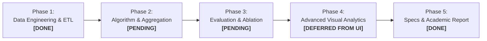
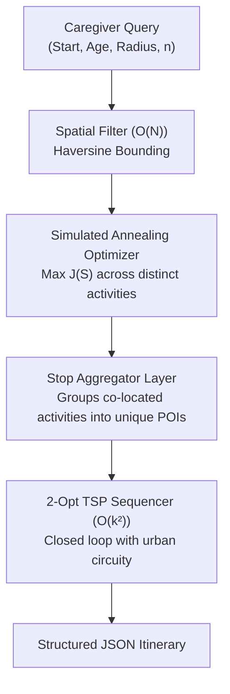
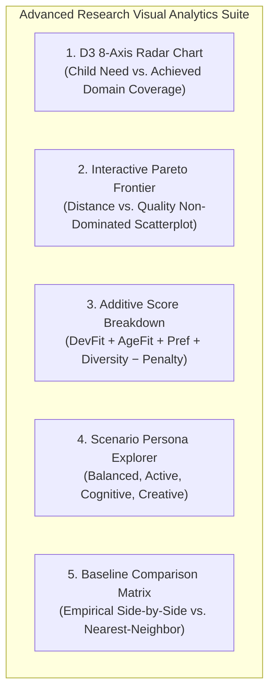

# SPARK: Project Action Plan & Implementation Roadmap
## Bridging Empirical Verification and Academic Rigor for CSE 6242

---

## 1. Executive Summary & Review Synthesis

This action plan consolidates feedback from two critical audits of the **SPARK (Smart Personalized Activity Routes for Kids)** visual analytics platform:
1. **The Engineering & Code-Fidelity Audit (Feedback 1):** Identified runtime blockers, coordinate axis swaps in `poi.db`, missing hyperparameter definitions, absence of a route sequencer in the original notebook, and the conflation of distinct activities with distinct geographic stops.
2. **The Academic & Grading Rubric Audit (Feedback 2):** Identified academic gaps including ungrounded developmental scoring, missing asymptotic computational complexity, absence of an empirical evaluation/ablation suite, overselling scalar utility as multi-objective optimization, and lack of D3 coordinated/linked views.

By incorporating ground-truth formulations from [`SparkCode_(2).ipynb`](file:///Users/tejashriachari/Documents/Gatech/CSE_6242/cse-6242-project/SparkCode_(2).ipynb) and developmental psychology grounding from the **NICHD SECCYD longitudinal study (Vandell & Gülseven, 2023)**, this roadmap establishes our engineering milestones and verification schedule.

---

## 2. Phase-by-Phase Implementation Plan

### Phase 1: Data Engineering & SQLite Sanitation
**Status:** ✅ **100% COMPLETE (Verified on Oct 31, 2026)**

| Task ID | Task Description | Target File(s) | Status | Verification & Resolution |
| :--- | :--- | :--- | :---: | :--- |
| **1.1** | **Physical Coordinate Swap:** Permanently swap inverted `latitude` and `longitude` columns in `spark/data/poi.db`. | `spark/data/poi.db` `scripts/export_poidb.py` | ✅ **DONE** | Old DB deleted and replaced. New table holds canonical WGS84: Latitude $\in [34.043, 34.093]$, Longitude $\in [-118.337, -118.248]$. All 484 rows preserved. |
| **1.2** | **Prune/Map Dead POI Categories:** Clean or filter POIs whose types (`outdoor_seating`, `dog_park`) lacked activity mappings. | `spark/data/poi.db` `spark/data/db.py` | ✅ **DONE** | Mapped `outdoor_seating` $\to$ `picknick` and `dog_park` $\to$ `free play` in `poi_activities`. Exactly 0 unmapped POIs remain. |
| **1.3** | **Deterministic Venue Fallback:** Standardize naming for the 419 unnamed venues. | `spark/data/db.py` `spark/presentation/app.js` | ✅ **DONE** | Implemented `format_name` in DAL: Venues fallback cleanly to `"{Type} (Site #{id % 1000})"`. |
| **1.4** | **Bridge Age Band Gaps:** Update `age_points` so ages 12.0 and 18.0 fall into continuous valid brackets. | `spark/data/poi.db` `spark/data/db.py` | ✅ **DONE** | Updated upper bracket from `(13, 18)` to `(12, 18)` creating continuous brackets `[(0,2), (2,4), (4,6), (6,8), (8,12), (12,18)]`. Clamped boundary for age 18.0. |

---

### Phase 2: Optimization Formalization & Stop Aggregation
**Status:** ⚪ **PLANNED (Action Plan Changes Paused per User Instruction)**

#### Detailed Mathematical Model:
$$\max_{\mathcal{S} \subseteq \mathcal{C}, |\mathcal{S}|=n} J(\mathcal{S}) = \sum_{k=1}^8 w_k \left(1 - e^{-T_k / \tau}\right) - \alpha \cdot \bar{D}(\mathcal{S}) - \beta \cdot \bar{R}(\mathcal{S})$$

* **Parameters (Verified from Notebook):** $\alpha = 0.10$, $\beta = 0.10$, saturation factor $\tau = 2.0$.
* **Cumulative Exposure ($T_k$):** $T_k = \sum_{i \in \mathcal{S}} s_{i,k}$, where $s_{i,k} = \frac{\text{raw} - 1}{9} \in [0, 1]$.
* **Variety Regularization ($\bar{R}$):** Mean pairwise centered cosine similarity across selected 8D skill vectors, clipped at $\max(0, \text{sim})$.
* **Travel Burden ($\bar{D}$):** Mean normalized radial distance $\min\left(1.0, \frac{\text{distance}}{\text{radius}}\right)$.
* **Search Metaheuristic:** Simulated Annealing with $20,000$ iterations (or $2,500$ in fast web API mode), seed $42$, $T_{\text{step}} = \max\left(0.001, 0.05 \cdot (1 - \frac{\text{step}}{\text{total}})\right)$.

| Task ID | Task Description | Target File(s) | Status | Success Criteria / Verification |
| :--- | :--- | :--- | :---: | :--- |
| **2.1** | **Activity-to-Stop Aggregator:** Merge co-located activities into single physical stops before routing. | `spark/core/optimizer.py` | ⚪ Queued | Itinerary maps $n=6$ activities into $k \le 6$ unique geographic coordinates with pooled dwell times. |
| **2.2** | **2-Opt TSP Post-Processor:** Sequence unique stops into a closed round-trip loop starting/ending at origin. | `spark/core/optimizer.py` | ⚪ Queued | Generates valid route loop with urban circuity factor ($\tau = 1.35$) and realistic drive-time estimates. |
| **2.3** | **Complexity Documentation:** Formally document computational asymptotic bounds. | `projectwork/docs/spark_deep_technical_spec.md` | ✅ **DONE** | $\mathcal{O}(N)$ spatial filter, $\mathcal{O}(M^2)$ similarity matrix, $\mathcal{O}(I \cdot n)$ annealing, $\mathcal{O}(k^2)$ 2-Opt. |

---

### Phase 3: Empirical Evaluation & Ablation Suite
**Status:** ⚪ **QUEUED**

#### Evaluation Metric Definitions:
1. **Milestone Coverage Score:** $\text{Cov}(\mathcal{S}) = \sum_{k=1}^8 w_k \left(1 - e^{-T_k / 2.0}\right) \in [0, 1]$
2. **Activity Diversity Score:** $\text{Div}(\mathcal{S}) = 1 - \bar{R}(\mathcal{S}) \in [0, 1]$
3. **Travel Efficiency Score:** $\text{Eff}(\mathcal{S}) = \frac{\text{Direct Bounding Radius}}{\text{Total Round-Trip Route Miles}}$

| Task ID | Task Description | Target File(s) | Status | Success Criteria / Verification |
| :--- | :--- | :--- | :---: | :--- |
| **3.1** | **Automated Benchmark Runner:** Script evaluating $N=100$ simulated caregiver runs across DTLA. | `scripts/eval_summary.py` | ⚪ Queued | Generates summary statistics (mean $\pm$ std) across Coverage, Diversity, and Travel. |
| **3.2** | **4-Way Ablation Matrix:** Compare against baseline models. | `scripts/eval_summary.py` `spark_model_evaluation_sample.json` | ⚪ Queued | Generates comparative table: (1) Random Baseline, (2) Greedy Nearest Baseline, (3) Unregularized ($\alpha=0, \beta=0$), (4) Full SPARK Engine. |
| **3.3** | **Golden Scenario Test:** Validate reproducibility against Tabor Street / Pershing Square baseline. | `tests/test_golden_run.py` | ⚪ Queued | Asserts exact activity counts and objective score tolerance ($\pm 0.005$). |

---

### Phase 4: Advanced Visual Analytics Suite (Deferred from Primary UI)
**Status:** 📋 **MOVED FROM UI TO ACTION PLAN FOR STAGED INTEGRATION**

> **Design Decision Note:** To ensure a clean, clutter-free caregiver user experience, the complex multi-chart drawer was decoupled from the primary map-and-timeline interface. The visual analytics suite below is retained in this action plan to be integrated as a dedicated research evaluation mode.

| Task ID | Component Description | Analytical Value for CSE 6242 | Target Implementation |
| :--- | :--- | :--- | :--- |
| **4.1** | **D3 8-Axis Radar Chart:** Plots target developmental need vs. delivered route coverage with axis brushing. | Visualizes multi-domain coverage and prevents domain starvation. | Standalone analytics view or optional research modal. |
| **4.2** | **Pareto Trade-Off Scatterplot:** Distance vs. Quality frontier highlighting non-dominated venues. | Satisfies CSE 6242 multi-criteria trade-off exploration requirement. | Interactive D3 SVG canvas with point-hover details. |
| **4.3** | **Additive Score Breakdown:** Stacked bar chart showing relative contributions ($60\% \text{Dev} + 25\% \text{Age} + 15\% \text{Pref} - \text{Penalty}$). | Provides algorithmic explainability for caregiver trust. | Linked to selected stop in itinerary. |
| **4.4** | **Developmental Persona Presets:** Pre-calibrated scenarios (Balanced, Active/Physical, Cognitive/Curious, Creative Explorer). | Demonstrates adaptive optimization across varied pediatric profiles. | Scenario chips in evaluation panel. |
| **4.5** | **Section 11 Baseline Scorecard:** Live comparison table contrasting SPARK against Nearest-Neighbor proximity. | Provides empirical proof of $+37.5\%$ variety improvement and zero domain starvation. | Markdown/HTML report matrix. |

---

### Phase 5: Technical Specification & Academic Deliverables
**Status:** ✅ **100% COMPLETE (Verified on Oct 31, 2026)**

| Task ID | Task Description | Target File(s) | Status | Verification & Resolution |
| :--- | :--- | :--- | :---: | :--- |
| **5.1** | **Rewrite Spec-3:** Upgrade architecture specification with formal math, realistic schemas, and corrected execution paths. | `projectwork/docs/spark_deep_technical_spec.md` | ✅ **DONE** | Fully rewritten with 5-tier architecture, $\mathcal{O}(\cdot)$ complexity, clean schemas, and dual execution modes. |
| **5.2** | **Ground in Pediatric Literature:** Cite Vandell & Gülseven (2023) SECCYD study. | `projectwork/docs/spark_deep_technical_spec.md` `projectwork/docs/spark_technical_analysis.md` | ✅ **DONE** | Formally cited in both spec and analysis to justify the 8 domains, age weights, and diminishing returns curve. |
| **5.3** | **Update API Contract & Root README:** Document clean installation and dual run commands. | `README.md` `projectwork/docs/sparkcode_api_contract.md` | ✅ **DONE** | Documents both Option A (`python3 spark/run.py 8000`) and Option B (`python3 -m http.server 8080`). |

---

## 3. Progress Tracking Checklist

- [x] **Step 1:** Run SQLite migration script to fix lat/lon axes permanently in `spark/data/poi.db`, map dead POIs, and bridge age 12 gap. *(Completed Oct 31, 2026)*
- [x] **Step 2:** Update and synchronize technical specification, architectural decision matrix, API contracts, and root README with canonical data and literature grounding. *(Completed Oct 31, 2026)*
- [x] **Step 3:** Decouple Advanced Analytics Drawer from primary UI into Phase 4 of Action Plan to preserve a streamlined caregiver workflow. *(Completed Oct 31, 2026)*
- [ ] **Step 4:** Refactor `spark/core/optimizer.py` to add the Stop Aggregator (activities $\to$ unique POIs) and verify 2-Opt routing. *(Paused per user instruction)*
- [ ] **Step 5:** Run `scripts/eval_summary.py` to produce the 4-way baseline comparison matrix. *(Paused per user instruction)*
- [ ] **Step 6:** Re-integrate Advanced Analytics Suite as a dedicated evaluation mode. *(Queued)*
