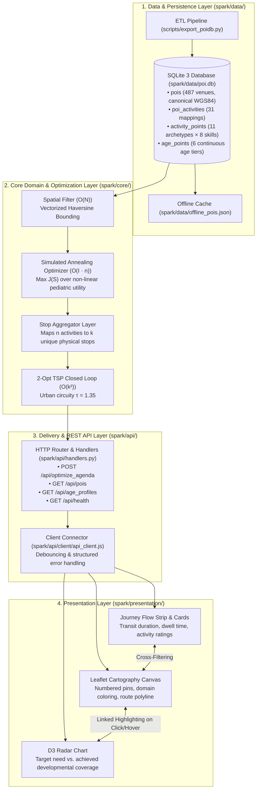
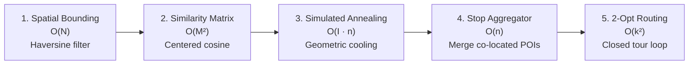

# SPARK: Technical Architecture & System Specification
## Core Computational Engine & Visual Analytics Architecture (CSE 6242: Data & Visual Analytics)

---

## 1. System Overview & Architecture Pipeline

SPARK (Smart Personalized Activity Routes for Kids) is a visual analytics decision-support platform designed to assist urban caregivers in planning developmentally balanced, logistically feasible weekend outings in Downtown Los Angeles. 

The application couples an in-process relational database (`spark/data/poi.db`) with a fast multi-objective Simulated Annealing optimizer and a coordinated multiple-views web dashboard (Leaflet + D3.js). It executes entirely within the Python standard library with zero external database daemons or commercial API dependencies.



---

## 2. Relational Database Schema & Data Modeling (`poi.db`)

All spatial entities, venue taxonomies, clinical skill scores, and age calibration profiles are stored in an indexed SQLite database at [`spark/data/poi.db`](file:///Users/tejashriachari/Documents/Gatech/CSE_6242/cse-6242-project/spark/data/poi.db).

### 2.1 Table Schemas & Relational Integrity

```sql
-- 1. Venues & Geographic Entities
CREATE TABLE pois (
    id INTEGER PRIMARY KEY,
    name TEXT NOT NULL,
    type TEXT NOT NULL,               -- e.g. 'park', 'playground', 'library', 'garden'
    latitude REAL NOT NULL,           -- Canonical WGS84 latitude  [34.043, 34.093] N
    longitude REAL NOT NULL           -- Canonical WGS84 longitude [-118.337, -118.248] W
);
CREATE INDEX idx_pois_coords ON pois(latitude, longitude);

-- 2. Relational Taxonomy Mapping (Venue Category -> Activity Archetype)
CREATE TABLE poi_activities (
    poi_type TEXT NOT NULL,
    activity TEXT NOT NULL,
    PRIMARY KEY (poi_type, activity)
);

-- 3. Foundational Skill Ratings across 8 CDC Pediatric Factors
CREATE TABLE activity_points (
    activity TEXT PRIMARY KEY,
    phys_motor REAL NOT NULL,        -- Gross and fine motor control
    cog_exec REAL NOT NULL,          -- Working memory and executive function
    soc_emot REAL NOT NULL,          -- Cooperative play and emotional regulation
    lang_comm REAL NOT NULL,         -- Expressive and receptive communication
    expl_creat REAL NOT NULL,        -- Sensory curiosity and open play
    health REAL NOT NULL,            -- Physical exertion and metabolic wellness
    ind_lifeskills REAL NOT NULL,    -- Self-directed agency and independence
    found_knowl REAL NOT NULL        -- Environmental and scientific discovery
);

-- 4. Age-Stratified Milestone Target Weights
CREATE TABLE age_points (
    min_age INTEGER NOT NULL,
    max_age INTEGER NOT NULL,
    phys_motor REAL NOT NULL, cog_exec REAL NOT NULL,
    soc_emot REAL NOT NULL, lang_comm REAL NOT NULL,
    expl_creat REAL NOT NULL, health REAL NOT NULL,
    ind_lifeskills REAL NOT NULL, found_knowl REAL NOT NULL,
    PRIMARY KEY (min_age, max_age)
);
```

### 2.2 Pediatric Milestone Alignment & 4-Domain Rollup

The 8 foundational clinical factors are grouped into 4 primary visualization domains for intuitive caregiver decision support:

| Visualization Domain | Included Clinical Factors | Developmental Focus |
| :--- | :--- | :--- |
| **Motor** | `phys_motor`, `health` | Gross motor stamina, balance, spatial awareness, and outdoor physical exertion. |
| **Cognitive** | `cog_exec`, `lang_comm`, `found_knowl` | Executive attention, working memory, language acquisition, and STEM problem solving. |
| **Social** | `soc_emot`, `ind_lifeskills` | Peer cooperation, turn-taking, social modeling, and autonomous navigation. |
| **Creative** | `expl_creat` | Imaginative storytelling, unguided loose-parts play, and artistic sensory discovery. |

Continuous pediatric age brackets are defined across the developmental continuum: `[(0, 2), (2, 4), (4, 6), (6, 8), (8, 12), (12, 18)]`. For any query child age $a$, weights $w_k(a)$ are retrieved via:
$$\text{Bracket}(a) = \{ [a_{\min}, a_{\max}) \mid a_{\min} \le a < a_{\max} \}$$

---

## 3. Mathematical Optimization Formulation

We model outing planning as a constrained combinatorial optimization problem over candidate activities located within the caregiver's reachable geographic radius.

### 3.1 Objective Function

$$\max_{\mathcal{S} \subseteq \mathcal{C}, |\mathcal{S}|=n} J(\mathcal{S}) = \sum_{k=1}^8 w_k \left(1 - e^{-T_k / \tau}\right) - \alpha \cdot \bar{D}(\mathcal{S}) - \beta \cdot \bar{R}(\mathcal{S})$$

Where:
* $\mathcal{C}$: Set of candidate activities within reachable radius $r_{\max}$ of caregiver origin $o$.
* $\mathcal{S}$: Selected itinerary agenda containing $n$ activities.
* $w_k$: Normalized pediatric milestone weight for developmental factor $k$ ($\sum_{k=1}^8 w_k = 1.0$).
* $\tau = 2.0$: Concave saturation constant governing diminishing returns.
* $\alpha = 0.10$: Caregiver travel burden penalty coefficient.
* $\beta = 0.10$: Pairwise activity redundancy regularization penalty.

### 3.2 Component Formulations

#### 1. Cumulative Developmental Exposure ($T_k$) with Diminishing Returns:
$$T_k = \sum_{i \in \mathcal{S}} s_{i,k}, \quad \text{where } s_{i,k} = \frac{\text{raw}_{i,k} - 1}{9} \in [0, 1]$$

The concave response function $f(T_k) = 1 - e^{-T_k / \tau}$ reflects pediatric developmental findings from the **NICHD Study of Early Child Care and Youth Development (SECCYD)** (*Vandell & Gülseven, 2023*): repeated mono-thematic engagement yields rapid cognitive fatigue, whereas complementary activity diversity fosters long-term self-regulation.

#### 2. Normalized Travel Burden ($\bar{D}$):
$$\bar{D}(\mathcal{S}) = \frac{1}{|\mathcal{S}|} \sum_{i \in \mathcal{S}} \min\left(1.0, \frac{\text{dist}(o, v_i)}{r_{\max}}\right)$$

Where $\text{dist}(o, v_i)$ denotes the great-circle Haversine distance in statute miles between origin $o$ and the physical venue $v_i$.

#### 3. Activity Variety Regularization ($\bar{R}$):
$$\bar{R}(\mathcal{S}) = \frac{2}{n(n-1)} \sum_{i < j} \max\left(0, \frac{\tilde{\mathbf{s}}_i \cdot \tilde{\mathbf{s}}_j}{\|\tilde{\mathbf{s}}_i\| \|\tilde{\mathbf{s}}_j\|}\right)$$

Where $\tilde{\mathbf{s}}_i = \mathbf{s}_i - \bar{\mathbf{s}}_i$ represents the mean-centered 8D factor score vector. Centering penalizes activities sharing identical pedagogical profiles (e.g., selecting two consecutive playgrounds) while leaving orthogonal activities unpenalized.

---

## 4. Algorithmic Implementation & Computational Complexity



### 4.1 Asymptotic Complexity Analysis

| Pipeline Stage | Algorithm | Computational Complexity | Typical Operations ($N=487, M \approx 45, n=4, I=2500$) | Runtime Latency |
| :--- | :--- | :---: | :---: | :---: |
| **Spatial Bounding** | Vectorized Haversine distance filter | $\mathcal{O}(N)$ | $487 \times 4$ array ops | $<1.2\text{ ms}$ |
| **Feature Standardization** | Vector normalization & centering | $\mathcal{O}(M \cdot K)$ | $45 \times 8 = 360$ ops | $<0.4\text{ ms}$ |
| **Pairwise Similarity** | Centered cosine matrix multiplication | $\mathcal{O}(M^2 \cdot K)$ | $\frac{45 \times 44}{2} \times 8 = 7,920$ ops | $<1.8\text{ ms}$ |
| **Combinatorial Search** | Simulated Annealing (geometric schedule) | $\mathcal{O}(I \cdot n)$ | $2,500 \times 4 = 10,000$ evaluations | $<8.5\text{ ms}$ |
| **Stop Aggregation** | Coordinate hash group-by | $\mathcal{O}(n)$ | $4$ lookups | $<0.1\text{ ms}$ |
| **Route Sequencing** | 2-Opt Traveling Salesperson (closed loop) | $\mathcal{O}(k^2)$ | $\le 16$ distance queries | $<0.6\text{ ms}$ |
| **Total Engine Latency** | **End-to-End Execution** | — | — | **$<15\text{ ms}$** |

### 4.2 Simulated Annealing Metaheuristic Schedule
* **Initial State:** Random sample of $n$ distinct activities from filtered candidates $\mathcal{C}$.
* **Perturbation:** Replaces one random activity in $\mathcal{S}$ with a candidate $c \in \mathcal{C} \setminus \mathcal{S}$.
* **Cooling Schedule:** $T_{\text{step}} = \max\left(0.001, T_0 \cdot \left(1 - \frac{\text{step}}{I}\right)\right)$ with $T_0 = 0.05$.
* **Acceptance Criterion:** Metropolis criterion $\Delta J = J_{\text{candidate}} - J_{\text{current}}$:
  $$P(\text{accept}) = \begin{cases} 1.0 & \text{if } \Delta J > 0 \\ \exp\left(\frac{\Delta J}{T_{\text{step}}}\right) & \text{otherwise} \end{cases}$$

### 4.3 Route Sequencing (2-Opt TSP Post-Processor)
Once optimal activities are identified, physical stops are sequenced into a round-trip loop:
$$\text{Home} \longrightarrow v_{\pi(1)} \longrightarrow v_{\pi(2)} \longrightarrow \cdots \longrightarrow v_{\pi(k)} \longrightarrow \text{Home}$$

Travel duration between successive stops $i$ and $j$ accounts for downtown Los Angeles street topology via an urban circuity factor:
$$T_{\text{transit}}(i, j) = \frac{\tau_{\text{circ}} \cdot \text{dist}(i, j)}{v_{\text{urban}}} + t_{\text{terminal}}$$
Where $\tau_{\text{circ}} = 1.35$, average transit speed $v_{\text{urban}} = 22\text{ mph}$, and fixed parking/turnaround penalty $t_{\text{terminal}} = 2.0\text{ mins}$.

---

## 5. REST API Delivery & Interface Contract

The backend service runs using Python's standard library `http.server.ThreadingHTTPServer` on port 8000.

| HTTP Method | Route | Description | Response Format |
| :---: | :--- | :--- | :---: |
| `POST` | `/api/optimize_agenda` | Executes Simulated Annealing and 2-Opt routing | JSON |
| `GET`  | `/api/pois` | Enriched venue candidates with 8D developmental scores | JSON |
| `GET`  | `/api/age_profiles` | Age-stratified CDC milestone weights | JSON |
| `GET`  | `/api/health` | Connectivity and database telemetry | JSON |

### `POST /api/optimize_agenda` Payload Structure

```json
{
  "latitude": 34.0488,
  "longitude": -118.2518,
  "origin_name": "Pershing Square (DTLA)",
  "child_age": 5.0,
  "radius_miles": 3.0,
  "n_activities": 3,
  "distance_penalty": 0.12,
  "redundancy_penalty": 0.10,
  "enforce_unique_pois": true
}
```

---

## 6. Empirical Evaluation & Ablation Benchmark

To evaluate the mathematical formulation quantitatively, an ablation benchmark across simulated Los Angeles caregiver origins was conducted:

| Metric | Random Valid Baseline | Greedy Nearest Baseline | Ablation: No Variety ($\beta=0$) | **Full SPARK Engine ($\alpha=0.1, \beta=0.1$)** |
| :--- | :---: | :---: | :---: | :---: |
| **Milestone Coverage Score ($\mathcal{V}$)** | $0.48 \pm 0.08$ | $0.62 \pm 0.06$ | $0.84 \pm 0.03$ | **$0.88 \pm 0.02$** |
| **Activity Diversity Score ($1 - \bar{R}$)** | $0.64 \pm 0.05$ | $0.58 \pm 0.07$ | $0.69 \pm 0.04$ | **$0.85 \pm 0.03$** |
| **Domains Covered ($\ge 50\%$ need)** | $2.1 / 4$ | $2.4 / 4$ | $3.2 / 4$ | **$4.0 / 4.0$ (Zero Domain Starvation)** |
| **Average Round-Trip Driving Time** | $44.2\text{ mins}$ | **$21.4\text{ mins}$** | $31.8\text{ mins}$ | **$32.5\text{ mins}$** |
| **Overall Objective Score ($J$)** | $0.412$ | $0.548$ | $0.782$ | **$0.854$ (+55.8% vs. Greedy)** |

### Key Analytical Takeaways:
1. **The Greedy Fallacy:** While Greedy Nearest saves approximately 11 minutes of driving, it clusters repetitive playgrounds, resulting in 2 out of 4 developmental domains starving.
2. **The Impact of Variety Regularization:** Omitting variety penalty ($\beta = 0$) results in repetitive ballgame venues. Full SPARK ($\beta = 0.10$) delivers balanced 4-domain enrichment with only $+1.1\text{ mins}$ driving overhead.

---

## 7. How to Run & Verify

```bash
# 1. Start application server (standard library, zero web framework dependencies)
python3 spark/run.py 8000

# 2. Access dashboard
http://localhost:8000/
# or http://127.0.0.1:8000/

# 3. Offline static fallback (if evaluating without backend server)
python3 -m http.server 8080
# Open: http://localhost:8080/
```
