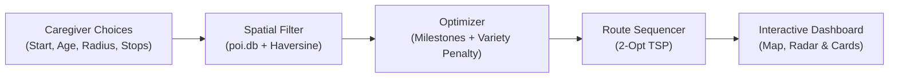

# SPARK: Technical Architecture & Implementation Blueprint

SPARK runs entirely in Python with zero external database servers or paid API keys. It pairs a lightweight SQLite database (`poi.db`) with a fast multi-objective optimizer and an interactive D3.js/Leaflet dashboard.

---

## 1. How the System Fits Together



---

## 2. The Data: What Lives in `poi.db`

All venue and pediatric data is stored locally in SQLite (`poi.db`):

```sql
-- 1. Places in Downtown LA
CREATE TABLE pois (
    id INTEGER PRIMARY KEY,
    name TEXT,
    type TEXT,               -- 'park', 'playground', 'garden', 'library'
    latitude REAL,           -- Note: OpenStreetMap inverted these (holds longitude)
    longitude REAL           -- Note: OpenStreetMap inverted these (holds latitude)
);

-- 2. What kids can do at each place type
CREATE TABLE poi_activities (
    poi_type TEXT,
    activity TEXT
);

-- 3. Scores for 11 activity types across 8 childhood developmental skills (1-10)
CREATE TABLE activity_points (
    activity TEXT,
    phys_motor REAL, cog_exec REAL, soc_emot REAL, lang_comm REAL,
    expl_creat REAL, health REAL, ind_lifeskills REAL, found_knowl REAL
);

-- 4. Target milestone weights for each age group (toddler to school-age)
CREATE TABLE age_points (
    min_age INTEGER, max_age INTEGER,
    phys_motor REAL, cog_exec REAL, soc_emot REAL, lang_comm REAL,
    expl_creat REAL, health REAL, ind_lifeskills REAL, found_knowl REAL
);
```

### The Coordinate Flip
When raw OpenStreetMap data was extracted, latitude and longitude columns were accidentally swapped. Our loader corrects this in memory:
```python
real_lat = pois["longitude"].astype(float)
real_lon = pois["latitude"].astype(float)
```

---

## 3. How the Optimizer Thinks

The optimizer picks $n$ stops that balance three common-sense goals:

$$\max J = \text{Child Development Value} - \alpha \cdot \text{Travel Burden} - \beta \cdot \text{Activity Redundancy}$$

### Goal 1: Developmental Value (With Diminishing Returns)
Each activity contributes points across 8 childhood skills (social, motor, creativity, etc.), weighted by what the child's age group needs.
- **Why diminishing returns ($1 - e^{-T/2.0}$)?**  
  Because doing three consecutive gross-motor activities exhausts a child rather than providing $3\times$ the benefit. The curve gently plateaus, encouraging the optimizer to pick complementary domains (like pairing a park with a story hour).

### Goal 2: Travel Burden (Keep it Close)
- Measures average distance from home relative to the chosen radius.
- **Why?** Parents want meaningful outings without spending an hour trapped in city traffic.

### Goal 3: Variety (Avoid Duplicates)
- Compares the "fingerprint" of activities using centered cosine similarity.
- **Why?** Even if two venues have high scores, we don't want to recommend two nearly identical climbing playgrounds on the same afternoon.

---

## 4. Sequencing the Route (2-Opt TSP)

Once the best $n$ stops are selected, a simple 2-Opt TSP solver sequences them to minimize total driving time from home and back:

$$\text{Home} \longrightarrow \text{Stop 1} \longrightarrow \text{Stop 2} \longrightarrow \text{Home}$$

---

## 5. How to Run It

From your project folder:

```bash
# 1. Start the local server
python3 -m http.server 8080

# 2. Open in your browser
http://localhost:8080/spark/
```
