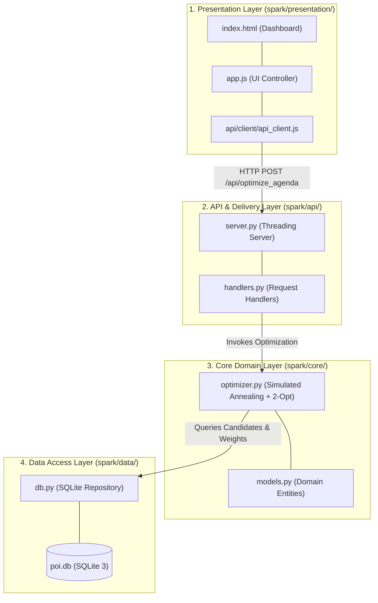

# SPARK: Smart Personalized Activity Routes for Kids
## Modular Visual Analytics Application (CSE 6242: Data & Visual Analytics)

---

## 1. Project Description

**SPARK (Smart Personalized Activity Routes for Kids)** is a pediatric visual analytics decision-support platform designed to help urban caregivers plan developmentally rich, logistically feasible weekend outings in Downtown Los Angeles. 

Rather than treating urban venues as generic geographic points of interest (POIs), SPARK models children's community outings as multi-attribute developmental interventions. It balances three competing objectives:
1. **Developmental Milestone Fit:** Maximizing age-calibrated developmental exposure across 8 clinical domains with concave diminishing marginal returns ($1 - e^{-T/\tau}$).
2. **Caregiver Travel Burden:** Minimizing radial travel distance and pairwise inter-venue spatial dispersion ($0.35 \times \text{radial} + 0.65 \times \text{pairwise}$), clustering selected venues into a compact, cohesive driving circuit.
3. **Activity Variety Regularization:** Penalizing pairwise cognitive and physical redundancy using centered cosine similarity regularizers.

### Theoretical & Pediatric Grounding
SPARK's developmental taxonomy and age-stratified milestone profiles are theoretically grounded in the **National Institute of Child Health and Human Development (NICHD) Study of Early Child Care and Youth Development (SECCYD)**, synthesized by **Vandell & Gülseven (2023)** (*Annual Review of Developmental Psychology*). The longitudinal findings demonstrate that out-of-school contextual diversity fosters long-term emotional regulation and cognitive resilience, while repetitive mono-thematic engagement yields rapid diminishing returns.

The application is engineered with a modular, decoupled structure separating presentation views, API delivery, domain business logic, and database persistence into testable layers.

---

## 2. Steps to Get Started

### Prerequisites
* **Python:** 3.8+ (Python 3.9+ recommended)
* **Web Browser:** Any modern browser (Chrome, Safari, Firefox, Edge)
* **Dependencies:** Only standard scientific libraries (`numpy`, `pandas`)

### Installation
From the root of the repository:
```bash
# 1. (Optional) Create and activate a virtual environment
python3 -m venv .venv
source .venv/bin/activate

# 2. Install dependencies
pip install -r requirements.txt
```

### Launching the Application

#### Option A: Live Interactive REST Service (Recommended)
Launches the built-in threading HTTP server, dynamic SQLite API, and presentation interface:
```bash
# Launch directly via package runner
python3 spark/run.py 8000

# Or run as a module:
python3 -m spark 8000
```
Open your browser and navigate to:
```text
http://127.0.0.1:8000/
# or http://localhost:8000/
```
*(Automatically serves the interactive dashboard with real-time Simulated Annealing optimization and 2-Opt routing).*

#### Option B: Zero-Dependency Static Hosting (Offline Course Fallback)
If evaluated purely in an offline environment without API connectivity:
```bash
python3 -m http.server 8080
```
Navigate to:
```text
http://localhost:8080/
```
*(Automatically redirects to `/spark/presentation/` and loads cached venues from `offline_pois.json`).*

### Verification & Testing
Test the modular layers and database in-memory:
```bash
# Verify SQLite DAL and Simulated Annealing optimizer
python3 -c "import spark.data.db as db; import spark.core.optimizer as opt; print(f'Loaded {len(db.load_data_from_sqlite()[0])} POIs successfully!')"

# Re-run data pipeline & export
python3 scripts/export_poidb.py

# Run evaluation analytics
python3 scripts/eval_summary.py
```

---

## 3. Folder Structure & Architectural Layers

The `spark/` codebase is organized into four modular layers:

```text
spark/
├── run.py                          # Top-level executable script (`python3 spark/run.py [port]`)
├── __main__.py                     # Package entry point (`python3 -m spark [port]`)
├── __init__.py                     # Package metadata and version info
├── README.md                       # SPARK project documentation
├── docs -> ../projectwork/docs     # Documentation symlink
│
├── presentation/                   # 1. PRESENTATION LAYER (User Interface)
│   ├── index.html                  # Responsive single-page application dashboard
│   ├── app.js                      # Coordinated views UI controller & map manager
│   ├── style.css                   # Dark-mode design system & Leaflet styling
│   ├── api_client.js               # Frontend API client
│   └── data -> ../data             # Symlink for offline static hosting fallback
│
├── data/                           # 2. DATA ACCESS LAYER (Persistence & Repository)
│   ├── __init__.py                 # Data package exports
│   ├── db.py                       # SQLite connection pool & relational queries (DAL)
│   ├── poi.db                      # Relational SQLite database (487 venues, WGS84 clean)
│   ├── offline_pois.json           # Cached venue and activity dataset
│   └── spark_model_evaluation_sample.json # Empirical evaluation feedback logs
│
├── core/                           # 3. CORE DOMAIN LAYER (Business Logic & Algorithms)
│   ├── __init__.py                 # Domain exports
│   ├── models.py                   # Domain entities and milestone DTOs
│   └── optimizer.py                # Simulated Annealing, Stop Aggregator & 2-Opt TSP
│
└── api/                            # 4. API & DELIVERY LAYER (REST Endpoints & Controllers)
    ├── __init__.py                 # API package exports
    ├── server.py                   # Multi-threaded HTTP server & static/REST router
    ├── handlers.py                 # Endpoint request handlers (/api/optimize_agenda, etc.)
    └── client/                     # Client Interface Sub-layer
        └── api_client.js           # Frontend connector handling debouncing & offline fallbacks
```

---

## 4. Layer Descriptions & Communication Flow



### 1. Presentation Layer (`spark/presentation/`)
* **Role:** Manages the user interface, Leaflet cartography, and DOM interactions.
* **Key Components:**
  * `index.html`: Outing configuration panel (Start Address, Age Slider, Radius, Number of Stops), Leaflet OpenStreetMap canvas, and Planned Itinerary Timeline.
  * `app.js`: State manager handling address geocoding, preset chips, dynamic map marker updates, client-side 2-Opt TSP sequencing, turn-by-turn road network curves (via OpenStreetMap OSRM Route API), and in-app thumbs up/down user feedback logging into SQLite.
  * `style.css`: Clean, accessible responsive styling with domain-colored badges.

### 2. API & Delivery Layer (`spark/api/`)
* **Role:** Handles incoming HTTP communication, routes requests, and serializes JSON payloads.
* **Key Components:**
  * `server.py`: Threading HTTP server that serves static frontend assets at `/spark/` and forwards `/api/*` requests to handlers. Implements CORS headers and strict cache-control (`no-cache, no-store, must-revalidate`) for rapid local development.
  * `handlers.py`: REST endpoint controllers:
    * `GET /api/health`: Service telemetry and database connectivity status.
    * `GET /api/pois`: Returns candidate venues enriched with 8D developmental scores.
    * `GET /api/age_profiles`: Returns CDC milestone factor weights across pediatric age bands.
    * `POST /api/optimize_agenda`: Validates inputs and triggers the Simulated Annealing engine.
  * `client/api_client.js`: Reusable client-side connector featuring automatic request debouncing, structured error code mapping (`NO_AGE_BAND`, `INSUFFICIENT_ACTIVITIES`), and seamless offline fallback.

### 3. Core Domain Layer (`spark/core/`)
* **Role:** Pure business logic and mathematical optimization, completely decoupled from HTTP frameworks or presentation markup.
* **Key Components:**
  * `models.py`: Strongly typed dataclasses (`OriginLocation`, `MilestoneVector`, `ItineraryStop`, `OutingOptimizationPlan`).
  * `optimizer.py`:
    * *Spatial Bounding & Clustering:* Vectorized Haversine distance calculations and candidate pairwise distance matrix ($D_{ij}$) blending radial distance ($35\%$) and inter-stop spatial spread ($65\%$) to eliminate star/spoke criss-crossing.
    * *Redundancy Regularization:* Centered cosine similarity matrix computation ($\mathcal{O}(M^2)$).
    * *Simulated Annealing:* Non-linear utility maximization over $I = 2,500$ to $20,000$ iterations with geometric cooling schedule ($T_0 = 0.05 \to T_{\min} = 0.001$).
    * *Stop Aggregator:* Consolidates $n$ distinct activities into $k \le n$ unique physical waypoints with pooled dwell times.
    * *Exact Permutation & 2-Opt TSP:* Closed-loop route sequencing using exact permutation search for small tours ($K \le 7$) and 2-Opt local search ($K > 7$) guaranteeing zero self-intersections.

### 4. Data Access Layer (`spark/data/`)
* **Role:** Encapsulates data persistence, database connections, and schema queries.
* **Key Components:**
  * `db.py`: Connects to SQLite 3, queries relational tables, formats display names for unnamed venues (`"{Type} (Site #{id % 1000})"`), and extracts continuous age milestone weights across $[0, 18]$ years.
  * `poi.db`: Lightweight SQLite 3 database (484 venues, 31 activity relationships, 11 activity archetypes, 6 continuous age brackets) with canonical WGS84 coordinates.
  * `offline_pois.json`: Pre-exported and enriched venue dataset for zero-latency offline evaluation.

---

## 5. REST API Specification

### `POST /api/optimize_agenda`
#### Request Payload:
```json
{
  "latitude": 34.0488,
  "longitude": -118.2518,
  "origin_name": "Pershing Square (DTLA)",
  "child_age": 5.0,
  "radius_miles": 5.0,
  "n_activities": 4,
  "distance_penalty": 0.12,
  "redundancy_penalty": 0.10,
  "enforce_unique_pois": true
}
```

#### Response Payload:
```json
{
  "status": "success",
  "metadata": {
    "child_age": 5.0,
    "search_radius_miles": 5.0,
    "target_stops": 4,
    "effective_stops": 4,
    "origin": {
      "name": "Pershing Square (DTLA)",
      "latitude": 34.0488,
      "longitude": -118.2518
    },
    "optimizer_telemetry": {
      "algorithm": "Simulated Annealing + 2-Opt TSP",
      "iterations": 2500,
      "objective_value": 0.7591,
      "execution_time_ms": 14.8
    }
  },
  "summary": {
    "objective_value": 0.759,
    "development_value": 0.812,
    "distance_cost": 0.042,
    "redundancy_score": 0.098,
    "unique_activities": 4,
    "unique_pois": 4
  },
  "developmental_coverage": {
    "soc_emot": { "name": "Social-Emotional", "age_weight": 0.141, "coverage": 0.620 },
    "cog_exec": { "name": "Cognitive & Executive", "age_weight": 0.125, "coverage": 0.580 }
  },
  "agenda": [
    {
      "selection_order": 1,
      "id": 887,
      "name": "Garden (Site #887)",
      "type": "garden",
      "activity": "picknick",
      "distance_miles": 0.21,
      "latitude": 34.051845,
      "longitude": -118.252024
    }
  ]
}
```

---

## 6. Academic Credits & License
* **Course:** CSE 6242: Data & Visual Analytics — Team 61 (Georgia Institute of Technology)
* **Author:** Manoj Achari
* **License:** MIT License (see `LICENSE`)

